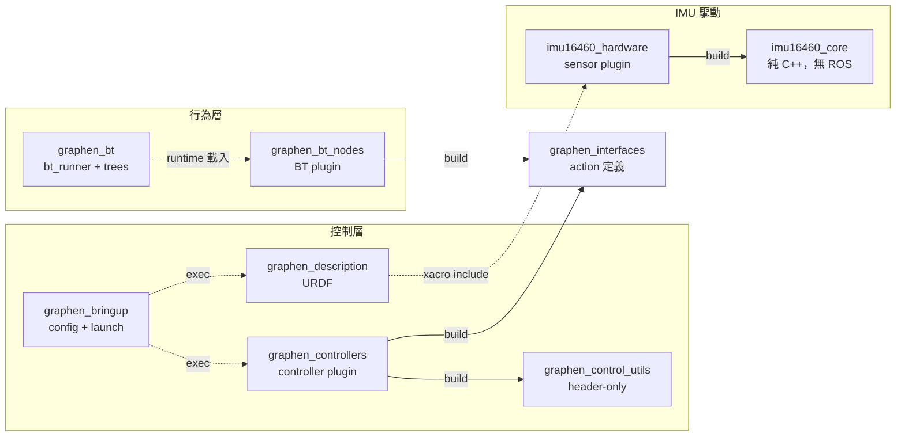
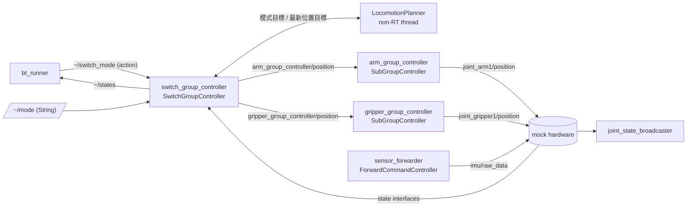
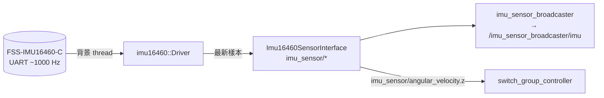
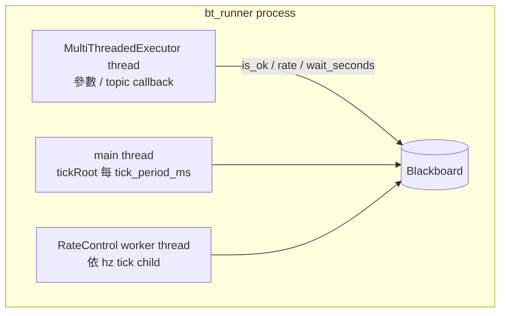

# graphen_ws 架構與設計

本文件說明工作區的整體架構、各元件的設計與設計決策，作為後續開發的參考。
快速開始與測試指令請見 [README.md](../README.md)。

- [1. 整體架構](#1-整體架構)
- [2. 控制層（ros2_control）](#2-控制層ros2_control)
- [3. 行為層（BehaviorTree.CPP v3）](#3-行為層behaviortreecpp-v3)
- [4. 設計決策紀錄](#4-設計決策紀錄)
- [5. 擴充指引](#5-擴充指引)
- [6. 已知限制與待辦](#6-已知限制與待辦)

---

## 1. 整體架構

### 1.1 套件依賴



實線為編譯期依賴，虛線為執行期依賴。兩層在執行期透過 `switch_group_controller` 的 `~/switch_mode` action 與 `~/states` topic 連動（見 [§3.5](#35-與控制層的連動)）。

### 1.2 模組化原則

- **一個套件一個職責**：共用元件、plugin、硬體描述、啟動設定各自獨立，修改其中一項時不會牽動其他套件。
- **plugin 與設定分離**：controller 和 BT 節點都編成 plugin。要用哪些、怎麼接，由 YAML 和 XML 決定，不需要重新編譯。
- **可調數值參數化**：頻率、模式對照表、檔案路徑、port 等都放在 YAML 或 launch argument，不寫死在程式中。

### 1.3 命名慣例

| 項目 | 慣例 | 範例 |
|---|---|---|
| 套件 | `graphen_<功能>` | `graphen_controllers` |
| C++ namespace | 控制層 `graphen::control`、行為層 `graphen::bt` | `graphen::control::SubGroupController` |
| controller plugin 名稱 | `graphen_control/<Class>` | `graphen_control/SwitchGroupController` |
| header 路徑 | `include/<pkg>/<file>.hpp` | `graphen_controllers/sub_group_controller.hpp` |
| include guard | `<PKG>__<FILE>_HPP_` | `GRAPHEN_CONTROLLERS__SUB_GROUP_CONTROLLER_HPP_` |

例外：IMU 驅動是可重用的裝置驅動，不綁定 graphen，使用自己的名稱（套件 `imu16460_core` / `imu16460_hardware`，namespace `imu16460` / `imu16460_hardware`，plugin `imu16460_hardware/Imu16460SensorInterface`），見 D11。

---

## 2. 控制層（ros2_control）

### 2.1 資料流



上圖是預設的 mock IMU（`use_mock_imu:=true`）。實機 IMU（`use_mock_imu:=false`）時：



- mock system 不再有 `imu/raw_data`，`sensor_forwarder` 不啟動；改為獨立的 sensor 硬體元件 `imu16460`，與 mock system 由同一個 controller_manager 管理。
- `switch_group_controller.sensor` 由 `controllers_imu16460.yaml` 覆寫為 `imu_sensor/angular_velocity.z`。

- `SwitchGroupController` 不直接操作硬體，而是寫入下層 `SubGroupController` 導出的 **reference interface**（ros2_control chaining）。
- `sensor_forwarder` 用來模擬 sensor 資料：mock hardware 開啟了 `mock_sensor_commands`，所以可以透過 `/sensor_forwarder/commands` 寫入 `imu/raw_data`。

### 2.2 SwitchGroupController

原始碼：[switch_group_controller.hpp](../src/graphen_controllers/include/graphen_controllers/switch_group_controller.hpp) / [.cpp](../src/graphen_controllers/src/switch_group_controller.cpp)
類型：`controller_interface::ControllerInterface`

**行為**
1. 每個週期讀取所有 state interface，依 `state_publish_rate` 的頻率發布到 `~/states`。
2. 讀取 sensor 值，存到 `sensor_value_`，供之後的控制邏輯使用。
3. 從 `target_buffer_` 讀取 `LocomotionPlanner` 的最新位置目標並寫出。

模式（來自 `~/mode` topic 或 `~/switch_mode` action）只決定 planner 要前往的**目標位置**；實際輸出由 planner 漸進產生（見 [§2.4](#24-locomotionplanner)）。

**模式對照表**
- 模式以**名稱**識別。`modes` 列出可用的名稱，每個名稱同時是該模式參數的前綴，`<mode>.targets` 依 `command_interfaces` 的順序給目標位置：
  ```yaml
  command_interfaces: [arm_group_controller/position, gripper_group_controller/position]
  modes: [forward, reverse]
  default_mode: forward
  forward:
    targets: [ 1.5, 0.05]   # arm, gripper
  reverse:
    targets: [-1.5, 0.05]
  ```
- BT、action、`~/mode` topic 都使用同一組名稱，不需要額外的數字對照。
- 名稱只允許 `[A-Za-z0-9_]`（要當作參數前綴），不可為空、不可重複。controller node 會自動宣告 YAML 中的 `<mode>.targets`；沒有寫的話，`on_configure` 會補宣告，再因為長度不符而回傳 ERROR。
- 對照表在 `on_configure` 中預先建好（`mode_names_` / `mode_targets_`），之後唯讀。
- 模式切換統一由 `apply_mode()`（non-RT，mutex 保護）處理：查表後呼叫 `planner_->set_goal()`。
- 從 `~/mode` 收到未知的 mode 時，所有目標設為 0，並印出 WARN（沿用原型的行為）；action 則直接 reject。

**`~/switch_mode` action**（`graphen_interfaces/action/SwitchMode`）
- `handle_goal`：controller 不是 active，或 mode 不在 `modes` 中時 REJECT。
- `handle_accepted`：`apply_mode()` 後立即 `succeed`，result 附上目前所有 state interface 的快照（`interface_names` / `values`）。模式切換是瞬間完成的，所以沒有 feedback，cancel 一律 REJECT。
- 快照由 `update()` 以 `try_lock` 寫入（拿不到 lock 就跳過這一次），action callback 再以 lock 讀取。

**Realtime 設計**
- planner 在 non-RT thread 中透過 `realtime_tools::RealtimeBuffer` 寫入目標；`update()` 用 `readFromRT()` 讀取，不會阻塞。buffer 長度不符（尚未寫入）時不輸出。
- `~/mode`、action 的 callback 都在 controller_manager 的 executor thread 執行，不會碰到 RT 路徑。
- `~/mode` 的 QoS 設為 **reliable + transient_local**：模式切換不能遺失，而且晚啟動的 controller 也能收到最後一次設定的模式。發布端必須使用相容的 QoS（見 README 的指令）。
- 每次 configure 都會回到 `default_mode`。
- `on_activate` 以 `target_state_interfaces` 的目前值作為 planner 的起點，啟動瞬間輸出不會跳動；`on_deactivate` 停止 planner。

**sensor 處理**：若有設定 `sensor`，但它不在 `state_interfaces` 中，會自動附加到最後，並記錄它的 index。

| 參數 | 型別 | 預設值 | 說明 |
|---|---|---|---|
| `command_interfaces` | string[] | `[]`（必填） | 下層 reference interface，順序對應 `<mode>.targets` |
| `state_interfaces` | string[] | `[]` | 要讀取並發布的 state interface |
| `sensor` | string | `""` | （選填）sensor state interface |
| `state_publish_rate` | double | 50.0 | `~/states` 的發布頻率（Hz） |
| `modes` | string[] | `[]`（必填） | 模式名稱，不可重複，只允許 `[A-Za-z0-9_]` |
| `<mode>.targets` | double[] | （必填） | 該模式的目標位置；長度必須等於 `command_interfaces` 數 |
| `default_mode` | string | `""`（必填） | 必須列在 `modes` 中 |
| `planner_rate` | double | 100.0 | planner 的規劃頻率（Hz），必須 > 0 |
| `planner_max_steps` | double[] | `[]`（必填） | 每個 command interface 在每個規劃週期最多移動的量，每個值必須 > 0 |
| `target_state_interfaces` | string[] | `[]`（必填） | 與 `command_interfaces` 一一對應，必須列在 `state_interfaces` 中；activate 時作為 planner 起點 |

| 介面 | 型別 | 方向 |
|---|---|---|
| `~/mode` | std_msgs/String | 訂閱 |
| `~/switch_mode` | graphen_interfaces/action/SwitchMode | action server |
| `~/states` | control_msgs/DynamicJointState | 發布 |

### 2.3 SubGroupController

原始碼：[sub_group_controller.hpp](../src/graphen_controllers/include/graphen_controllers/sub_group_controller.hpp) / [.cpp](../src/graphen_controllers/src/sub_group_controller.cpp)
類型：`controller_interface::ChainableControllerInterface`

- 依 `input_interfaces` 導出 reference interface，全名為 `<controller 名稱>/<input>`，例如 `arm_group_controller/position`。實際的儲存空間是基類的 `reference_interfaces_`。
- **只支援 chained 模式**：沒有 topic 訂閱，`update_reference_from_subscribers()` 是空實作。
- `update_and_write_commands()`：把**第一個** reference 寫到所有 output command interface；其餘 reference 只發布到 `~/references`，目前沒有實際用途。
- reference 初始化為 NaN，代表上層還沒寫入；這段期間不輸出，避免把 NaN 寫進硬體。

| 參數 | 型別 | 預設值 | 說明 |
|---|---|---|---|
| `input_interfaces` | string[] | `[]`（必填） | 要導出的 reference interface 名稱 |
| `output_interfaces` | string[] | `[]`（必填） | 要寫入的硬體 command interface |
| `reference_publish_rate` | double | 50.0 | `~/references` 的發布頻率（Hz） |

| Topic | 型別 | 方向 |
|---|---|---|
| `~/references` | control_msgs/DynamicJointState | 發布 |

### 2.4 LocomotionPlanner

原始碼：[locomotion_planner.hpp](../src/graphen_controllers/include/graphen_controllers/locomotion_planner.hpp) / [.cpp](../src/graphen_controllers/src/locomotion_planner.cpp)
類型：一般類別（不是 plugin），由 `SwitchGroupController` 擁有。

- 在獨立的 non-RT thread 中以 `rate_hz` 執行（`sleep_until` 絕對時間排程；落後時重新對齊，不連續補跑）。
- 每個週期：`current[i] += clamp(goal[i] - current[i], -max_steps[i], max_steps[i])`，再 `writeFromNonRT` 到呼叫端提供的 `TargetBuffer`（`RealtimeBuffer<std::vector<double>>` 指標）。
- `set_goal()` 可以在任何 thread 呼叫（mutex 保護）；未啟動時設定的 goal 會保留到 `start()` 之後使用。
- `start()` 會先把起點寫入 buffer，controller 在第一個規劃週期前就有值可以輸出。
- 不認識 joint 或模式，只處理「一組位置往一組目標內插」，可以重用在其他 controller。

### 2.5 StateInterfacePublisher（graphen_control_utils）

原始碼：[state_interface_publisher.hpp](../src/graphen_control_utils/include/graphen_control_utils/state_interface_publisher.hpp)

把一組具名的 double 值以 `control_msgs/DynamicJointState` 發布，兩個 controller 都使用它。

- 名稱以**最後一個 `/`** 拆成 prefix 和 interface（例如 `joint_arm1/position` 拆成 `joint_arm1` + `position`），依 prefix 分組。
- msg 在建構時預先配置，`publish()` 只填值，符合 RT 的要求。
- 用累積的 `period` 控制發布頻率，並保留餘數以維持準確的頻率；落後太多時歸零，避免連續補發。
- 使用 `RealtimePublisher::trylock()`，拿不到 lock 就跳過這一次，不會阻塞 `update()`。
- 提供兩個 overload：`LoanedStateInterface` 的 vector 和 `double` 的 vector。

### 2.6 啟動順序

[bringup.launch.py](../src/graphen_bringup/launch/bringup.launch.py) 以 `OnProcessExit` 串接 spawner：

```
joint_state_broadcaster ─▶ arm_group_controller ─▶ gripper_group_controller ─▶ switch_group_controller
sensor_forwarder（與 JSB 並行，use_mock_imu:=true）
imu_sensor_broadcaster（與 JSB 並行，use_mock_imu:=false）
```

上層 `switch_group_controller` 要 claim 下層導出的 reference interface，所以下層必須先 active，上層要最後啟動。

launch argument：

| 參數 | 預設值 | 說明 |
|---|---|---|
| `use_mock_imu` | `true` | `true`：mock `imu/raw_data` + `sensor_forwarder`（原本的行為）；`false`：實機 IMU，額外載入 [controllers_imu16460.yaml](../src/graphen_bringup/config/controllers_imu16460.yaml) |
| `imu_port` | `/dev/ttyTHS1` | 實機 IMU 的 serial port |
| `imu_baudrate` | `921600` | 實機 IMU 的鮑率 |

`use_mock_imu` 同時傳給 xacro（切換 URDF 中的 sensor 區塊）和 controller_manager 的參數檔組合（ROS 參數檔無法以 condition 切換，所以 controller_manager 在 `OpaqueFunction` 中建立）。

### 2.7 Imu16460SensorInterface（imu16460_hardware）

原始碼：[imu16460_sensor_interface.hpp](../src/imu16460/imu16460_hardware/include/imu16460_hardware/imu16460_sensor_interface.hpp) / [.cpp](../src/imu16460/imu16460_hardware/src/imu16460_sensor_interface.cpp)
類型：`hardware_interface::SensorInterface`；協議與硬體細節見 [IMU16460.md](IMU16460.md)，參數見 [套件 README](../src/imu16460/imu16460_hardware/README.md)。

- **更新模型**：`imu16460_core` 的 `Driver` 在背景 thread 依裝置頻率（約 1000 Hz）接收並更新最新樣本；`read()` 每個週期只以 `try_lock` 取最新一筆、換算後寫入 state，不做 serial I/O、不阻塞、不配置記憶體。拿不到 lock 時沿用上一筆。
- 匯出 `imu_sensor_broadcaster` 需要的 10 個 state interface，加上選用的 `temperature`。
- activate 時確認 `activate_timeout_ms` 內有資料，否則回傳 ERROR；之後超過 `data_timeout_ms` 沒有新資料時節流警告。
- 不送任何命令、不修改 IMU 設定；裝置設定由 `imu16460_cli` 處理。
- 實機 xacro 片段由 [imu16460.ros2_control.xacro](../src/imu16460/imu16460_hardware/urdf/imu16460.ros2_control.xacro) 的 macro 產生，graphen 的 URDF 以 `xacro:unless use_mock_imu` 引入。

---

## 3. 行為層（BehaviorTree.CPP v3）

### 3.1 執行模型



- **main thread**：每 `tick_period_ms`（預設 100 ms，也就是 10 Hz）tick 一次主樹。
- **executor thread**：處理 ROS 參數修改和 topic 訂閱，把值同步到 blackboard，不會阻塞主樹。
- **worker thread**：`RateControl` 和 `HighFreqControlNode` 自己開 thread，讓特定子樹的執行頻率高於主樹。
- 結束時（Ctrl+C）會先 `haltTree()`，讓 worker thread 結束，再停止 executor。

### 3.2 Plugin 機制

- [graphen_bt_nodes](../src/graphen_bt_nodes/) 編成 `libgraphen_bt_nodes.so`，以 `BT_PLUGIN_EXPORT` 編譯。[register_nodes.cpp](../src/graphen_bt_nodes/src/register_nodes.cpp) 的 `BT_REGISTER_NODES` 會註冊全部節點。
- `bt_runner` 依參數 `plugins`（函式庫名稱）呼叫 `factory.registerFromPlugin(SharedLibrary::getOSName(name))`，透過 `LD_LIBRARY_PATH` 尋找，所以執行前要先 source `install/setup.bash`。
- **ROS node 注入**：需要 ROS 的節點（`IncrementSysCount`、`ClearSysCount`、`GetStateValue`、`SwitchMode`）在建構時以 [ros_node.hpp](../src/graphen_bt_nodes/include/graphen_bt_nodes/ros_node.hpp) 的 `get_ros_node()` 從 blackboard 的 `"node"` key 取得 `rclcpp::Node::SharedPtr`（Nav2 慣例）。`bt_runner` 會在建樹**之前**放入；取不到時建構會丟出 `BT::RuntimeError`。

### 3.3 節點清單

| ID | 類型 | Ports | 說明 |
|---|---|---|---|
| `RateControl` | Decorator | `hz`(double, 100) | worker thread 依 `hz` tick child，自身永遠回傳 RUNNING；每輪重新讀取 `hz`，可以動態調整 |
| `ExecutionRateLogger` | SyncAction | `label`(string) | 每 1 秒印出實際 tick 頻率，回傳 SUCCESS |
| `IsOk` | Condition | `is_ok_val`(bool) | true 回傳 SUCCESS，否則回傳 FAILURE |
| `IncrementSysCount` | SyncAction | — | blackboard `sys_count` + 1，並同步到參數 `gp_sys_count` |
| `CheckSysCount` | Condition | `target`(int) | `sys_count >= target` 時回傳 SUCCESS |
| `ClearSysCount` | SyncAction | — | `sys_count` 歸零，並同步到參數 |
| `HighFreqControlNode` | StatefulAction | `target_hz`(double, 100) | 背景高頻迴圈範例，跑滿 5 秒後回傳 SUCCESS（demo tree 未使用） |
| `Wait` | StatefulAction | `seconds`(int) | 非阻塞等待（demo tree 未使用） |
| `SayHello` | SyncAction | — | 範例（demo tree 未使用） |
| `GetStateValue` | SyncAction | `topic`(string, `/switch_group_controller/states`)、`joint`(string)、`interface`(string)、out `value`(double) | 訂閱 DynamicJointState，tick 時輸出指定 joint / interface 的最新值；還沒有資料或找不到時回傳 FAILURE |
| `IsBelow` | Condition | `value`、`threshold`(double) | `value < threshold` 時回傳 SUCCESS |
| `IsAbove` | Condition | `value`、`threshold`(double) | `value > threshold` 時回傳 SUCCESS |
| `SwitchMode` | StatefulAction | `action_name`(string, `/switch_group_controller/switch_mode`)、`mode`(string，模式名稱)、`timeout_ms`(int, 1000) | 以 async 送出 SwitchMode goal，期間回傳 RUNNING；reject、失敗或逾時（含等待 server）回傳 FAILURE。每次執行都會送 goal，應放在只有換向時才會走到的分支 |

`GetStateValue` 的 XML 屬性用 `joint` 而不是 `name`：BT.CPP v3 會把 `name` 當成節點的實例名稱。

### 3.4 demo tree 邏輯

[trees/demo.xml](../src/graphen_bt/trees/demo.xml)：

```
Fallback
├─ ReactiveSequence                     # 正常分支（is_ok = true）
│  ├─ IsOk {is_ok}
│  ├─ ClearSysCount
│  ├─ ExecutionRateLogger "Normal"     → 約 10 Hz（主樹頻率）
│  └─ RateControl hz=1
│     └─ ExecutionRateLogger "RateControl"  → 約 1 Hz
└─ ReactiveSequence                     # 異常分支（is_ok = false）
   ├─ Inverter ─ IsOk {is_ok}
   ├─ Inverter ─ CheckSysCount target=3000
   └─ RateControl hz={rate}
      └─ Sequence
         ├─ ExecutionRateLogger "1000Hz"
         └─ IncrementSysCount
```

- `is_ok` 變成 false 時，第一個 ReactiveSequence 失敗並 halt 它的 RateControl，改走第二條分支，以 `{rate}` 的頻率累加 `sys_count`。
- `sys_count` 達到 3000 時，第二條分支也失敗，整棵樹每次 tick 都回傳 FAILURE，進入閒置狀態，直到 `is_ok` 恢復成 true。
- `is_ok` 恢復成 true 後，`ClearSysCount` 把計數歸零。

### 3.5 與控制層的連動

[trees/joint_reciprocate.xml](../src/graphen_bt/trees/joint_reciprocate.xml) 依「目前方向」分支，換向在 Groot 中可以直接看出來：

```
Sequence
├─ GetStateValue joint=joint_arm1 interface=position → {arm_pos}
└─ Fallback
   ├─ BlackboardCheckString "Forward"  {direction} == forward
   │  └─ Fallback
   │     ├─ IsBelow "KeepForward"  {arm_pos} < 1.0
   │     └─ Sequence "TurnToReverse"
   │        ├─ SwitchMode mode=reverse
   │        └─ SetBlackboard direction = reverse
   ├─ BlackboardCheckString "Reverse"  {direction} == reverse
   │  └─ Fallback
   │     ├─ IsAbove "KeepReverse"  {arm_pos} > -1.0
   │     └─ Sequence "TurnToForward"
   │        ├─ SwitchMode mode=forward
   │        └─ SetBlackboard direction = forward
   └─ Sequence "Init"   # {direction} 既不是 forward 也不是 reverse（剛啟動）
      ├─ Inverter ─ BlackboardCheckString {direction} == forward ─ AlwaysSuccess
      ├─ Inverter ─ BlackboardCheckString {direction} == reverse ─ AlwaysSuccess
      ├─ SwitchMode mode=forward
      └─ SetBlackboard direction = forward
```

- 移動期間 `Forward`（forward 模式，往 +1.5）或 `Reverse`（reverse 模式，往 -1.5）分支持續成功；跨過門檻時走 `TurnToReverse` / `TurnToForward` 換向，之後由另一個方向的分支接手。因此 joint 會在 ±1.0 之間往返。
- 換向時**先 SwitchMode 再寫入方向**：action 失敗時方向不變，下一個 tick 會重試同一個換向分支。
- `Init` 前面的兩個 Inverter 檢查，確保只有 `{direction}` 未設定時才會走到這裡；否則換向失敗時，Fallback 會誤落到 `Init` 而送出 forward。
- `BlackboardCheckString`、`SetBlackboard`、`Inverter`、`AlwaysSuccess` 都是 BT.CPP v3 內建的節點。
- 門檻必須落在兩個模式的 arm 目標之間，否則 joint 到達模式目標後就停住，不會換向。
- 以預設值（planner 0.005 × 100 Hz ≈ 0.5 rad/s、BT tick 100 ms）實測，換向週期約 4.1 秒，超出門檻的量約 0.05（等於速度 × tick 延遲）。

### 3.6 bt_runner 參數與介面

設定檔：[bt_runner.yaml](../src/graphen_bt/config/bt_runner.yaml)，launch：[bt.launch.py](../src/graphen_bt/launch/bt.launch.py)（launch argument：`tree_file`、`params_file`）

| 參數 | 型別 | 預設值 | 說明 |
|---|---|---|---|
| `tree_file` | string | launch 給 `share/graphen_bt/trees/demo.xml` | 空字串時報錯並結束 |
| `plugins` | string[] | `[graphen_bt_nodes]` | 要載入的 BT plugin 函式庫名稱 |
| `tick_period_ms` | int | 100 | 主樹 tick 週期，必須 > 0 |
| `groot.enabled` | bool | true | 是否啟用 Groot v1 的 ZMQ publisher |
| `groot.max_msg_per_second` / `publisher_port` / `server_port` | int | 25 / 1666 / 1667 | Groot 連線設定 |
| `gp_is_ok` | bool | true | 對應 blackboard `is_ok` |
| `gp_wait_seconds` | int | 3 | 對應 blackboard `wait_seconds` |
| `gp_rate` | double | 100.0 | 對應 blackboard `rate` |
| `gp_sys_count` | int | 0 | 由節點寫入，供外部觀察 `sys_count` |

`gp_*` 參數在執行中修改（`ros2 param set` 或 rqt）時，會由 parameter callback 同步寫入 blackboard。

| Topic | 型別 | 對應的 blackboard key |
|---|---|---|
| `/is_ok` | std_msgs/Bool | `is_ok` |
| `/wait_seconds` | std_msgs/Int32 | `wait_seconds` |

---

## 4. 設計決策紀錄

| # | 決策 | 理由 |
|---|---|---|
| D1 | `StateInterfacePublisher` 獨立成 `graphen_control_utils` | 它是通用元件，只依賴 rclcpp、realtime_tools、control_msgs，不依賴 pluginlib 或 controller_interface。之後的 controller、hardware plugin 或一般 node 都可以重用，不必連帶引入 controller plugin |
| D2 | 兩個 controller 放在同一個套件 `graphen_controllers` | 兩者是成對使用的，放在一起可以減少套件數量；共用部分已經抽到 utils |
| D3 | plugin 名稱前綴統一用 `graphen_control/` | 和 C++ namespace 對應，YAML 中容易辨識 |
| D4 | controller 參數在 `on_init` 用 `auto_declare` 宣告，在 `on_configure` 讀取並驗證，失敗時回傳 ERROR | 依循 ros2_control 慣例；設定錯誤會在 configure 階段就被發現，不會等到 update 才出錯 |
| D5 | 模式以名稱識別，名稱作為參數前綴（`<mode>.targets`） | BT、action、topic、YAML 共用同一組名稱，tree 中寫 `mode="reverse"` 一看就懂，不必對照數字；每個模式有自己的參數區塊，ROS 2 參數不支援巢狀陣列的限制也不會造成問題。之後 mode plugin 化時，這個區塊直接當作 plugin 的設定（見 §6 TODO） |
| D6 | BT 拆成節點庫（plugin）和執行器 | 新增節點不必修改執行器；之後其他執行器（例如整合到控制流程）也可以重用同一份節點庫 |
| D7 | BT 節點透過 blackboard `"node"` 取得 ROS node | 以 plugin 載入時無法使用自訂建構子注入，改用 Nav2 慣例 |
| D8 | 模式切換走 action，joint 狀態走既有的 `~/states` topic | 指令與狀態分開是 ROS 的主流分工（Nav2 也這樣做）：action 提供明確的接受、拒絕與結果，BT 可以據此判斷成敗；狀態用 topic，BT 隨時都拿得到最新值，不必等 goal |
| D9 | 規劃放在 controller 內的 `LocomotionPlanner` thread，以 `RealtimeBuffer` 交接 | 規劃計算不佔用 RT 的 `update()`；`update()` 只輸出最新目標。planner 不認識模式或 joint，可以重用在其他 controller |
| D10 | 遲滯判斷放在 BT，以「方向分支 + `{direction}`」表達，不放在 controller | 門檻屬於任務邏輯，放在 tree XML 中修改不需要重新建置；controller 只負責「模式 → 目標」。用分支而不是單一變數切換，在 Groot 中可以直接看到目前的方向和換向的時間點 |
| D11 | IMU 驅動獨立命名（`imu16460_*`），core 不依賴 ROS | 它是裝置驅動，與 graphen 的控制邏輯無關，可以直接搬到其他機器人或非 ROS 程式；協議、parser、Driver 不依賴 ROS，可以用 GoogleTest + pty 在沒有實機的環境測試 |
| D12 | mock / 實機 IMU 以 `use_mock_imu` 切換，mock 完全保留 | 開發機（WSL）沒有實體設備，mock 是日常開發的預設；實機差異集中在 xacro 的 `xacro:if/unless` 和疊加的 `controllers_imu16460.yaml`，不修改原本的 `controllers.yaml` |
| D13 | IMU 由背景 thread 依自身頻率更新，`read()` 只取最新一筆 | serial I/O 不進 RT 路徑；IMU 頻率與 controller_manager 的 `update_rate` 互不影響（不提供平均模式，避免引入額外延遲） |

---

## 5. 擴充指引

### 新增 controller plugin
1. 在 `graphen_controllers/include/graphen_controllers/` 和 `src/` 新增類別（namespace `graphen::control`），並在 `.cpp` 結尾加上 `PLUGINLIB_EXPORT_CLASS`。
2. **以下三處要同步修改**：
   - [graphen_controllers.xml](../src/graphen_controllers/graphen_controllers.xml)：新增 `<class name="graphen_control/<Class>" ...>`
   - [CMakeLists.txt](../src/graphen_controllers/CMakeLists.txt)：把 `.cpp` 加入 `add_library`
   - [package.xml](../src/graphen_controllers/package.xml)：補上新的依賴
3. 參數在 `on_init` 用 `auto_declare` 宣告，在 `on_configure` 讀取並驗證，參數值放在 [controllers.yaml](../src/graphen_bringup/config/controllers.yaml)。

### 新增一個子群組（例如 leg）
1. 在 URDF 的 `<ros2_control>` 中新增 joint 和 interface。
2. 在 `controllers.yaml` 新增一個 `type: graphen_control/SubGroupController` 的 controller，並設定 `input_interfaces` / `output_interfaces`。
3. 在 `switch_group_controller` 的 `command_interfaces` 加上 `<新 controller>/position`，每個 `<mode>.targets` 多一個值，`planner_max_steps` 和 `target_state_interfaces` 也各加一個（對應的 state interface 也要加進 `state_interfaces`）。
4. 在 launch 中把新 controller 的 spawner 串進啟動鏈，讓它在 `switch_group_controller` 之前啟動。

### 新增 BT 節點
1. 在 `graphen_bt_nodes` 新增 hpp/cpp（namespace `graphen::bt`），加入 CMake 的 `add_library`。
2. 在 [register_nodes.cpp](../src/graphen_bt_nodes/src/register_nodes.cpp) 用 `registerNodeType` 註冊。
3. 需要 ROS node 時，從 blackboard 的 `"node"` 取得（參考 [sys_count_nodes.cpp](../src/graphen_bt_nodes/src/sys_count_nodes.cpp)）。
4. 在 tree XML 的 `<TreeNodesModel>` 補上節點定義，Groot 才能顯示。

### 新增 tree
把 XML 放到 `graphen_bt/trees/`，以 `tree_file:=` 指定執行；也可以直接指定任意路徑，不需要重新建置。

---

## 6. 已知限制與待辦

- **TODO：mode plugin 化**
  - **時機**：需要第一個「不是往固定目標逼近」的行為時（例如正弦擺動、步態）。目前所有模式都是同一種行為，plugin 化之後功能不會有差別，所以先不做。
  - **做法**：
    - 新增套件 `graphen_modes`，基類 `LocomotionMode` 提供 `configure(node, name, dof)` / `on_enter(current)` / `update(dt, targets)` / `on_exit()`。
    - 目前的「往目標逼近」改寫成第一個實作 `MoveToTarget`。
    - YAML 在每個 mode 底下加 `type: graphen_modes/MoveToTarget`，`planner_max_steps` 移到各個 mode 底下。
    - `LocomotionPlanner` 只保留 thread 和 buffer，每個週期呼叫目前 mode 的 `update()`。
    - 名稱與 action、BT 介面不變。
  - **注意事項**：
    - 切換由 planner thread 在下一個週期執行（呼叫舊 mode 的 `on_exit` 和新 mode 的 `on_enter`），mode 只在單一 thread 中執行。
    - `pluginlib::ClassLoader` 的生命週期必須比 mode 實例長。
    - plugin 不能用 `auto_declare`，要用 `declare_parameter`，宣告前先檢查 `has_parameter`。
- **BT 的方向與 controller 的模式可能不一致**：controller 被 reconfigure 回到 `default_mode` 時，BT 的 `{direction}` 不會跟著改變，要等到下一次換向才會重新同步。
- **planner 的速度受 non-RT 排程影響**：`planner_max_steps` 是「每週期」的量，planner thread 被延遲時，實際速度會變慢（WSL 在高負載下觀察得到）。
- **SubGroupController 只使用第一個 reference**：多 reference 的用法尚未定義。
- **RateControl 的並行存取**：worker thread 和主樹會並行存取 child 和 blackboard（沿用原型設計）。因此 `sys_count` 可能略微超過 target（實測約 3006）。若要嚴格同步，需要重新設計。
- **CheckSysCount 的 target（3000）寫死在 tree XML**：可以考慮改成 blackboard 變數。
- **Groot 只支援 v1**：要改用 Groot2 必須升級到 BT.CPP v4。
- **robot_description 以參數傳給 controller_manager 已被標為 deprecated**：Humble 下會印 WARN，之後可以改成由 `robot_state_publisher` 的 topic 提供。
- **WSL 環境**：沒有 RT scheduling（會印 WARN），ros2 daemon 探索偏慢。
- **IMU 待實機驗證**：坐標系方向、Euler 順序、S1 長度、共變異數（見 [IMU16460.md §3](IMU16460.md#3-待實機驗證)），程式中以 `TODO(verify-on-hw)` 標記。
- **IMU 時間戳**：Humble 的 `imu_sensor_broadcaster` 以 controller_manager 的更新時間打時間戳，無法傳遞裝置 timer；需要精確時間戳時改用獨立 node 發布。
- **測試**：只有 `imu16460_core` 有自動化測試（GoogleTest，`colcon test --packages-select imu16460_core`）；其他套件尚無，測試方式待討論。
