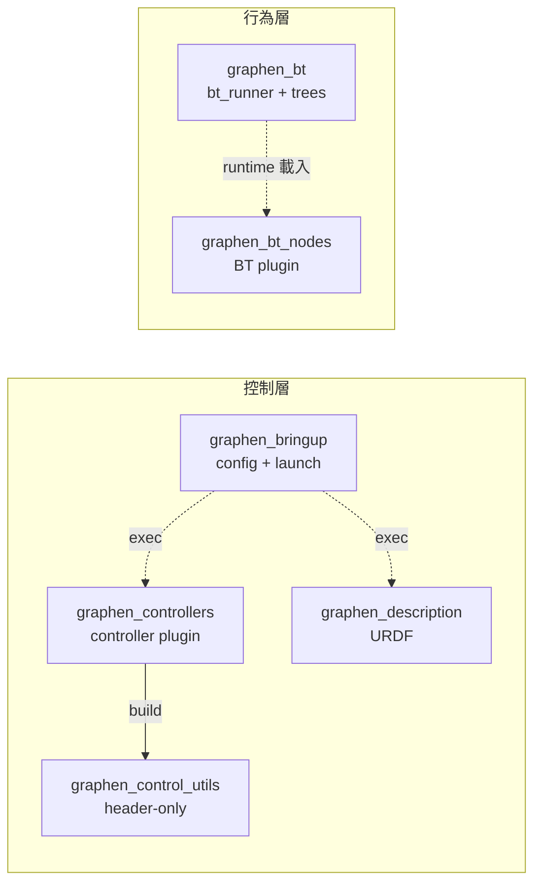
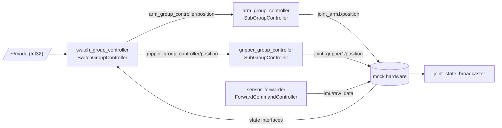
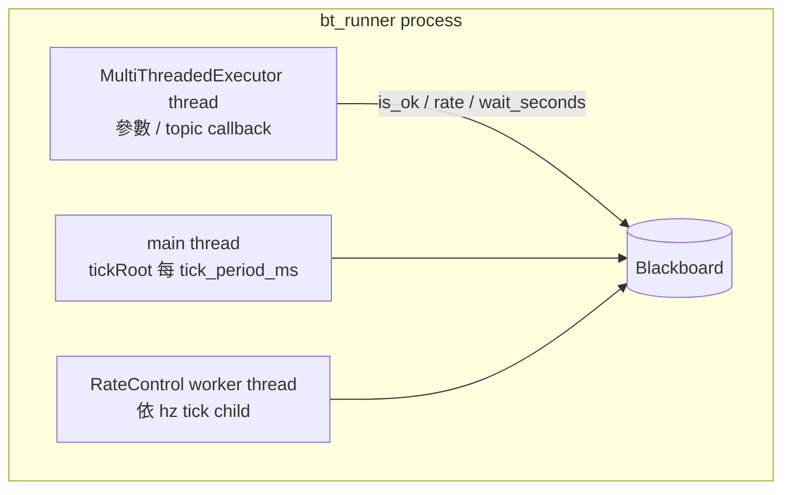

# graphen_ws 架構與設計

本文件說明工作區的整體架構、各元件的設計與設計決策，作為後續開發的參考。
快速開始與測試指令請見 [README.md](../README.md)。

- [1. 整體架構](#1-整體架構)
- [2. 控制層（ros2_control）](#2-控制層ros2_control)
- [3. 行為層（BehaviorTree.CPP v3）](#3-行為層behaviortreecpp-v3)
- [4. 設計決策紀錄](#4-設計決策紀錄)
- [5. 擴充指引](#5-擴充指引)
- [6. 已知限制與待辦](#6-已知限制與待辦)

---

## 1. 整體架構

### 1.1 套件依賴



實線為編譯期依賴，虛線為執行期依賴。

### 1.2 模組化原則

- **一個套件一個職責**：共用元件、plugin、硬體描述、啟動設定各自獨立，修改其中一項時不會牽動其他套件。
- **plugin 與設定分離**：controller 和 BT 節點都編成 plugin。要用哪些、怎麼接，由 YAML 和 XML 決定，不需要重新編譯。
- **可調數值參數化**：頻率、模式對照表、檔案路徑、port 等都放在 YAML 或 launch argument，不寫死在程式中。

### 1.3 命名慣例

| 項目 | 慣例 | 範例 |
|---|---|---|
| 套件 | `graphen_<功能>` | `graphen_controllers` |
| C++ namespace | 控制層 `graphen::control`、行為層 `graphen::bt` | `graphen::control::SubGroupController` |
| controller plugin 名稱 | `graphen_control/<Class>` | `graphen_control/SwitchGroupController` |
| header 路徑 | `include/<pkg>/<file>.hpp` | `graphen_controllers/sub_group_controller.hpp` |
| include guard | `<PKG>__<FILE>_HPP_` | `GRAPHEN_CONTROLLERS__SUB_GROUP_CONTROLLER_HPP_` |

---

## 2. 控制層（ros2_control）

### 2.1 資料流



- `SwitchGroupController` 不直接操作硬體，而是寫入下層 `SubGroupController` 導出的 **reference interface**（ros2_control chaining）。
- `sensor_forwarder` 用來模擬 sensor 資料：mock hardware 開啟了 `mock_sensor_commands`，所以可以透過 `/sensor_forwarder/commands` 寫入 `imu/raw_data`。

### 2.2 SwitchGroupController

原始碼：[switch_group_controller.hpp](../src/graphen_controllers/include/graphen_controllers/switch_group_controller.hpp) / [.cpp](../src/graphen_controllers/src/switch_group_controller.cpp)
類型：`controller_interface::ControllerInterface`

**行為**
1. 每個週期讀取所有 state interface，依 `state_publish_rate` 的頻率發布到 `~/states`。
2. 讀取 sensor 值，存到 `sensor_value_`，供之後的控制邏輯使用。
3. 從 `~/mode` 取得最新模式，查表得到各 command interface 的目標值後寫出。

**模式對照表**
- `modes` 列出可用的 mode id。`mode_targets` 依 `modes` 的順序攤平，每個模式佔 `command_interfaces` 個數的值：
  ```yaml
  command_interfaces: [arm_group_controller/position, gripper_group_controller/position]
  modes: [1, 2]
  mode_targets: [0.1, 0.2,   # mode 1: arm, gripper
                 0.3, 0.4]   # mode 2: arm, gripper
  ```
- 對照表在 `on_configure` 中預先建好（`mode_ids_` / `mode_targets_`），`update()` 只做查表，不配置記憶體。
- 收到未知的 mode 時，所有輸出寫 0，並印出 WARN（沿用原型的行為）。

**Realtime 設計**
- `~/mode` 的 callback 在 non-RT thread 執行，透過 `realtime_tools::RealtimeBuffer` 寫入；`update()` 用 `readFromRT()` 讀取，不會阻塞。
- `~/mode` 的 QoS 設為 **reliable + transient_local**：模式切換不能遺失，而且晚啟動的 controller 也能收到最後一次設定的模式。發布端必須使用相容的 QoS（見 README 的指令）。
- 每次 configure 都會回到 `default_mode`。

**sensor 處理**：若有設定 `sensor`，但它不在 `state_interfaces` 中，會自動附加到最後，並記錄它的 index。

| 參數 | 型別 | 預設值 | 說明 |
|---|---|---|---|
| `command_interfaces` | string[] | `[]`（必填） | 下層 reference interface，順序對應 `mode_targets` |
| `state_interfaces` | string[] | `[]` | 要讀取並發布的 state interface |
| `sensor` | string | `""` | （選填）sensor state interface |
| `state_publish_rate` | double | 50.0 | `~/states` 的發布頻率（Hz） |
| `modes` | int[] | `[]`（必填） | mode id，不可重複 |
| `mode_targets` | double[] | `[]` | 長度必須是 `modes` 數 × `command_interfaces` 數 |
| `default_mode` | int | 1 | 必須列在 `modes` 中 |

| Topic | 型別 | 方向 |
|---|---|---|
| `~/mode` | std_msgs/Int32 | 訂閱 |
| `~/states` | control_msgs/DynamicJointState | 發布 |

### 2.3 SubGroupController

原始碼：[sub_group_controller.hpp](../src/graphen_controllers/include/graphen_controllers/sub_group_controller.hpp) / [.cpp](../src/graphen_controllers/src/sub_group_controller.cpp)
類型：`controller_interface::ChainableControllerInterface`

- 依 `input_interfaces` 導出 reference interface，全名為 `<controller 名稱>/<input>`，例如 `arm_group_controller/position`。實際的儲存空間是基類的 `reference_interfaces_`。
- **只支援 chained 模式**：沒有 topic 訂閱，`update_reference_from_subscribers()` 是空實作。
- `update_and_write_commands()`：把**第一個** reference 寫到所有 output command interface；其餘 reference 只發布到 `~/references`，目前沒有實際用途。
- reference 初始化為 NaN，代表上層還沒寫入；這段期間不輸出，避免把 NaN 寫進硬體。

| 參數 | 型別 | 預設值 | 說明 |
|---|---|---|---|
| `input_interfaces` | string[] | `[]`（必填） | 要導出的 reference interface 名稱 |
| `output_interfaces` | string[] | `[]`（必填） | 要寫入的硬體 command interface |
| `reference_publish_rate` | double | 50.0 | `~/references` 的發布頻率（Hz） |

| Topic | 型別 | 方向 |
|---|---|---|
| `~/references` | control_msgs/DynamicJointState | 發布 |

### 2.4 StateInterfacePublisher（graphen_control_utils）

原始碼：[state_interface_publisher.hpp](../src/graphen_control_utils/include/graphen_control_utils/state_interface_publisher.hpp)

把一組具名的 double 值以 `control_msgs/DynamicJointState` 發布，兩個 controller 都使用它。

- 名稱以**最後一個 `/`** 拆成 prefix 和 interface（例如 `joint_arm1/position` 拆成 `joint_arm1` + `position`），依 prefix 分組。
- msg 在建構時預先配置，`publish()` 只填值，符合 RT 的要求。
- 用累積的 `period` 控制發布頻率，並保留餘數以維持準確的頻率；落後太多時歸零，避免連續補發。
- 使用 `RealtimePublisher::trylock()`，拿不到 lock 就跳過這一次，不會阻塞 `update()`。
- 提供兩個 overload：`LoanedStateInterface` 的 vector 和 `double` 的 vector。

### 2.5 啟動順序

[bringup.launch.py](../src/graphen_bringup/launch/bringup.launch.py) 以 `OnProcessExit` 串接 spawner：

```
joint_state_broadcaster ─▶ arm_group_controller ─▶ gripper_group_controller ─▶ switch_group_controller
sensor_forwarder（與 JSB 並行）
```

上層 `switch_group_controller` 要 claim 下層導出的 reference interface，所以下層必須先 active，上層要最後啟動。

---

## 3. 行為層（BehaviorTree.CPP v3）

### 3.1 執行模型



- **main thread**：每 `tick_period_ms`（預設 100 ms，也就是 10 Hz）tick 一次主樹。
- **executor thread**：處理 ROS 參數修改和 topic 訂閱，把值同步到 blackboard，不會阻塞主樹。
- **worker thread**：`RateControl` 和 `HighFreqControlNode` 自己開 thread，讓特定子樹的執行頻率高於主樹。
- 結束時（Ctrl+C）會先 `haltTree()`，讓 worker thread 結束，再停止 executor。

### 3.2 Plugin 機制

- [graphen_bt_nodes](../src/graphen_bt_nodes/) 編成 `libgraphen_bt_nodes.so`，以 `BT_PLUGIN_EXPORT` 編譯。[register_nodes.cpp](../src/graphen_bt_nodes/src/register_nodes.cpp) 的 `BT_REGISTER_NODES` 會註冊全部節點。
- `bt_runner` 依參數 `plugins`（函式庫名稱）呼叫 `factory.registerFromPlugin(SharedLibrary::getOSName(name))`，透過 `LD_LIBRARY_PATH` 尋找，所以執行前要先 source `install/setup.bash`。
- **ROS node 注入**：需要 ROS 的節點（`IncrementSysCount`、`ClearSysCount`）在建構時從 blackboard 的 `"node"` key 取得 `rclcpp::Node::SharedPtr`（Nav2 慣例）。`bt_runner` 會在建樹**之前**放入；取不到時建構會丟出 `BT::RuntimeError`。

### 3.3 節點清單

| ID | 類型 | Ports | 說明 |
|---|---|---|---|
| `RateControl` | Decorator | `hz`(double, 100) | worker thread 依 `hz` tick child，自身永遠回傳 RUNNING；每輪重新讀取 `hz`，可以動態調整 |
| `ExecutionRateLogger` | SyncAction | `label`(string) | 每 1 秒印出實際 tick 頻率，回傳 SUCCESS |
| `IsOk` | Condition | `is_ok_val`(bool) | true 回傳 SUCCESS，否則回傳 FAILURE |
| `IncrementSysCount` | SyncAction | — | blackboard `sys_count` + 1，並同步到參數 `gp_sys_count` |
| `CheckSysCount` | Condition | `target`(int) | `sys_count >= target` 時回傳 SUCCESS |
| `ClearSysCount` | SyncAction | — | `sys_count` 歸零，並同步到參數 |
| `HighFreqControlNode` | StatefulAction | `target_hz`(double, 100) | 背景高頻迴圈範例，跑滿 5 秒後回傳 SUCCESS（demo tree 未使用） |
| `Wait` | StatefulAction | `seconds`(int) | 非阻塞等待（demo tree 未使用） |
| `SayHello` | SyncAction | — | 範例（demo tree 未使用） |

### 3.4 demo tree 邏輯

[trees/demo.xml](../src/graphen_bt/trees/demo.xml)：

```
Fallback
├─ ReactiveSequence                     # 正常分支（is_ok = true）
│  ├─ IsOk {is_ok}
│  ├─ ClearSysCount
│  ├─ ExecutionRateLogger "Normal"     → 約 10 Hz（主樹頻率）
│  └─ RateControl hz=1
│     └─ ExecutionRateLogger "RateControl"  → 約 1 Hz
└─ ReactiveSequence                     # 異常分支（is_ok = false）
   ├─ Inverter ─ IsOk {is_ok}
   ├─ Inverter ─ CheckSysCount target=3000
   └─ RateControl hz={rate}
      └─ Sequence
         ├─ ExecutionRateLogger "1000Hz"
         └─ IncrementSysCount
```

- `is_ok` 變成 false 時，第一個 ReactiveSequence 失敗並 halt 它的 RateControl，改走第二條分支，以 `{rate}` 的頻率累加 `sys_count`。
- `sys_count` 達到 3000 時，第二條分支也失敗，整棵樹每次 tick 都回傳 FAILURE，進入閒置狀態，直到 `is_ok` 恢復成 true。
- `is_ok` 恢復成 true 後，`ClearSysCount` 把計數歸零。

### 3.5 bt_runner 參數與介面

設定檔：[bt_runner.yaml](../src/graphen_bt/config/bt_runner.yaml)，launch：[bt.launch.py](../src/graphen_bt/launch/bt.launch.py)（launch argument：`tree_file`、`params_file`）

| 參數 | 型別 | 預設值 | 說明 |
|---|---|---|---|
| `tree_file` | string | launch 給 `share/graphen_bt/trees/demo.xml` | 空字串時報錯並結束 |
| `plugins` | string[] | `[graphen_bt_nodes]` | 要載入的 BT plugin 函式庫名稱 |
| `tick_period_ms` | int | 100 | 主樹 tick 週期，必須 > 0 |
| `groot.enabled` | bool | true | 是否啟用 Groot v1 的 ZMQ publisher |
| `groot.max_msg_per_second` / `publisher_port` / `server_port` | int | 25 / 1666 / 1667 | Groot 連線設定 |
| `gp_is_ok` | bool | true | 對應 blackboard `is_ok` |
| `gp_wait_seconds` | int | 3 | 對應 blackboard `wait_seconds` |
| `gp_rate` | double | 100.0 | 對應 blackboard `rate` |
| `gp_sys_count` | int | 0 | 由節點寫入，供外部觀察 `sys_count` |

`gp_*` 參數在執行中修改（`ros2 param set` 或 rqt）時，會由 parameter callback 同步寫入 blackboard。

| Topic | 型別 | 對應的 blackboard key |
|---|---|---|
| `/is_ok` | std_msgs/Bool | `is_ok` |
| `/wait_seconds` | std_msgs/Int32 | `wait_seconds` |

---

## 4. 設計決策紀錄

| # | 決策 | 理由 |
|---|---|---|
| D1 | `StateInterfacePublisher` 獨立成 `graphen_control_utils` | 它是通用元件，只依賴 rclcpp、realtime_tools、control_msgs，不依賴 pluginlib 或 controller_interface。之後的 controller、hardware plugin 或一般 node 都可以重用，不必連帶引入 controller plugin |
| D2 | 兩個 controller 放在同一個套件 `graphen_controllers` | 兩者是成對使用的，放在一起可以減少套件數量；共用部分已經抽到 utils |
| D3 | plugin 名稱前綴統一用 `graphen_control/` | 和 C++ namespace 對應，YAML 中容易辨識 |
| D4 | controller 參數在 `on_init` 用 `auto_declare` 宣告，在 `on_configure` 讀取並驗證，失敗時回傳 ERROR | 依循 ros2_control 慣例；設定錯誤會在 configure 階段就被發現，不會等到 update 才出錯 |
| D5 | 模式對照表用攤平的 `mode_targets` 陣列 | ROS 2 參數不支援巢狀陣列；攤平後仍然可以支援任意數量的模式和群組 |
| D6 | BT 拆成節點庫（plugin）和執行器 | 新增節點不必修改執行器；之後其他執行器（例如整合到控制流程）也可以重用同一份節點庫 |
| D7 | BT 節點透過 blackboard `"node"` 取得 ROS node | 以 plugin 載入時無法使用自訂建構子注入，改用 Nav2 慣例 |

---

## 5. 擴充指引

### 新增 controller plugin
1. 在 `graphen_controllers/include/graphen_controllers/` 和 `src/` 新增類別（namespace `graphen::control`），並在 `.cpp` 結尾加上 `PLUGINLIB_EXPORT_CLASS`。
2. **以下三處要同步修改**：
   - [graphen_controllers.xml](../src/graphen_controllers/graphen_controllers.xml)：新增 `<class name="graphen_control/<Class>" ...>`
   - [CMakeLists.txt](../src/graphen_controllers/CMakeLists.txt)：把 `.cpp` 加入 `add_library`
   - [package.xml](../src/graphen_controllers/package.xml)：補上新的依賴
3. 參數在 `on_init` 用 `auto_declare` 宣告，在 `on_configure` 讀取並驗證，參數值放在 [controllers.yaml](../src/graphen_bringup/config/controllers.yaml)。

### 新增一個子群組（例如 leg）
1. 在 URDF 的 `<ros2_control>` 中新增 joint 和 interface。
2. 在 `controllers.yaml` 新增一個 `type: graphen_control/SubGroupController` 的 controller，並設定 `input_interfaces` / `output_interfaces`。
3. 在 `switch_group_controller` 的 `command_interfaces` 加上 `<新 controller>/position`，`mode_targets` 每個模式多一個值。
4. 在 launch 中把新 controller 的 spawner 串進啟動鏈，讓它在 `switch_group_controller` 之前啟動。

### 新增 BT 節點
1. 在 `graphen_bt_nodes` 新增 hpp/cpp（namespace `graphen::bt`），加入 CMake 的 `add_library`。
2. 在 [register_nodes.cpp](../src/graphen_bt_nodes/src/register_nodes.cpp) 用 `registerNodeType` 註冊。
3. 需要 ROS node 時，從 blackboard 的 `"node"` 取得（參考 [sys_count_nodes.cpp](../src/graphen_bt_nodes/src/sys_count_nodes.cpp)）。
4. 在 tree XML 的 `<TreeNodesModel>` 補上節點定義，Groot 才能顯示。

### 新增 tree
把 XML 放到 `graphen_bt/trees/`，以 `tree_file:=` 指定執行；也可以直接指定任意路徑，不需要重新建置。

---

## 6. 已知限制與待辦

- **兩層尚未連動**：之後可以新增一個 BT action 節點，發送 `/switch_group_controller/mode`（注意 QoS 必須是 reliable + transient_local）。
- **SubGroupController 只使用第一個 reference**：多 reference 的用法尚未定義。
- **RateControl 的並行存取**：worker thread 和主樹會並行存取 child 和 blackboard（沿用原型設計）。因此 `sys_count` 可能略微超過 target（實測約 3006）。若要嚴格同步，需要重新設計。
- **CheckSysCount 的 target（3000）寫死在 tree XML**：可以考慮改成 blackboard 變數。
- **Groot 只支援 v1**：要改用 Groot2 必須升級到 BT.CPP v4。
- **robot_description 以參數傳給 controller_manager 已被標為 deprecated**：Humble 下會印 WARN，之後可以改成由 `robot_state_publisher` 的 topic 提供。
- **WSL 環境**：沒有 RT scheduling（會印 WARN），ros2 daemon 探索偏慢。
- **測試**：目前沒有自動化測試，測試方式待討論。
