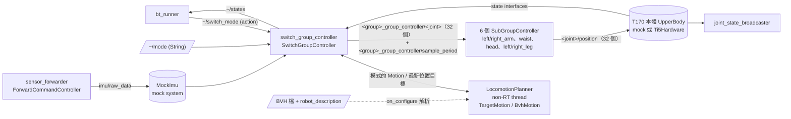
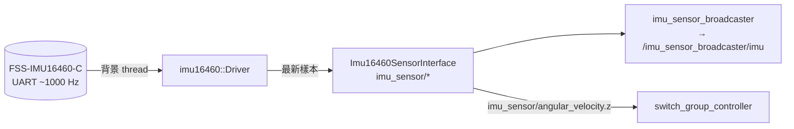
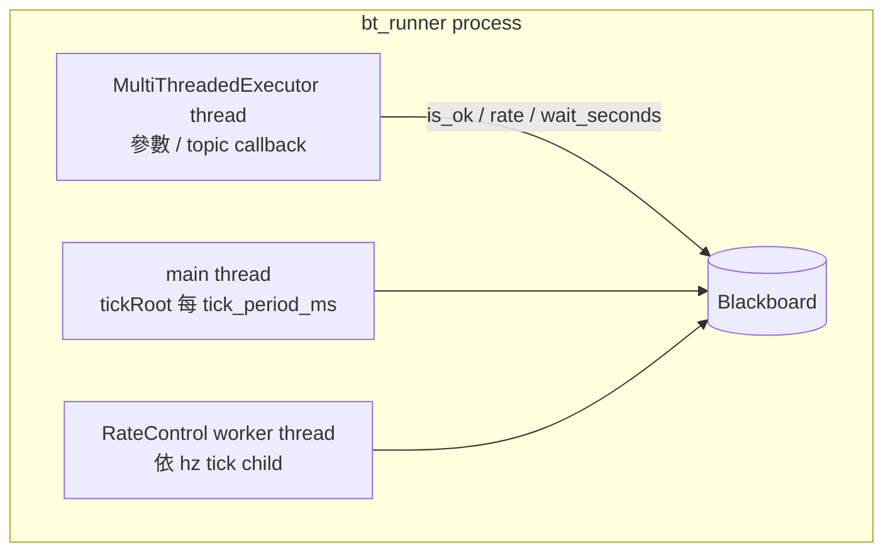

# graphen_ws 架構與設計

本文件說明工作區的整體架構、各元件的設計與設計決策，作為後續開發的參考。
快速開始與測試指令請見 [README.md](../README.md)。

- [1. 整體架構](#1-整體架構)
- [2. 控制層（ros2_control）](#2-控制層ros2_control)
- [3. 行為層（BehaviorTree.CPP v3）](#3-行為層behaviortreecpp-v3)
- [4. 設計決策紀錄](#4-設計決策紀錄)
- [5. 擴充指引](#5-擴充指引)
- [6. 已知限制與待辦](#6-已知限制與待辦)

---

## 1. 整體架構

### 1.1 套件依賴

```mermaid
graph LR
  ifaces[graphen_interfaces<br/>action 定義]
  subgraph 控制層
    utils[graphen_control_utils<br/>header-only]
    motion[graphen_motion<br/>BVH 轉換，無 rclcpp]
    ctrl[graphen_controllers<br/>controller plugin]
    bringup[graphen_bringup<br/>config + launch]
  end
  subgraph 機器人（外部套件）
    desc[ti5_170a_graphen<br/>URDF + ros2_control xacro]
    ti5hw[ti5_hardware<br/>CAN system plugin]
    can[can_driver<br/>SocketCAN lib]
    handdesc[dexterous_hand_description<br/>手部 ros2_control xacro]
    handhw[dexterous_hand_hardware<br/>RS485 system plugin]
  end
  subgraph IMU 驅動
    imucore[imu16460_core<br/>純 C++，無 ROS]
    imuhw[imu16460_hardware<br/>sensor plugin]
  end
  subgraph 行為層
    btnodes[graphen_bt_nodes<br/>BT plugin]
    bt[graphen_bt<br/>bt_runner + trees]
  end
  ctrl -->|build| utils
  ctrl -->|build| motion
  ctrl -->|build| ifaces
  btnodes -->|build| ifaces
  bringup -.->|exec| ctrl
  bringup -.->|exec| desc
  imuhw -->|build| imucore
  desc -.->|xacro include| imuhw
  desc -.->|xacro include| handdesc
  desc -.->|exec| ti5hw
  ti5hw -->|build| can
  handdesc -.->|exec| handhw
  bt -.->|runtime 載入| btnodes
```

實線為編譯期依賴，虛線為執行期依賴。兩層在執行期透過 `switch_group_controller` 的 `~/switch_mode` action 與 `~/states` topic 連動（見 [§3.5](#35-與控制層的連動)）。

### 1.2 模組化原則

- **一個套件一個職責**：共用元件、plugin、硬體描述、啟動設定各自獨立，修改其中一項時不會牽動其他套件。
- **plugin 與設定分離**：controller 和 BT 節點都編成 plugin。要用哪些、怎麼接，由 YAML 和 XML 決定，不需要重新編譯。
- **可調數值參數化**：頻率、模式對照表、檔案路徑、port 等都放在 YAML 或 launch argument，不寫死在程式中。

### 1.3 命名慣例

| 項目 | 慣例 | 範例 |
|---|---|---|
| 套件 | `graphen_<功能>` | `graphen_controllers` |
| C++ namespace | 控制層 `graphen::control`、行為層 `graphen::bt` | `graphen::control::SubGroupController` |
| controller plugin 名稱 | `graphen_control/<Class>` | `graphen_control/SwitchGroupController` |
| header 路徑 | `include/<pkg>/<file>.hpp` | `graphen_controllers/sub_group_controller.hpp` |
| include guard | `<PKG>__<FILE>_HPP_` | `GRAPHEN_CONTROLLERS__SUB_GROUP_CONTROLLER_HPP_` |

例外：IMU 驅動是可重用的裝置驅動，不綁定 graphen，使用自己的名稱（套件 `imu16460_core` / `imu16460_hardware`，namespace `imu16460` / `imu16460_hardware`，plugin `imu16460_hardware/Imu16460SensorInterface`），見 D11。

---

## 2. 控制層（ros2_control）

### 2.1 資料流



- 本體 `UpperBody` 有 32 個 joint（雙臂、腰、頭、雙腿），每個 joint 為 position 指令、position/velocity/acceleration 狀態。32 個 joint 都由 `switch_group_controller` 經 6 個 `SubGroupController`（左臂 7、右臂 7、腰 3、頭 3、左腿 6、右腿 6）驅動。
- `use_mock_hardware:=false` 時本體改為 `ti5_hardware/Ti5Hardware`（CAN），參數來自 [can_driver_config.json](../src/graphen_bringup/config/can_driver_config.json) 與 [real_initial_positions.yaml](../src/graphen_bringup/config/real_initial_positions.yaml)。
- `use_hands:=true` 時另外加入左右手兩個 system（各 13 個 joint，mock / 實機跟隨 `use_mock_hardware`），目前沒有 controller 驅動。
- joint 分組（left_arm、right_arm、left_hand、right_hand、waist、head）定義在 [ti5_170a_graphen.srdf](../src/ti5_170a_graphen/config/ti5_170a_graphen.srdf)，只作為子群組劃分的參考，程式不讀取。

上圖是預設的 mock IMU（`use_mock_imu:=true`）。實機 IMU（`use_mock_imu:=false`）時：



- 不建立 `MockImu`，`sensor_forwarder` 不啟動；改為獨立的 sensor 硬體元件 `imu16460`，與本體由同一個 controller_manager 管理。
- `switch_group_controller.sensor` 由 `controllers_imu16460.yaml` 覆寫為 `imu_sensor/angular_velocity.z`。

- `SwitchGroupController` 不直接操作硬體，而是寫入下層 `SubGroupController` 導出的 **reference interface**（ros2_control chaining）。除了位置，還會寫入目前 Motion 的輸出點間隔 `sample_period`，下層依此在 RT 迴圈中插補（BVH 依檔案頻率送出原始幀，插補在子群組進行）。
- `sensor_forwarder` 用來模擬 sensor 資料：`MockImu` 開啟了 `mock_sensor_commands`，所以可以透過 `/sensor_forwarder/commands` 寫入 `imu/raw_data`。`MockImu` 獨立於本體，本體改用實機時 mock IMU 仍可單獨使用。

### 2.2 SwitchGroupController

原始碼：[switch_group_controller.hpp](../src/graphen_controllers/include/graphen_controllers/switch_group_controller.hpp) / [.cpp](../src/graphen_controllers/src/switch_group_controller.cpp)
類型：`controller_interface::ControllerInterface`

**行為**
1. 每個週期讀取所有 state interface，依 `state_publish_rate` 的頻率發布到 `~/states`。
2. 讀取 sensor 值，存到 `sensor_value_`，供之後的控制邏輯使用。
3. 從 `target_buffer_` 讀取 `LocomotionPlanner` 的最新輸出，位置寫到 `command_interfaces`，`sample_period` 寫到 `sample_period_interfaces`。

模式（來自 `~/mode` topic 或 `~/switch_mode` action）只決定 planner 要播放哪一個 **Motion**；實際輸出由 planner 在 non-RT thread 中產生（見 [§2.4](#24-locomotionplanner)）。controller 本身不包含任何特定模式（例如 forward/reverse）的邏輯。

**模式對照表**
- 模式以**名稱**識別。`modes` 列出可用的名稱，每個名稱同時是該模式參數的前綴。`<mode>.type` 決定 Motion 的種類：
  ```yaml
  modes: [forward, reverse, walk, stop]
  default_mode: ""          # 空字串：啟動時保持位置，收到命令才移動
  forward:
    type: target            # 往固定目標移動
    joints: [L_WRIST_P, R_WRIST_P]   # 只列出要動的 joint，其餘保持進入模式時的位置；省略時為全部
    targets: [1.5, 1.5]
  walk:
    type: bvh               # 播放 BVH
    file: package://graphen_bringup/motions/t170wk_walk1_subject1.bvh
    loop: true
    max_steps: [...]        # 32 個，播放時的每週期上限
  stop:
    type: hold              # 停在進入模式時的位置
  ```
- joint 名稱取自 `target_state_interfaces` 的 prefix（`L_WRIST_P/position` → `L_WRIST_P`），`<mode>.joints` 與 BVH 對應都使用它。
- BT、action、`~/mode` topic 都使用同一組名稱，不需要額外的數字對照。
- 名稱只允許 `[A-Za-z0-9_]`（要當作參數前綴），不可為空、不可重複。`<mode>.*` 參數無法在 `on_init` 預先宣告：YAML 有寫的會被 controller node 自動宣告，沒寫的在 `on_configure` 以預設值補宣告。
- 各模式的 Motion 在 `on_configure` 中預先建好（`mode_names_` / `mode_motions_`）。bvh 模式在此解析 BVH、建立 `BvhRetargeter`（只做分組與驗證，並以 INFO 印出分組），任何錯誤都回傳 ERROR。
- 模式切換統一由 `apply_mode()`（non-RT，mutex 保護）處理：查表後呼叫 `planner_->set_motion()`。已在該模式時不重新開始（BVH 不會從頭播放）。
- 從 `~/mode` 收到未知的 mode 時忽略並印出 WARN（原本會把所有目標設為 0；32 軸含腿部時太危險，因此改掉）；action 則直接 reject。
- bvh 模式需要 URDF：Humble 的 controller 沒有 robot_description API，改讀 controller node 的 `robot_description` 參數。launch 以 dict 傳給 controller_manager 的參數會寫成 `/**` 的參數檔，同一個 process 中的 controller node 會自動宣告它。

**`~/switch_mode` action**（`graphen_interfaces/action/SwitchMode`）
- `handle_goal`：controller 不是 active，或 mode 不在 `modes` 中時 REJECT。
- `handle_accepted`：`apply_mode()` 後立即 `succeed`，result 附上目前所有 state interface 的快照（`interface_names` / `values`）。模式切換是瞬間完成的，所以沒有 feedback，cancel 一律 REJECT。
- 快照由 `update()` 以 `try_lock` 寫入（拿不到 lock 就跳過這一次），action callback 再以 lock 讀取。

**Realtime 設計**
- planner 在 non-RT thread 中透過 `realtime_tools::RealtimeBuffer` 寫入目標；`update()` 用 `readFromRT()` 讀取，不會阻塞。buffer 長度不符（尚未寫入）時不輸出。
- `~/mode`、action 的 callback 都在 controller_manager 的 executor thread 執行，不會碰到 RT 路徑。
- `~/mode` 的 QoS 設為 **reliable + transient_local**：模式切換不能遺失，而且晚啟動的 controller 也能收到最後一次設定的模式。發布端必須使用相容的 QoS（見 README 的指令）。
- 每次 configure 都會回到 `default_mode`。
- `on_activate` 以 `target_state_interfaces` 的目前值作為 planner 的起點，啟動瞬間輸出不會跳動，並把目前模式的 Motion 交給 planner；`on_deactivate` 停止 planner。
- **保持模式**：`default_mode` 為空字串時，啟動後不進入任何模式。`on_activate` 以保持位置作為 planner 的起點，並交給 planner 一個全部為 NaN 的 `TargetMotion`（保持），收到第一個模式命令（BT、action 或 `~/mode`）才開始移動。
  - 保持位置優先取下游 reference 的值。下游在 activate 時，會以硬體目前的 command 值初始化 reference，也就是 Ti5Hardware 從 `real_initial_positions.yaml` 或 encoder 得到的值；reference 無效時才用 `target_state_interfaces`。
  - 這樣實機馬達還在走向初始姿態時，不會被停在半路。

**sensor 處理**：若有設定 `sensor`，但它不在 `state_interfaces` 中，會自動附加到最後，並記錄它的 index。

| 參數 | 型別 | 預設值 | 說明 |
|---|---|---|---|
| `command_interfaces` | string[] | `[]`（必填） | 下層 reference interface，順序對應 `target_state_interfaces`、各 max_steps |
| `sample_period_interfaces` | string[] | `[]` | 下層的 `<sub>/sample_period`，每週期寫入目前 Motion 的輸出點間隔；只是接線設定，與 BVH 無關。不可重複，不可與 `command_interfaces` 重複 |
| `state_interfaces` | string[] | `[]` | 要讀取並發布的 state interface |
| `sensor` | string | `""` | （選填）sensor state interface |
| `state_publish_rate` | double | 50.0 | `~/states` 的發布頻率（Hz） |
| `target_state_interfaces` | string[] | `[]`（必填） | 與 `command_interfaces` 一一對應，必須列在 `state_interfaces` 中；activate 時作為 planner 起點，prefix 即為 joint 名稱 |
| `planner_rate` | double | 100.0 | planner 的規劃頻率（Hz），必須 > 0 |
| `planner_max_steps` | double[] | `[]`（必填） | 每個 command interface 在每個規劃週期最多移動的量，每個值必須 > 0；各模式未指定 max_steps 時使用 |
| `modes` | string[] | `[]`（必填） | 模式名稱，不可重複，只允許 `[A-Za-z0-9_]` |
| `default_mode` | string | `""` | 啟動時的模式，必須列在 `modes` 中；空字串表示保持位置，直到收到第一個模式命令 |
| `<mode>.type` | string | `target` | `target`、`hold` 或 `bvh` |
| `<mode>.max_steps` | double[] | `planner_max_steps` | 該模式的每週期上限（bvh 為播放時） |
| `<mode>.joints` | string[] | 全部 | （target）要移動的 joint；沒有列出的保持進入模式時的位置 |
| `<mode>.targets` | double[] | （必填） | （target）對應 `joints` 的目標位置 |
| `<mode>.file` | string | （必填） | （bvh）BVH 路徑，支援 `package://<pkg>/<path>` |
| `<mode>.loop` | bool | true | （bvh）播放到結尾後循環 |
| `<mode>.time_scale` | double | 1.0 | （bvh）播放速度倍率，必須 > 0 |
| `<mode>.approach_max_steps` | double[] | `planner_max_steps` | （bvh）走向第 0 幀（含循環接回）時的每週期上限 |
| `bvh.base_link` | string | `""` | BVH 與 URDF 共同的基準 link，有 bvh 模式時必填（T170 為 `BASE_S`） |
| `bvh.axis_tolerance` | double | 1e-4 | 判斷軸線交於一點的距離容差（m） |
| `bvh.max_iterations` | int | 50 | 每組求解的迭代上限 |
| `bvh.damping` | double | 1e-6 | damped least squares 的阻尼 |
| `bvh.residual_tolerance` | double | 1e-3 | 從上一幀求解的殘差超過此值時改用多組初始值；也是選解時視為相同的範圍（rad） |

| 介面 | 型別 | 方向 |
|---|---|---|
| `~/mode` | std_msgs/String | 訂閱 |
| `~/switch_mode` | graphen_interfaces/action/SwitchMode | action server |
| `~/states` | control_msgs/DynamicJointState | 發布 |

### 2.3 SubGroupController

原始碼：[sub_group_controller.hpp](../src/graphen_controllers/include/graphen_controllers/sub_group_controller.hpp) / [.cpp](../src/graphen_controllers/src/sub_group_controller.cpp)
類型：`controller_interface::ChainableControllerInterface`

- 依 `input_interfaces` 導出 reference interface，全名為 `<controller 名稱>/<input>`，例如 `left_arm_group_controller/L_SHOULDER_P`（input 使用 joint 名稱）。實際的儲存空間是基類的 `reference_interfaces_`。
- **只支援 chained 模式**：沒有 topic 訂閱，`update_reference_from_subscribers()` 是空實作。
- `update_and_write_commands()`：input 只有 1 個時寫到所有 output（廣播）；否則 input 與 output 數量必須相同（configure 時檢查，不符回傳 ERROR），第 i 個 reference 寫到第 i 個 output。所有 reference 都發布到 `~/references`。
- reference 為 NaN（上層尚未寫入）的 output 不輸出，避免把 NaN 寫進硬體；configure 時 reference 初始化為 NaN。
- **插補**：另外導出 `<controller 名稱>/sample_period`（上游輸出點的間隔，秒；初始 0，NaN 或負值視為 0）。
  - reference 改變時開一段新的線性插補：從目前輸出走到新值，時間為 `max(sample_period, 上一段剩下的時間)`。
  - `sample_period` 為 0 時直接輸出，target 模式的行為與沒有插補時相同。
  - 「至少花上一段剩下的時間」讓間隔從 1/24 s 變成 0 時（BVH 切到其他模式、循環接回第 0 幀），不會把還沒走完的一幀瞬間跳完。
  - BVH 播放時，輸出是精確的幀間線性插補，約晚一幀（1/24 s ≈ 42 ms）。
  - 插補狀態（每個 output 的起點、目標、時間）在 `on_configure` 預先配置；`on_activate` 從目前的 command 開始，不會產生斜坡。
  - `input_interfaces` 不可使用保留名稱 `sample_period`。
- `on_activate` 以對應 output 目前的 command 值初始化 reference（沒有對應 output 的為 NaN），讓上層可以據此保持位置。
- **停用輸出**（`output_enabled: false`）：照常發布 `~/references`，但不更新插補、不寫 command。ros2_control 的 command interface 會保留最後的值，硬體（mock / `Ti5Hardware`）持續以它為目標，關節維持最後狀態（不斷電、不卸力）。上層照常運作，不受影響。用於停用會碰撞（例如 BVH 手臂打到大腿）或故障的部位；只在 configure 時讀取，執行中不能切換。

| 參數 | 型別 | 預設值 | 說明 |
|---|---|---|---|
| `input_interfaces` | string[] | `[]`（必填） | 要導出的 reference interface 名稱；1 個（廣播）或與 `output_interfaces` 同數量（1:1） |
| `output_interfaces` | string[] | `[]`（必填） | 要寫入的硬體 command interface |
| `reference_publish_rate` | double | 50.0 | `~/references` 的發布頻率（Hz） |
| `output_enabled` | bool | true | false 時不寫 command，關節維持最後的 command；只在 configure 時讀取 |

| Topic | 型別 | 方向 |
|---|---|---|
| `~/references` | control_msgs/DynamicJointState | 發布 |

### 2.4 LocomotionPlanner 與 Motion

原始碼：[locomotion_planner.hpp](../src/graphen_controllers/include/graphen_controllers/locomotion_planner.hpp)、[motion.hpp](../src/graphen_controllers/include/graphen_controllers/motion.hpp)、[target_motion.hpp](../src/graphen_controllers/include/graphen_controllers/target_motion.hpp)、[bvh_motion.hpp](../src/graphen_controllers/include/graphen_controllers/bvh_motion.hpp)
類型：一般類別（不是 plugin），由 `SwitchGroupController` 擁有。

**LocomotionPlanner**
- 在獨立的 non-RT thread 中以 `rate_hz` 執行（`sleep_until` 絕對時間排程；落後時重新對齊，不連續補跑）。
- 每個週期：向目前的 Motion 取得期望位置（`update(dt, current, desired)`，`dt` 為實際經過時間），再 `current[i] += clamp(desired[i] - current[i], ±motion.max_steps()[i])`（NaN 表示保持），連同 `motion.sample_period()` 以 `Output{positions, sample_period}` `writeFromNonRT` 到呼叫端提供的 `TargetBuffer`。
- `set_motion()` 可以在任何 thread 呼叫（mutex 保護），切換由 planner thread 在下一個週期執行（呼叫新 Motion 的 `on_enter(current)`），因此 Motion 只在單一 thread 中執行。未啟動時設定的 Motion 會保留到 `start()` 之後使用。
- `start()` 會先把起點寫入 buffer，controller 在第一個規劃週期前就有值可以輸出。
- 不認識 joint 或模式，可以重用在其他 controller。

**Motion 介面**：`on_enter(current)` / `update(dt, current, desired)` / `max_steps()` / `sample_period()`。同一個實例可以重複進入，`on_enter` 會重設狀態；`max_steps()` 與 `sample_period()` 在每次 `update()` 之後讀取，可以依階段改變。`sample_period()` 預設為 0（輸出已連續，下游不插補）。

**TargetMotion**（`type: target`）：往固定目標移動；目標為 NaN 的介面在 `on_enter` 時記住目前位置並保持。`type: hold` 是全部為 NaN 的 TargetMotion，用來停止（保持進入模式時的位置）。

**BvhMotion**（`type: bvh`）：
- **Approach**：以 `approach_max_steps` 走向第 0 幀（`on_enter` 時以目前位置為初始值解出），所有介面都在一步之內時開始播放。
- **Play**：時間累加 `dt × time_scale`；跨進新的一幀時才以 `BvhRetargeter` 解出該幀（以上一幀為初始值），**依檔案頻率輸出原始幀**（幀與幀之間保持），`sample_period()` 回傳 `frame_time / time_scale`，插補由 `SubGroupController` 進行。BVH 的轉換都在 planner thread 中進行，平均每幀約 0.1 ms。
- `max_steps`（播放時）是對「一幀的跳動」的限制，要讓一個週期就能走完一幀，同時擋下異常的大跳動。
- 播完最後一幀時：`loop: true` 回到 Approach（以 `approach_max_steps` 接回第 0 幀），否則保持最後一幀。Approach / Hold 時 `sample_period()` 為 0。
- 沒有 BVH 資料的介面保持進入時的位置。

### 2.5 StateInterfacePublisher（graphen_control_utils）

原始碼：[state_interface_publisher.hpp](../src/graphen_control_utils/include/graphen_control_utils/state_interface_publisher.hpp)

把一組具名的 double 值以 `control_msgs/DynamicJointState` 發布，兩個 controller 都使用它。

- 名稱以**最後一個 `/`** 拆成 prefix 和 interface（例如 `L_SHOULDER_P/position` 拆成 `L_SHOULDER_P` + `position`），依 prefix 分組。
- msg 在建構時預先配置，`publish()` 只填值，符合 RT 的要求。
- 用累積的 `period` 控制發布頻率，並保留餘數以維持準確的頻率；落後太多時歸零，避免連續補發。
- 使用 `RealtimePublisher::trylock()`，拿不到 lock 就跳過這一次，不會阻塞 `update()`。
- 提供兩個 overload：`LoanedStateInterface` 的 vector 和 `double` 的 vector。

### 2.6 啟動順序

[bringup.launch.py](../src/graphen_bringup/launch/bringup.launch.py) 以 `OnProcessExit` 串接 spawner：

```
joint_state_broadcaster ─▶ left_arm ─▶ right_arm ─▶ waist ─▶ head ─▶ left_leg ─▶ right_leg（*_group_controller）─▶ switch_group_controller
sensor_forwarder（與 JSB 並行，use_mock_imu:=true）
imu_sensor_broadcaster（與 JSB 並行，use_mock_imu:=false）
```

上層 `switch_group_controller` 要 claim 下層導出的 reference interface，所以下層必須先 active，上層要最後啟動。

launch argument：

| 參數 | 預設值 | 說明 |
|---|---|---|
| `use_mock_hardware` | `true` | `true`：本體使用 `mock_components/GenericSystem`；`false`：T170 實機（`ti5_hardware`，CAN） |
| `hw_read_timeout_ms` | `20` | `ti5_hardware` 的 CAN 讀取 timeout |
| `max_command_velocity` | `0.5` | `ti5_hardware` 送往馬達的指令最大變化速度（rad/s，0 為不限速）；開機走向 `real_initial_positions` 時也受限，應 >= planner 速度 |
| `use_hands` | `false` | 啟用靈巧手 ros2_control（mock / 實機跟隨 `use_mock_hardware`） |
| `left_hand_port` / `right_hand_port` | `/dev/ttyUSB1` / `/dev/ttyUSB0` | 實機靈巧手的 serial port |
| `hand_baudrate` | `115200` | 實機靈巧手的鮑率 |
| `use_mock_imu` | `true` | `true`：mock `imu/raw_data` + `sensor_forwarder`（原本的行為）；`false`：實機 IMU，額外載入 [controllers_imu16460.yaml](../src/graphen_bringup/config/controllers_imu16460.yaml) |
| `imu_port` | `/dev/ttyTHS1` | 實機 IMU 的 serial port |
| `imu_baudrate` | `921600` | 實機 IMU 的鮑率 |

`use_mock_hardware`、`use_hands` 只傳給 xacro。`use_mock_imu` 同時傳給 xacro（切換 URDF 中的 sensor 區塊）和 controller_manager 的參數檔組合（ROS 參數檔無法以 condition 切換，所以 controller_manager 在 `OpaqueFunction` 中建立）。

### 2.7 Imu16460SensorInterface（imu16460_hardware）

原始碼：[imu16460_sensor_interface.hpp](../src/imu16460/imu16460_hardware/include/imu16460_hardware/imu16460_sensor_interface.hpp) / [.cpp](../src/imu16460/imu16460_hardware/src/imu16460_sensor_interface.cpp)
類型：`hardware_interface::SensorInterface`；協議與硬體細節見 [IMU16460.md](IMU16460.md)，參數見 [套件 README](../src/imu16460/imu16460_hardware/README.md)。

- **更新模型**：`imu16460_core` 的 `Driver` 在背景 thread 依裝置頻率（約 1000 Hz）接收並更新最新樣本；`read()` 每個週期只以 `try_lock` 取最新一筆、換算後寫入 state，不做 serial I/O、不阻塞、不配置記憶體。拿不到 lock 時沿用上一筆。
- 匯出 `imu_sensor_broadcaster` 需要的 10 個 state interface，加上選用的 `temperature`。
- activate 時確認 `activate_timeout_ms` 內有資料，否則回傳 ERROR；之後超過 `data_timeout_ms` 沒有新資料時節流警告。
- 不送任何命令、不修改 IMU 設定；裝置設定由 `imu16460_cli` 處理。
- 實機 xacro 片段由 [imu16460.ros2_control.xacro](../src/imu16460/imu16460_hardware/urdf/imu16460.ros2_control.xacro) 的 macro 產生，graphen 的 URDF 以 `xacro:unless use_mock_imu` 引入。

### 2.8 BVH 轉換（graphen_motion）

原始碼：[bvh_clip.hpp](../src/graphen_motion/include/graphen_motion/bvh_clip.hpp)、[bvh_retargeter.hpp](../src/graphen_motion/include/graphen_motion/bvh_retargeter.hpp)、[bvh_retarget_cli.cpp](../src/graphen_motion/tools/bvh_retarget_cli.cpp)
類型：C++ 函式庫（namespace `graphen::motion`），依賴 Eigen3、urdfdom，不依賴 rclcpp。

**BVH 與 URDF 的對應（以 `t170wk_walk1_subject1.bvh` 確認）**
- BVH 節點名稱 = URDF **link** 名稱（例如 `L_HIP_P_S` 是 joint `L_HIP_P` 的 child link），offset（cm）與 URDF joint origin（m）相同，rest pose = URDF 零位。channel 順序 `Z X Y`（度），旋轉為 `Rz·Rx·Ry`。
- BVH 每個節點有 3 個旋轉自由度，但 URDF 每個 joint 只有 1 個；而且 BVH 把一組關節的旋轉**集中在組內某一個節點**（例如髖 P/R/Y 的旋轉都在 `L_HIP_R_S`，其他兩個恆為 0），所以不能逐軸對應，要以組為單位分解。
- root 的位移與 `BASE_S` 的旋轉是浮動基座，固定基座的機器人無法執行，因此忽略；所有姿態都相對於 `bvh.base_link`。

**分組**：沿 URDF 運動鏈（DFS），把連續、軸線交於同一點的可動 joint 歸成一組（最多 3 個），遇到分岔的 link 或 fixed joint 就切組。軸線交於一點的組，其組合旋轉可以精確分解成各軸角度，平移差異不影響角度。T170 分成 18 組有資料的組：
- 雙腿：髖 P/R/Y、膝、踝 P/R
- 腰 Y/R/P
- 雙臂：肩 P/R/Y、肘 + 腕 P、腕 Y/R
- 頸 Y/P/R

手指的組沒有 BVH 資料，輸出 NaN（由上層保持）。

**求解**（`solve(frame, q_inout)`）
1. 由 BVH 計算各節點相對 base_link 的姿態。
2. 依樹的順序，以已解出的上游 joint 做 URDF FK，得到組的父 link 姿態。目標是組內最後一個在 BVH 中有同名節點的 link 的姿態，例如 BVH 沒有 `*_WRIST_R_S`，腕組以 `*_WRIST_Y_S` 為目標，`WRIST_R` 仍然解得出來。
3. 以 damped least squares 在 SO(3) 上求解。每步依 URDF 限位截斷。
4. 1、2 軸的組是最小平方投影：丟掉的分量（例如膝的側向分量）由下游的組以實際 FK 補償。
5. 先從上一幀出發，殘差超過 `residual_tolerance` 時（奇異點附近走到錯誤的分支，或撞到限位），改從 {−π/2, 0, π/2} 的所有組合重新求解。在殘差相近（最佳值 + tolerance 以內）的解中，選最接近上一幀的。

**`bvh_retarget_cli`**：離線把整段 BVH 轉成 CSV，並印出分組、每組最大殘差、各 joint 的範圍 / 限位 / 最大速度、限位截斷次數（用法見 README）。`t170wk_walk1_subject1.bvh` 的結果：
- 3 軸組不撞限位時殘差 ≈ 1e-10。
- 膝與肘的角度與 BVH 原始 channel 的相關係數 > 0.999。
- 步行段最大速度：膝約 13 rad/s，其他約 2~8 rad/s。

---

## 3. 行為層（BehaviorTree.CPP v3）

### 3.1 執行模型



- **main thread**：每 `tick_period_ms`（預設 100 ms，也就是 10 Hz）tick 一次主樹。
- **executor thread**：處理 ROS 參數修改和 topic 訂閱，把值同步到 blackboard，不會阻塞主樹。
- **worker thread**：`RateControl` 和 `HighFreqControlNode` 自己開 thread，讓特定子樹的執行頻率高於主樹。
- 結束時（Ctrl+C）會先 `haltTree()`，讓 worker thread 結束，再停止 executor。

### 3.2 Plugin 機制

- [graphen_bt_nodes](../src/graphen_bt_nodes/) 編成 `libgraphen_bt_nodes.so`，以 `BT_PLUGIN_EXPORT` 編譯。[register_nodes.cpp](../src/graphen_bt_nodes/src/register_nodes.cpp) 的 `BT_REGISTER_NODES` 會註冊全部節點。
- `bt_runner` 依參數 `plugins`（函式庫名稱）呼叫 `factory.registerFromPlugin(SharedLibrary::getOSName(name))`，透過 `LD_LIBRARY_PATH` 尋找，所以執行前要先 source `install/setup.bash`。
- **ROS node 注入**：需要 ROS 的節點（`IncrementSysCount`、`ClearSysCount`、`GetStateValue`、`SwitchMode`）在建構時以 [ros_node.hpp](../src/graphen_bt_nodes/include/graphen_bt_nodes/ros_node.hpp) 的 `get_ros_node()` 從 blackboard 的 `"node"` key 取得 `rclcpp::Node::SharedPtr`（Nav2 慣例）。`bt_runner` 會在建樹**之前**放入；取不到時建構會丟出 `BT::RuntimeError`。

### 3.3 節點清單

| ID | 類型 | Ports | 說明 |
|---|---|---|---|
| `RateControl` | Decorator | `hz`(double, 100) | worker thread 依 `hz` tick child，自身永遠回傳 RUNNING；每輪重新讀取 `hz`，可以動態調整 |
| `ExecutionRateLogger` | SyncAction | `label`(string) | 每 1 秒印出實際 tick 頻率，回傳 SUCCESS |
| `IsOk` | Condition | `is_ok_val`(bool) | true 回傳 SUCCESS，否則回傳 FAILURE |
| `IncrementSysCount` | SyncAction | — | blackboard `sys_count` + 1，並同步到參數 `gp_sys_count` |
| `CheckSysCount` | Condition | `target`(int) | `sys_count >= target` 時回傳 SUCCESS |
| `ClearSysCount` | SyncAction | — | `sys_count` 歸零，並同步到參數 |
| `HighFreqControlNode` | StatefulAction | `target_hz`(double, 100) | 背景高頻迴圈範例，跑滿 5 秒後回傳 SUCCESS（demo tree 未使用） |
| `Wait` | StatefulAction | `seconds`(int) | 非阻塞等待（demo tree 未使用） |
| `SayHello` | SyncAction | — | 範例（demo tree 未使用） |
| `GetStateValue` | SyncAction | `topic`(string, `/switch_group_controller/states`)、`joint`(string)、`interface`(string)、out `value`(double) | 訂閱 DynamicJointState，tick 時輸出指定 joint / interface 的最新值；還沒有資料或找不到時回傳 FAILURE |
| `IsBelow` | Condition | `value`、`threshold`(double) | `value < threshold` 時回傳 SUCCESS |
| `IsAbove` | Condition | `value`、`threshold`(double) | `value > threshold` 時回傳 SUCCESS |
| `SwitchMode` | StatefulAction | `action_name`(string, `/switch_group_controller/switch_mode`)、`mode`(string，模式名稱)、`timeout_ms`(int, 1000) | 以 async 送出 SwitchMode goal，期間回傳 RUNNING；reject、失敗或逾時（含等待 server）回傳 FAILURE。每次執行都會送 goal，應放在只有換向時才會走到的分支 |

`GetStateValue` 的 XML 屬性用 `joint` 而不是 `name`：BT.CPP v3 會把 `name` 當成節點的實例名稱。

### 3.4 demo tree 邏輯

[trees/demo.xml](../src/graphen_bt/trees/demo.xml)：

```
Fallback
├─ ReactiveSequence                     # 正常分支（is_ok = true）
│  ├─ IsOk {is_ok}
│  ├─ ClearSysCount
│  ├─ ExecutionRateLogger "Normal"     → 約 10 Hz（主樹頻率）
│  └─ RateControl hz=1
│     └─ ExecutionRateLogger "RateControl"  → 約 1 Hz
└─ ReactiveSequence                     # 異常分支（is_ok = false）
   ├─ Inverter ─ IsOk {is_ok}
   ├─ Inverter ─ CheckSysCount target=3000
   └─ RateControl hz={rate}
      └─ Sequence
         ├─ ExecutionRateLogger "1000Hz"
         └─ IncrementSysCount
```

- `is_ok` 變成 false 時，第一個 ReactiveSequence 失敗並 halt 它的 RateControl，改走第二條分支，以 `{rate}` 的頻率累加 `sys_count`。
- `sys_count` 達到 3000 時，第二條分支也失敗，整棵樹每次 tick 都回傳 FAILURE，進入閒置狀態，直到 `is_ok` 恢復成 true。
- `is_ok` 恢復成 true 後，`ClearSysCount` 把計數歸零。

### 3.5 與控制層的連動

[trees/joint_reciprocate.xml](../src/graphen_bt/trees/joint_reciprocate.xml) 依 bt_runner 參數 `gp_enable_walk` / `gp_enable_reciprocate`（blackboard `{enable_walk}` / `{enable_reciprocate}`）選擇 walk、往返或停止；往返再依「目前方向」分支，換向在 Groot 中可以直接看出來。`{mode}` 記錄 BT 最後成功切換的模式：

```
IfThenElse "WalkEnabled"
├─ IsOk {enable_walk}
├─ Fallback "Walk"                 # 兩個都 true 時也是 walk
│  ├─ BlackboardCheckString "AlreadyWalking" {mode} == walk ─ AlwaysSuccess
│  └─ Sequence "EnterWalk"
│     ├─ SwitchMode mode=walk
│     └─ SetBlackboard mode = walk
└─ IfThenElse "ReciprocateEnabled"
   ├─ IsOk {enable_reciprocate}
   ├─ Sequence "Reciprocate"
   │  ├─ GetStateValue joint=L_WRIST_P interface=position → {arm_pos}
   │  └─ Fallback
   │     ├─ BlackboardCheckString "Forward"  {mode} == forward
   │     │  └─ Fallback
   │     │     ├─ IsBelow "KeepForward"  {arm_pos} < 1.0
   │     │     └─ Sequence "TurnToReverse"
   │     │        ├─ SwitchMode mode=reverse
   │     │        └─ SetBlackboard mode = reverse
   │     ├─ BlackboardCheckString "Reverse"  {mode} == reverse
   │     │  └─ Fallback
   │     │     ├─ IsAbove "KeepReverse"  {arm_pos} > -1.0
   │     │     └─ Sequence "TurnToForward"
   │     │        ├─ SwitchMode mode=forward
   │     │        └─ SetBlackboard mode = forward
   │     └─ Sequence "Init"   # {mode} 既不是 forward 也不是 reverse（剛啟動、從 walk / stop 切過來）
   │        ├─ Inverter ─ BlackboardCheckString {mode} == forward ─ AlwaysSuccess
   │        ├─ Inverter ─ BlackboardCheckString {mode} == reverse ─ AlwaysSuccess
   │        ├─ SwitchMode mode=forward
   │        └─ SetBlackboard mode = forward
   └─ Fallback "Stop"              # 兩個都 false
      ├─ BlackboardCheckString "AlreadyStopped" {mode} == stop ─ AlwaysSuccess
      └─ Sequence "EnterStop"
         ├─ SwitchMode mode=stop
         └─ SetBlackboard mode = stop
```

- 用 `IfThenElse` 而不是 `Fallback` 選分支：已選定的分支失敗時（例如 SwitchMode 失敗）直接回傳 FAILURE，下一個 tick 重試，不會落到優先順序較低的分支而送出別的模式。
- walk / stop 已是目前模式時不再送 SwitchMode（BVH 不會重新播放）。`stop` 是 `type: hold` 的模式，controller 停在目前位置；之後再切到 walk 會重新 `on_enter`，從第 0 幀 approach 開始。
- 移動期間 `Forward`（forward 模式，往 +1.5）或 `Reverse`（reverse 模式，往 -1.5）分支持續成功；跨過門檻時走 `TurnToReverse` / `TurnToForward` 換向，之後由另一個方向的分支接手。因此 joint 會在 ±1.0 之間往返。
- 切換時**先 SwitchMode 再寫入 `{mode}`**：action 失敗時 `{mode}` 不變，下一個 tick 會重試同一個換向分支。
- `Init` 前面的兩個 Inverter 檢查，確保只有 `{mode}` 不是 forward / reverse 時才會走到這裡；否則換向失敗時，Fallback 會誤落到 `Init` 而送出 forward。
- `BlackboardCheckString`、`SetBlackboard`、`Inverter`、`AlwaysSuccess` 都是 BT.CPP v3 內建的節點。
- 門檻必須落在兩個模式的 arm 目標之間，否則 joint 到達模式目標後就停住，不會換向。
- 以預設值（planner 0.005 × 100 Hz ≈ 0.5 rad/s、BT tick 100 ms）實測，換向週期約 4.1 秒，超出門檻的量約 0.05（等於速度 × tick 延遲）。

### 3.6 bt_runner 參數與介面

設定檔：[bt_runner.yaml](../src/graphen_bt/config/bt_runner.yaml)，launch：[bt.launch.py](../src/graphen_bt/launch/bt.launch.py)（launch argument：`tree_file`、`params_file`）

| 參數 | 型別 | 預設值 | 說明 |
|---|---|---|---|
| `tree_file` | string | launch 給 `share/graphen_bt/trees/demo.xml` | 空字串時報錯並結束 |
| `plugins` | string[] | `[graphen_bt_nodes]` | 要載入的 BT plugin 函式庫名稱 |
| `tick_period_ms` | int | 100 | 主樹 tick 週期，必須 > 0 |
| `groot.enabled` | bool | true | 是否啟用 Groot v1 的 ZMQ publisher |
| `groot.max_msg_per_second` / `publisher_port` / `server_port` | int | 25 / 1666 / 1667 | Groot 連線設定 |
| `gp_is_ok` | bool | true | 對應 blackboard `is_ok` |
| `gp_wait_seconds` | int | 3 | 對應 blackboard `wait_seconds` |
| `gp_rate` | double | 100.0 | 對應 blackboard `rate` |
| `gp_sys_count` | int | 0 | 由節點寫入，供外部觀察 `sys_count` |
| `gp_enable_walk` | bool | false | 對應 blackboard `enable_walk`（joint_reciprocate.xml：啟用 walk，優先於往返） |
| `gp_enable_reciprocate` | bool | true | 對應 blackboard `enable_reciprocate`（joint_reciprocate.xml：啟用 forward / reverse 往返；兩者都 false 時切到 stop） |

`gp_*` 參數在執行中修改（`ros2 param set` 或 rqt）時，會由 parameter callback 同步寫入 blackboard。

| Topic | 型別 | 對應的 blackboard key |
|---|---|---|
| `/is_ok` | std_msgs/Bool | `is_ok` |
| `/wait_seconds` | std_msgs/Int32 | `wait_seconds` |

---

## 4. 設計決策紀錄

| # | 決策 | 理由 |
|---|---|---|
| D1 | `StateInterfacePublisher` 獨立成 `graphen_control_utils` | 它是通用元件，只依賴 rclcpp、realtime_tools、control_msgs，不依賴 pluginlib 或 controller_interface。之後的 controller、hardware plugin 或一般 node 都可以重用，不必連帶引入 controller plugin |
| D2 | 兩個 controller 放在同一個套件 `graphen_controllers` | 兩者是成對使用的，放在一起可以減少套件數量；共用部分已經抽到 utils |
| D3 | plugin 名稱前綴統一用 `graphen_control/` | 和 C++ namespace 對應，YAML 中容易辨識 |
| D4 | controller 參數在 `on_init` 用 `auto_declare` 宣告，在 `on_configure` 讀取並驗證，失敗時回傳 ERROR | 依循 ros2_control 慣例；設定錯誤會在 configure 階段就被發現，不會等到 update 才出錯 |
| D5 | 模式以名稱識別，名稱作為參數前綴（`<mode>.targets`） | BT、action、topic、YAML 共用同一組名稱，tree 中寫 `mode="reverse"` 一看就懂，不必對照數字；每個模式有自己的參數區塊，ROS 2 參數不支援巢狀陣列的限制也不會造成問題。之後 mode plugin 化時，這個區塊直接當作 plugin 的設定（見 §6 TODO） |
| D6 | BT 拆成節點庫（plugin）和執行器 | 新增節點不必修改執行器；之後其他執行器（例如整合到控制流程）也可以重用同一份節點庫 |
| D7 | BT 節點透過 blackboard `"node"` 取得 ROS node | 以 plugin 載入時無法使用自訂建構子注入，改用 Nav2 慣例 |
| D8 | 模式切換走 action，joint 狀態走既有的 `~/states` topic | 指令與狀態分開是 ROS 的主流分工（Nav2 也這樣做）：action 提供明確的接受、拒絕與結果，BT 可以據此判斷成敗；狀態用 topic，BT 隨時都拿得到最新值，不必等 goal |
| D9 | 規劃放在 controller 內的 `LocomotionPlanner` thread，以 `RealtimeBuffer` 交接 | 規劃計算（包含 BVH 的逐幀轉換）不佔用 RT 的 `update()`；`update()` 只輸出最新目標。planner 不認識模式或 joint，可以重用在其他 controller |
| D10 | 遲滯判斷放在 BT，以「方向分支 + `{mode}`」表達，不放在 controller | 門檻屬於任務邏輯，放在 tree XML 中修改不需要重新建置；controller 只負責「模式 → 目標」。用分支而不是單一變數切換，在 Groot 中可以直接看到目前的方向和換向的時間點 |
| D11 | IMU 驅動獨立命名（`imu16460_*`），core 不依賴 ROS | 它是裝置驅動，與 graphen 的控制邏輯無關，可以直接搬到其他機器人或非 ROS 程式；協議、parser、Driver 不依賴 ROS，可以用 GoogleTest + pty 在沒有實機的環境測試 |
| D12 | mock / 實機 IMU 以 `use_mock_imu` 切換，mock 完全保留 | 開發機（WSL）沒有實體設備，mock 是日常開發的預設；實機差異集中在 xacro 的 `xacro:if/unless` 和疊加的 `controllers_imu16460.yaml`，不修改原本的 `controllers.yaml` |
| D13 | IMU 由背景 thread 依自身頻率更新，`read()` 只取最新一筆 | serial I/O 不進 RT 路徑；IMU 頻率與 controller_manager 的 `update_rate` 互不影響（不提供平均模式，避免引入額外延遲） |
| D14 | 機器人描述改用 `ti5_170a_graphen`，32 軸依部位分成 6 個 `SubGroupController`（分組參考 SRDF），reference 與 output 1:1 | 每個部位可以獨立觀察（`~/references`）與替換；外部套件（`ti5_*`、`can_driver`、`dexterous_hand_*`）保留原本命名，不套 `graphen_` 慣例 |
| D15 | BVH 以「組」分解：依軸線是否交於一點自動分組，追蹤組末端 link 相對 base_link 的姿態，從上一幀熱啟動並在失敗時多起點求解 | BVH 把一組關節的旋轉集中在任一節點，只有整組的姿態有意義；交於一點的組可以精確分解。以實際 FK 為基準追蹤全域姿態，1~2 軸的組丟掉的分量會由下游補償。自動分組不需要為每台機器人寫對照表；分組會在 configure 時印出供確認 |
| D16 | 模式泛化成 `Motion` 介面（`TargetMotion` / `BvhMotion`），controller 只認得名稱 | 新增行為不必修改 controller；forward/reverse 只是 YAML 中的兩個 target 模式。介面與 §6 的 mode plugin 化規劃一致，之後改成 pluginlib 只需換掉建立 Motion 的地方 |
| D18 | BVH 依檔案頻率輸出原始幀，幀間插補放在 RT 的 `SubGroupController`；間隔（`sample_period`）由 switch 經 chained reference interface 傳下去 | 與 JointTrajectoryController 相同的分工：上游給點，RT controller 依控制週期插補，時間基準是 controller_manager 的週期，不受 planner thread 的排程抖動影響。間隔由上游提供，換 BVH 的 fps 或 `time_scale` 時不需要修改設定；以 interface 傳遞，RT 安全。代價是 BVH 播放約晚一幀 |
| D17 | BVH 轉換放在獨立的 `graphen_motion`（不依賴 rclcpp），提供 `bvh_retarget_cli` | 轉換與 ros2_control 無關，可以離線檢查新的 BVH、決定 max_steps，也能在其他程式重用 |

---

## 5. 擴充指引

### 新增 controller plugin
1. 在 `graphen_controllers/include/graphen_controllers/` 和 `src/` 新增類別（namespace `graphen::control`），並在 `.cpp` 結尾加上 `PLUGINLIB_EXPORT_CLASS`。
2. **以下三處要同步修改**：
   - [graphen_controllers.xml](../src/graphen_controllers/graphen_controllers.xml)：新增 `<class name="graphen_control/<Class>" ...>`
   - [CMakeLists.txt](../src/graphen_controllers/CMakeLists.txt)：把 `.cpp` 加入 `add_library`
   - [package.xml](../src/graphen_controllers/package.xml)：補上新的依賴
3. 參數在 `on_init` 用 `auto_declare` 宣告，在 `on_configure` 讀取並驗證，參數值放在 [controllers.yaml](../src/graphen_bringup/config/controllers.yaml)。

### 新增一個子群組（例如 leg）
1. 在 URDF 的 `<ros2_control>` 中新增 joint 和 interface。
2. 在 `controllers.yaml` 新增一個 `type: graphen_control/SubGroupController` 的 controller，`input_interfaces` 用 joint 名稱，`output_interfaces` 為 `<joint>/position`（兩者 1:1）。
3. 在 `switch_group_controller` 的 `command_interfaces` 加上 `<新 controller>/<joint>`，`sample_period_interfaces` 加上 `<新 controller>/sample_period`，`target_state_interfaces`、`state_interfaces` 加上 `<joint>/position`，`planner_max_steps` 與各模式的 `max_steps` / `approach_max_steps` 各加一個值。target 模式只列出要動的 joint，不需要修改。
4. 在 launch 的 `sub_group_controllers` 清單加上新 controller，它會自動串進啟動鏈。

### 新增 BVH 動作
1. 把 BVH 放到 `graphen_bringup/motions/`，節點名稱必須是 URDF link 名稱，rest pose 必須等於 URDF 零位。
2. 先用 `bvh_retarget_cli` 檢查分組、殘差、限位截斷與最大速度。
3. 在 `modes` 加上名稱，設定 `type: bvh`、`file`，並以「最大速度 × frame_time × 1.2」設定 `max_steps`（每幀的跳動上限）。幀間隔會自動傳給子群組，不需要其他設定。

### 新增 BT 節點
1. 在 `graphen_bt_nodes` 新增 hpp/cpp（namespace `graphen::bt`），加入 CMake 的 `add_library`。
2. 在 [register_nodes.cpp](../src/graphen_bt_nodes/src/register_nodes.cpp) 用 `registerNodeType` 註冊。
3. 需要 ROS node 時，從 blackboard 的 `"node"` 取得（參考 [sys_count_nodes.cpp](../src/graphen_bt_nodes/src/sys_count_nodes.cpp)）。
4. 在 tree XML 的 `<TreeNodesModel>` 補上節點定義，Groot 才能顯示。

### 新增 tree
把 XML 放到 `graphen_bt/trees/`，以 `tree_file:=` 指定執行；也可以直接指定任意路徑，不需要重新建置。

---

## 6. 已知限制與待辦

- **TODO：Motion plugin 化**
  - **現況**：模式已泛化成 `Motion` 介面（D16）。`TargetMotion` / `BvhMotion` 由 `SwitchGroupController::create_motion()` 依 `<mode>.type` 建立，切換由 planner thread 執行，`max_steps` 已移到各模式。
  - **時機**：需要在不修改 `graphen_controllers` 的情況下新增動作種類時（例如正弦擺動、其他步態產生器）。
  - **做法**：
    - 把 `Motion` 移到獨立套件，加上 `configure(node, name, joint_names)`。
    - `<mode>.type` 改為 plugin 名稱，`create_motion()` 改以 `pluginlib::ClassLoader` 建立。
    - 名稱與 action、BT 介面不變。
  - **注意事項**：
    - `pluginlib::ClassLoader` 的生命週期必須比 Motion 實例長。
    - plugin 不能用 `auto_declare`，要用 `declare_parameter`，宣告前先檢查 `has_parameter`。
- **BT 的方向與 controller 的模式可能不一致**：controller 被 reconfigure 回到 `default_mode` 時，BT 的 `{mode}` 不會跟著改變，要等到下一次換向（或切換 `gp_enable_*`）才會重新同步。
- **planner 的速度受 non-RT 排程影響**：max_steps 是「每週期」的量，planner thread 被延遲時，實際速度會變慢（WSL 在高負載下觀察得到）。BVH 的播放時間以實際經過時間推進，不受影響，但輸出仍受 max_steps 限制。
- **BVH 步態是開環播放**：沒有平衡控制，浮動基座（root 位移、`BASE_S` 旋轉）被忽略；實機只能在吊掛等安全條件下使用。
- **BVH 超出 T170 限位**：`t170wk_walk1_subject1.bvh` 的髖 roll（約 ±0.6 rad）、踝等會超出 URDF 限位而被截斷，組的殘差因此不為 0（約 0.3~0.6 rad）。
- **BVH 播放的延遲**：插補在子群組進行，輸出約晚一幀（1/24 s ≈ 42 ms）；開環播放沒有影響，切換模式的反應也會晚最多一幀。
- **肩部奇異點**：肩 P/R/Y 為 Y-X-Y，`R ≈ 0`（手臂水平的 T-pose）時 P 與 Y 共線。BVH 開頭與結尾的 T-pose 段會讓 P/Y 快速擺動或換分支（離線最大約 75 rad/s），實際輸出受 `walk.max_steps` 限制；步行段連續。
- **關節正負號以 xacro 為準**：Ti5Hardware 的限位、BVH 轉換都取自 robot_description（xacro）。原廠的靜態 `robot.urdf`（已刪除）有 16 個 joint 的軸方向與 xacro 相反（例如 `L_HIP_R`、`L_ELBOW_Y`、`NECK_P`），`R_KNEE_P`、`L_HIP_R`/`R_HIP_R`、`R_ANKLE_P` 的限位正負號也對調；上實機前需確認 xacro 的正負號與馬達一致，否則限位會落在錯誤的一側（`TODO(verify-on-hw)`）。
- **實機速度**：Ti5Hardware 的 `max_command_velocity`（預設 0.5 rad/s）遠低於步態所需的速度（膝約 13 rad/s），實機播放會明顯落後；需要時以 `walk.time_scale` 放慢。
- **ti5_hardware 的 state interface 語意**：`velocity` 實際綁到 error code、`acceleration` 綁到 filter current（[ti5_hardware.cpp](../src/ti5_hardware/src/ti5_hardware.cpp) `export_state_interfaces`），實機時不可當作速度 / 加速度使用。
- **Ti5Hardware 的開機與限速**：
  - `on_activate` 讀 encoder 作為輸出起點；有列在 `real_initial_positions.yaml` 的 joint，目標為該值，沒列的保持目前位置。
  - `write()` 先把 `hw_commands_` clamp 到關節限位，再以 `max_command_velocity` 限速逼近。限位依序取自 ros2_control `<command_interface name="position">` 的 `min`/`max`、joint 的 `<param name="min/max">`、robot_description 的 `<limit>`（目前只用最後一項）；開始 / 結束 clamp 時各印一次 log。
  - 命令為 NaN / inf 時無法 clamp，`read()` / `write()` 改為回傳 ERROR，直到重新 activate。
  - 原本 activate 時的 encoder 讀取被註解掉，需實機確認此時讀取是否可靠（`TODO(verify-on-hw)`）。
- **T170 實機尚未在本架構下驗證**：`use_mock_hardware:=false`、`use_hands:=true` + 實機只做過 xacro 展開檢查；限位 clamp 的行為只做過建置檢查；IMU 在 T170 上的安裝位置待確認（`TODO(verify-on-hw)`）。
- **RateControl 的並行存取**：worker thread 和主樹會並行存取 child 和 blackboard（沿用原型設計）。因此 `sys_count` 可能略微超過 target（實測約 3006）。若要嚴格同步，需要重新設計。
- **CheckSysCount 的 target（3000）寫死在 tree XML**：可以考慮改成 blackboard 變數。
- **Groot 只支援 v1**：要改用 Groot2 必須升級到 BT.CPP v4。
- **robot_description 以參數傳給 controller_manager 已被標為 deprecated**：Humble 下會印 WARN，之後可以改成由 `robot_state_publisher` 的 topic 提供。
- **WSL 環境**：沒有 RT scheduling（會印 WARN），ros2 daemon 探索偏慢。
- **IMU 待實機驗證**：坐標系方向、Euler 順序、S1 長度、共變異數（見 [IMU16460.md §3](IMU16460.md#3-待實機驗證)），程式中以 `TODO(verify-on-hw)` 標記。
- **IMU 時間戳**：Humble 的 `imu_sensor_broadcaster` 以 controller_manager 的更新時間打時間戳，無法傳遞裝置 timer；需要精確時間戳時改用獨立 node 發布。
- **測試**：只有 `imu16460_core` 有自動化測試；`graphen_motion` 目前以 `bvh_retarget_cli` 檢查（GoogleTest，`colcon test --packages-select imu16460_core`）；其他套件尚無，測試方式待討論。
