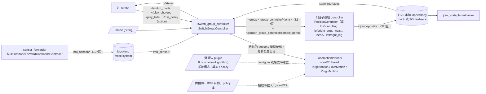
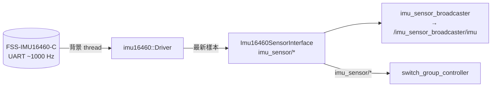
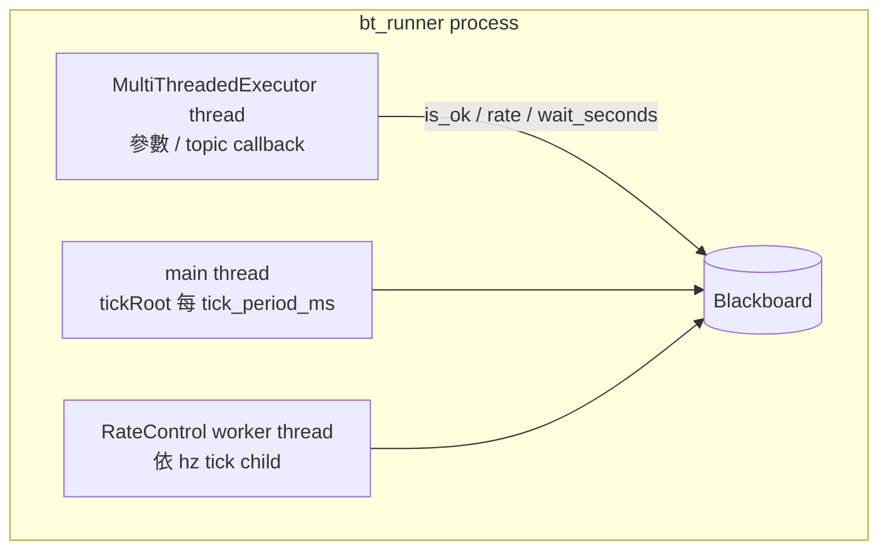

# graphen_ws 架構與設計

本文件說明工作區的整體架構、各元件的設計與設計決策，作為後續開發的參考。
快速開始與測試指令請見 [README.md](../README.md)。

- [1. 整體架構](#1-整體架構)
- [2. 控制層（ros2_control）](#2-控制層ros2_control)
- [3. 行為層（BehaviorTree.CPP v3）](#3-行為層behaviortreecpp-v3)
- [4. 設計決策紀錄](#4-設計決策紀錄)
- [5. 擴充指引](#5-擴充指引)
- [6. 已知限制與待辦](#6-已知限制與待辦)

---

## 1. 整體架構

### 1.1 套件依賴

```mermaid
graph LR
  ifaces[graphen_interfaces<br/>action 定義]
  subgraph 控制層
    utils[graphen_control_utils<br/>header-only]
    motion[graphen_motion<br/>BVH 轉換，無 rclcpp]
    loco[graphen_locomotion<br/>演算法 plugin 介面，無 rclcpp]
    choreography[graphen_choreographer<br/>編舞 plugin，無 rclcpp]
    armik[graphen_arm_ik<br/>手臂 IK + 碰撞（MuJoCo）<br/>arm_ik_server、伺服 plugin]
    ctrl[graphen_controllers<br/>controller plugin]
    bringup[graphen_bringup<br/>config + launch]
  end
  subgraph 機器人（外部套件）
    desc[ti5_170a_graphen<br/>URDF + ros2_control xacro]
    ti5hw[ti5_hardware<br/>CAN system plugin]
    can[can_driver<br/>SocketCAN lib]
    handdesc[dexterous_hand_description<br/>手部 ros2_control xacro]
    handhw[dexterous_hand_hardware<br/>RS485 system plugin]
  end
  subgraph IMU 驅動
    imucore[imu16460_core<br/>純 C++，無 ROS]
    imuhw[imu16460_hardware<br/>sensor plugin]
  end
  subgraph 行為層
    btnodes[graphen_bt_nodes<br/>BT plugin]
    bt[graphen_bt<br/>bt_runner + trees]
  end
  subgraph 視覺
    vision[graphen_vision<br/>face_tracker（YuNet，rclpy）]
  end
  ctrl -->|build| utils
  ctrl -->|build| motion
  ctrl -->|build| loco
  ctrl -->|build| ifaces
  choreography -->|build| loco
  choreography -->|build| armik
  armik -->|build| loco
  armik -->|build| ifaces
  ctrl -.->|runtime 載入| armik
  bringup -.->|exec| armik
  ctrl -.->|runtime 載入| choreography
  btnodes -->|build| ifaces
  bringup -.->|exec| ctrl
  bringup -.->|exec| desc
  imuhw -->|build| imucore
  desc -.->|xacro include| imuhw
  desc -.->|xacro include| handdesc
  desc -.->|exec| ti5hw
  ti5hw -->|build| can
  handdesc -.->|exec| handhw
  bt -.->|runtime 載入| btnodes
  vision -.->|topic /face_tracker/target| bt
```

實線為編譯期依賴，虛線為執行期依賴。兩層在執行期透過 `switch_group_controller` 的播放類 action（`~/switch_mode`、`~/play_choreo`、`~/play_bvh`、`~/run_policy`）與 `~/states` topic 連動（見 [§3.5](#35-與控制層的連動)）。

### 1.2 模組化原則

- **一個套件一個職責**：共用元件、plugin、硬體描述、啟動設定各自獨立，修改其中一項時不會牽動其他套件。
- **plugin 與設定分離**：controller 和 BT 節點都編成 plugin。要用哪些、怎麼接，由 YAML 和 XML 決定，不需要重新編譯。
- **可調數值參數化**：頻率、模式對照表、檔案路徑、port 等都放在 YAML 或 launch argument，不寫死在程式中。

### 1.3 命名慣例

| 項目 | 慣例 | 範例 |
|---|---|---|
| 套件 | `graphen_<功能>` | `graphen_controllers` |
| C++ namespace | 控制層 `graphen::control`、行為層 `graphen::bt` | `graphen::control::PositionController` |
| controller plugin 名稱 | `graphen_control/<Class>` | `graphen_control/SwitchGroupController` |
| header 路徑 | `include/<pkg>/<file>.hpp` | `graphen_controllers/switch_group_controller.hpp` |
| include guard | `<PKG>__<FILE>_HPP_` | `GRAPHEN_CONTROLLERS__SUB_GROUP_CONTROLLER_HPP_` |

例外：IMU 驅動是可重用的裝置驅動，不綁定 graphen，使用自己的名稱（套件 `imu16460_core` / `imu16460_hardware`，namespace `imu16460` / `imu16460_hardware`，plugin `imu16460_hardware/Imu16460SensorInterface`），見 D11。

---

## 2. 控制層（ros2_control）

### 2.1 資料流



- 本體 `UpperBody` 有 32 個 joint（雙臂、腰、頭、雙腿），每個 joint 為 position 指令；狀態為 position、velocity，以及自訂的 `current`（濾波電流）、`error_code`（馬達錯誤碼）。自訂介面不在 `/joint_states`（只有 position / velocity / effort），要從 `/dynamic_joint_states` 或 `~/states` 觀察；mock 中兩者沒有資料（NaN）。32 個 joint 都由 `switch_group_controller` 經 6 個子群組 controller（左臂 7、右臂 7、腰 3、頭 3、左腿 6、右腿 6）驅動，子群組的 type 依控制方式由 `hardware/position_common.yaml` / `hardware/pd_common.yaml` 決定：`hardware:=mujoco_pd` / `real_pd` 為 `PdController`（§2.3，接線共用 `hardware/pd_common.yaml`），其他為 `PositionController`。`real_pd` 時 joint 的 command 為 effort，另有由回饋電流估計的 `effort` state。
- 本體的 hardware component 由 launch 參數 `hardware` 決定：`mock` 為 `mock_components/GenericSystem`，`mujoco` / `mujoco_pd` 為 `graphen_mujoco/MujocoSystem`（§2.10），`real` / `real_pd` 為 `ti5_hardware/Ti5Hardware`（CAN；`real` 為位置模式，`real_pd` 為電流模式，模式由 URDF 的 command interface 決定，見 [TI5_CAN_TORQUE.md](TI5_CAN_TORQUE.md)）。實機，參數來自 [can_driver_config.json](../src/graphen_bringup/config/can_driver_config.json) 與 [real_initial_positions.yaml](../src/graphen_bringup/config/real_initial_positions.yaml)。
- 本體的 URDF（幾何、慣量、軸向、極限）由 launch 參數 `robot` 決定：`ti5_t170` 引用 `ti5_t170_description` 的 T170-V2.1-A0（與 ti5_t170 MJCF 同一份 CAD）並以 `dexterous_hand_description` 掛上雙手；`ti5_170a` 與 `fb70`（沒有自己的 URDF）用 `ti5_170a_graphen` 的 `robot.urdf.xacro`。三者 32 個本體 joint 名稱相同，ros2_control 區塊共用。`robot` 預設 `ti5_170a`（一直以來實機用的 URDF），所有 hardware 相同。
- `use_hands:=true` 時另外加入左右手兩個 system（各 13 個 joint，`hardware:=real` / `real_pd` 時用實機，其他為 mock），目前沒有 controller 驅動。
- joint 分組（left_arm、right_arm、left_hand、right_hand、waist、head）定義在 [ti5_170a_graphen.srdf](../src/robot_description/ti5_170a_graphen/config/ti5_170a_graphen.srdf)，只作為子群組劃分的參考，程式不讀取。

上圖是預設的 mock IMU（`use_mock_imu:=true`）。實機 IMU（`use_mock_imu:=false`）時：



- 不建立 `MockImu`，`sensor_forwarder` 不啟動；改為獨立的 sensor 硬體元件 `imu16460`，與本體由同一個 controller_manager 管理。
- mock 與實機 IMU 的 interface 名稱相同（`imu_sensor/orientation.x` … `linear_acceleration.z`、`temperature`），`switch_group_controller` 的設定不需要隨 `use_mock_imu` 改變。

- `SwitchGroupController` 不直接操作硬體，而是寫入下層子群組 controller 導出的 **reference interface**（ros2_control chaining）。除了位置，還會寫入目前 Motion 的輸出點間隔 `sample_period`，下層依此在 RT 迴圈中插補（BVH 依檔案頻率送出原始幀，插補在子群組進行）。下層為 `PdController` 時，另外寫入速度前饋與 kp / kd。
- `sensor_forwarder` 用來模擬 IMU 資料：`MockImu` 開啟了 `mock_sensor_commands`，所以可以透過 `/sensor_forwarder/commands`（10 個值，依序為 orientation.xyzw、angular_velocity.xyz、linear_acceleration.xyz）寫入 `imu_sensor/*`。初始值為靜止水平（`orientation.w` = 1、`linear_acceleration.z` = 9.81）。`MockImu` 獨立於本體，本體改用實機時 mock IMU 仍可單獨使用。

### 2.2 SwitchGroupController

原始碼：[switch_group_controller.hpp](../src/graphen_controllers/include/graphen_controllers/switch_group_controller.hpp) / [.cpp](../src/graphen_controllers/src/switch_group_controller.cpp)
類型：`controller_interface::ControllerInterface`

**行為**
1. 每個週期讀取所有 state interface，依 `state_publish_rate` 的頻率發布到 `~/states`。
2. 讀取 sensor 值，存到 `sensor_value_`，供之後的控制邏輯使用。
3. 把量測的關節角度（`target_state_interfaces`）、速度（`velocity_state_interfaces`）、IMU（`imu_sensor_name`）以 `TryLockBuffer<RobotState>` 交給 planner（拿不到 lock 就跳過這一次，不阻塞）。planner thread 讀取後補上 `~/cmd_vel` 的速度指令與 `~/pose_targets` 的末端目標，並執行機身狀態估測器（見 [§2.9](#29-外部演算法介面graphen_locomotion)）。
4. 從 `target_buffer_` 讀取 `LocomotionPlanner` 的最新輸出，位置寫到 `command_interfaces`，`sample_period` 寫到 `sample_period_interfaces`。

同一時間 planner 只播放一個 **Motion**；實際輸出由 planner 在 non-RT thread 中產生（見 [§2.4](#24-locomotionplanner)）。controller 本身只做接線，不包含任何特定動作的邏輯。

**四種入口：模式 = 類型**

「播什麼」依類型分成四種，各有自己的 action 和 BT 節點。不再有 `walk`、`arm_demo` 這種把內容寫死的具名模式：類型決定入口，內容由指令指定的項目（檔案）決定。

| 模式（類型） | 入口 | 播放的東西 | 來源元件 | 何時載入 |
|---|---|---|---|---|
| 系統模式 | `~/switch_mode`、`~/mode` topic | `modes` 列出的具名模式：`target` / `hold` / `plugin` | controller 本身 | configure |
| `choreo` | `~/play_choreo` | 編舞腳本：舞曲庫中已發佈的名稱，或直接帶內容試播 | `ChoreoSource` | 每次播放 |
| `bvh` | `~/play_bvh` | BVH 目錄中的 `<name>.bvh` | `BvhSource` | 第一次播放或預載（之後快取） |
| `policy` | `~/run_policy` | policy 庫中的 `<name>.policy.yaml` | `PolicySource` | 第一次執行或預載（之後快取） |

- 系統模式留給「機器人本身的狀態」：停止（`hold`）、固定姿態（`target`）、通用的演算法 plugin（例如範例 `sine`）。停止走這條路，因為它不需要載入任何東西、不會因為內容有誤而失敗。
- `choreo`、`bvh`、`policy` 是保留名稱，系統模式不能使用。
- 四個 action 的 goal 都有 `PlaybackOptions options`（`on_same`、`wait_until_finished`），result 都是 `PlaybackResult`（`success`、`message`、目前的 `mode` / `item`、state 快照），feedback 都是 `PlaybackFeedback`（`stage`、`elapsed`）。共通的語意只定義一次（`graphen_interfaces/msg/Playback*.msg`），各 action 只加自己的 goal 欄位。

**角色分工：設定、能力、內容分開**

| 性質 | 內容 | 放在哪裡 | 由誰管理 |
|---|---|---|---|
| 硬體與安全 | 介面接線、`planner_max_steps`、各類型的上限（`choreo.*`、`bvh.*`） | `controllers.yaml`、`hardware/*.yaml` | 控制工程師 |
| 系統模式 | `target`、`hold`、通用 plugin | `controllers.yaml` 的 `modes` | 控制工程師 |
| 機器人能力 | RL policy（onnx + 訓練常數 + sha） | policy 庫（`graphen_rl_policy/policy/*.policy.yaml`），跟著程式碼版控，唯讀 | 控制 / 訓練 |
| 表演內容 | 編舞 | 舞曲庫（機器人端的資料目錄），以 service 發佈 | 編輯工具（UI） |
| 表演內容 | BVH | BVH 目錄，手動放檔案 | 內容製作者 |

- **安全上限分層**：UI 管理的內容（編舞、BVH）不能放寬機器人端的上限。`max_steps`、`velocity_limit_scale`、`start_tolerance`、`entry_velocity` 只從 controller 的 `choreo.*` / `bvh.*` 讀取，腳本和 goal 裡沒有對應的欄位。policy 庫由控制端管理、跟著程式碼版控，檔案裡的 `max_steps`、PD 增益直接採用。
- **播放紀錄**：每次切換都 log 一行類型、項目與內容的版本，例如 `Change to [ choreo:show_1 ], published, sha256 5e32a6b4e584`，事後可以對出播的是哪個版本。

**元件**

| 元件 | 原始碼 | 職責 |
|---|---|---|
| `PlaybackArbiter` | [playback_arbiter.hpp](../src/graphen_controllers/include/graphen_controllers/playback_arbiter.hpp) | 切換規則：`on_same`、不可中斷、`preempt`、序號。所有入口都把 `PlaybackRequest` 交給它 |
| `PlaybackServer<ActionT>` | [playback_server.hpp](../src/graphen_controllers/include/graphen_controllers/playback_server.hpp) | 播放類 action 的共同行為：接受 / 拒絕、載入中的 feedback、等待播完、cancel。四個 action 各一個實例 |
| `ChoreoSource` | [choreo_source.hpp](../src/graphen_controllers/include/graphen_controllers/choreo_source.hpp) | 舞曲庫（讀、發佈、列出）與編舞的 Motion |
| `BvhSource` | [bvh_source.hpp](../src/graphen_controllers/include/graphen_controllers/bvh_source.hpp) | BVH 目錄、clip / retargeter 的快取、`BvhMotion` |
| `PolicySource` | [policy_source.hpp](../src/graphen_controllers/include/graphen_controllers/policy_source.hpp) | policy 庫、已載入 policy 的快取 |
| `PluginFactory` | [plugin_factory.hpp](../src/graphen_controllers/include/graphen_controllers/plugin_factory.hpp) | 建立並 configure `LocomotionAlgorithm` plugin（系統模式、編舞、policy 共用），持有 pluginlib 的 loader |
| 參數來源 | [parameter_sources.hpp](../src/graphen_controllers/include/graphen_controllers/parameter_sources.hpp) | `ParameterSource` 的實作：controller 參數、YAML 檔、多層疊加 |

三個來源的形式相同：`prepare(...)` 回傳 `PlaybackRequest`（Motion、`mode`、`item`、判斷「同一個」的 `identity`、是否可中斷），失敗時丟出帶訊息的例外，訊息直接成為 action result 的 `message`。新增一種類型時，加一個來源、一個 action 定義和一個 `PlaybackServer` 的實例，切換規則不用改。

**Thread 歸屬**

| Thread | 做什麼 | 不做什麼 |
|---|---|---|
| RT（`update()`） | 讀取 planner 的最新輸出、寫入介面、更新 state | 不碰任何內容庫、不建立或釋放 Motion |
| planner（non-RT，`planner_rate`） | Motion 的 `on_enter` / `update`、進入時的檢查 | 不讀檔、不建立 plugin |
| 播放用的 callback group（executor，non-RT） | 會載入內容的 action（`~/play_choreo`、`~/play_bvh`、`~/run_policy`）與所有 service：讀檔、解析、建立 plugin 與 ONNX session，然後送交 arbiter；編舞的影子試播（`run_shadow`）也在這裡同步執行 | — |
| 預設的 callback group（executor，non-RT） | `~/switch_mode`、`~/mode`、`~/cmd_vel`、`~/pose_targets`、等待播完的 timer（同時發布 `~/playback_state`）、試播軌跡的 timer | 不做載入，所以不會被載入擋住：停止不必排在別人的載入後面 |

- **先載入、通過才切換**：載入期間機器人繼續原本的動作；載入或檢查失敗時 goal 為 aborted，原本的動作不受影響。需要載入時先發布一次 `STAGE_LOADING` 的 feedback。
- 播放用的 callback group 是 MutuallyExclusive：一次只載入一個內容或處理一個 service。
- 被換掉的 Motion 在 non-RT thread 釋放。`plugin_factory_` 宣告在所有持有 Motion 的成員之前，確保演算法的 library 最後才卸載。

**系統模式**
- 以**名稱**識別。`modes` 列出名稱，每個名稱同時是該模式參數的前綴。`<mode>.type` 決定 Motion 的種類：
  ```yaml
  modes: [forward, reverse, stop, sine]
  forward:
    type: target            # 往固定目標移動
    joints: [L_WRIST_P, R_WRIST_P]   # 只列出要動的 joint，其餘保持進入模式時的位置；省略時為全部
    targets: [1.5, 1.5]
  stop:
    type: hold              # 停在進入模式時的位置
  sine:
    type: plugin            # graphen_locomotion::LocomotionAlgorithm plugin
    plugin: graphen_locomotion/SineWaveAlgorithm
  ```
- joint 名稱取自 `target_state_interfaces` 的 prefix（`L_WRIST_P/position` → `L_WRIST_P`）。
- 名稱只允許 `[A-Za-z0-9_]`（要當作參數前綴），不可為空、不可重複。`<mode>.*` 參數無法在 `on_init` 預先宣告：YAML 有寫的會被 controller node 自動宣告，沒寫的在 `on_configure` 以預設值補宣告。
- 各系統模式的 Motion 在 `on_configure` 中預先建好，任何錯誤都回傳 ERROR。舊設定的 `type: bvh` 會在這裡報錯，訊息指出要改用 `play_bvh`。
- 從 `~/mode` 收到未知的 mode 時忽略並印出 WARN（32 軸含腿部，不做任何移動）；action 則直接 reject。`~/mode` 只接受系統模式，沒有回應，固定是 `ON_SAME_IGNORE`。

**切換規則（`PlaybackArbiter`，所有入口共用）**
- **「同一個」的判斷**（`identity`）：

  | 類型 | 視為同一個的條件 |
  |---|---|
  | 系統模式 | 模式名稱相同 |
  | 編舞 | 名稱相同且內容的 sha256 相同：重新發佈後的同名舞曲是不同的內容；試播以內容的 sha256 判斷 |
  | BVH | 名稱、`loop`、`time_scale` 都相同 |
  | policy | 名稱相同且設定檔的 sha256 相同 |

- **目前在播的就是同一個時**，依**這一次指令**的 `on_same` 決定（策略不會留給之後的指令）：

  | `on_same` | 播放中 | 已結束（完成或失敗） |
  |---|---|---|
  | `ON_SAME_IGNORE`（預設；`~/mode` topic 一律是這個） | 不重新開始 | 不重新開始 |
  | `ON_SAME_RESTART` | 從頭重播 | 重播 |
  | `ON_SAME_RESTART_IF_FINISHED` | 不重新開始 | 重播 |

  「已結束」以 planner 的進度判斷：序號相同且 `kFinished` / `kFailed`；planner 還沒開始這一次播放時視為播放中。永遠不會結束的動作（循環 BVH、policy）在 `RESTART_IF_FINISHED` 下等同 `IGNORE`。
- **不是同一個時一律切換**，四種入口可以互相取代。
- **不可中斷**：目前在播的不可中斷、而且尚未結束時，拒絕其他播放，也拒絕 `RESTART` 重播；播完或失敗之後恢復。`preempt: true` 的系統模式不受限制，`type: hold` 預設為 true，確保停止永遠有效。不可中斷的來源：

  | 類型 | 由哪裡決定 |
  |---|---|
  | 系統模式 | `<mode>.interruptible`；plugin 另外可以用 `interruptible()` 回報，兩者取較嚴格的 |
  | 編舞 | 腳本頂層的 `interruptible: false` |
  | BVH | `bvh.interruptible`（所有 BVH 一致） |
  | policy | 設定檔的 `interruptible` |

  被拒絕時 action 為 aborted（`success: false`，message 說明原因），`~/mode` 印出 WARN。判斷和切換在同一個 lock 中進行，所以在 `handle_accepted` 拒絕，而不是 `handle_goal`。

**播放類 action 的共同行為（`PlaybackServer`）**
- `handle_goal`：controller 不是 active、`on_same` 不是合法的值，或專用欄位的基本檢查不通過（未知的系統模式、不合規則的名稱、`name` 與 `content` 沒有擇一…）時 REJECT。
- `handle_accepted`：需要載入時先發布 `STAGE_LOADING`；呼叫來源的 `prepare()` 再送交 arbiter。內容有誤、檔案不存在、目前在播的不可中斷時 abort，message 說明原因；這時還沒有切換。之後：
  - `wait_until_finished: false`：立即 `succeed`（`Switched`；已經在播同一個而沒有重新開始時為 `Already playing this, not restarted`）。
  - `wait_until_finished: true`：把 goal 和這次播放的序號放進等待清單，由 wall timer（`switch_mode_poll_rate`）比對 planner 的進度：

    | 情況 | 結果 |
    |---|---|
    | 序號相同且 `MotionStatus::kFinished` | succeed（`Finished`） |
    | 序號相同且 `kFailed`（plugin 丟出例外，例如編舞進入時的檢查不通過） | abort（`[ X ] failed, see the controller log`） |
    | 目前的序號已不是這個 goal 的（被任何入口取代、被重播） | abort（`Preempted by [ X ]`） |
    | controller 不是 active | abort |
    | client cancel | canceled（`Stopped waiting; the motion keeps running`） |
    | 其他 | 發布 feedback（`STAGE_PLAYING`、`elapsed`：開始播放後經過的時間） |

  - 已經在播同一個且沒有重新開始時，goal 等的是**目前這一次**播放；已經播完就立即成功。
  - 「播完」以 planner 的**命令位置**為準（target 到達目標、BVH 的 `loop: false` 播完、plugin 的 `finished()`），不看量測位置；持續性的動作（policy、循環的 BVH）不會結束。
- **cancel 只停止等待，不改變目前的動作**：要停下來必須另外切到停止類的系統模式。BT 節點被 halt 時通常是別的分支要送出新的指令，所以不在這裡自動停止。
- result 附上回傳當下的 `mode` / `item` 與所有 state interface 的快照（`interface_names` / `values`）。快照由 `update()` 以 `try_lock` 寫入（拿不到 lock 就跳過這一次），action callback 再以 lock 讀取。

**編舞（`~/play_choreo`、`ChoreoSource`）**
- goal：`name`（舞曲庫中已發佈的名稱）或 `content`（腳本的 YAML，直接試播、不存檔），兩者擇一。BT 只能依名稱播放；帶內容的試播是給編輯工具用的。
- **舞曲庫**：`choreo.library_path` 目錄中的 `<name>.choreo.yaml`，名稱只允許 `[a-z0-9_-]`（1 ~ 64 個字元，擋掉路徑穿越）。只保存發佈過的版本：同名覆寫、不留歷史、沒有刪除介面。
- 每次播放或發佈都以 `choreo.plugin` 建立一個新的演算法實例並 configure（內容疊加在 controller 的 `choreo.*` 上），所以**發佈和播放用的是同一套檢查**（格式、限位、速度、`max_steps`、姿態的 joint 名稱，見 [§2.12](#212-編舞graphen_choreographer)），而且**重新發佈不影響正在播的那一次**（播放中的實例持有已解析的內容）。
- service：`~/publish_choreo`（檢查通過才寫入，先寫暫存檔再 rename；回傳 sha256）、`~/list_choreos`（名稱與 sha256，編輯端用來比對是否已同步）、`~/get_choreo`（讀回內容）。
- **影子試播**（`options.dry_run`，[shadow_runner.hpp](../src/graphen_controllers/include/graphen_controllers/shadow_runner.hpp)）：照常建立實例與檢查，但**不交給 arbiter**，改以 `LocomotionPlanner::snapshot()`（planner 最近一個週期開始時的 `RobotState`，含 `commanded_*`）為起點，用 `PlannerCore`（和實際播放同一份限速與速度計算，[§2.4](#24-locomotionplanner-與-motion)）以固定步長 `1 / planner_rate` 空跑到播完、失敗或 `choreo.shadow.max_duration`。
  - **理想追蹤**：每一步令 `measured_* := commanded_*`；IMU、`base`、速度指令、末端目標沿用快照。編舞是開環的（只用起點與時間插值），這個假設下的結果就是實際播放時的命令；看不到力矩飽和與追蹤誤差。
  - 起點的量測值保留實機的值：`on_enter` 的碰撞檢查以它設定非播放部位的姿態。
  - 不碰任何 interface、不經過 arbiter，目前的動作不受影響；失敗原因取自 `Motion::failure_reason()`（`PluginMotion` 記錄的例外），回在 result 的 message。
  - 軌跡（通過或失敗都會）以 `choreo.shadow.publish_rate` 取樣，由預設 group 的 timer 依實際時間發布到 `~/shadow/joint_states`（`sensor_msgs/JointState`，名稱為各 command interface 的 joint）；新的試播取代舊的。
- **試播憑證**（[shadow_gate.hpp](../src/graphen_controllers/include/graphen_controllers/shadow_gate.hpp)）：試播通過時發出 `shadow_token`，記錄內容的 sha256 與起點（planner 的輸出位置）。正式播放帶 `options.shadow_token` 時，送交 arbiter 前確認 token 存在且未過期（`choreo.shadow.token_ttl`）、sha256 相同（所以可以用 content 試播、再以名稱播放發佈後的同一份內容）、目前 planner 的輸出位置和起點的差都在 `choreo.shadow.start_tolerance` 以內；不通過時 abort，還沒有切換。`choreo.shadow.require: true` 時沒有 token 的編舞一律拒絕（BT 播放已發佈的舞曲也一樣，所以預設 false）。token 在有效期間可重複使用，每次都重新檢查起點。驗證和 planner 實際 `on_enter` 之間差不到一個週期，靠 `start_tolerance` 涵蓋；機器人在動的時候（例如上一段還在播）起點與速度都可能不同，建議在 hold 模式（`teach`）下試播與正式播放。
- **影子播放模式**（`<mode>.shadow_playback: true`，例如 `teach`）：這個系統模式播放中，所有 `PlayChoreo`（content 或 name，帶不帶 token 都一樣）都改為影子試播，回傳 token、不切換，`message` 以 `Shadow playback in mode [ <mode> ]` 開頭。示教時對 UI 的「試播」不必特別處理，機器人也不會被意外帶離示教；要上機必須先用 `switch_mode` 切離該模式（例如 `stop`，同樣保持不動、起點不變），再帶 token 播放。判斷以 arbiter 目前的模式為準，`dry_run` 與這個設定的效果相同。
- 其他類型（`SwitchMode`、`PlayBvh`、`RunPolicy`）收到 `dry_run` 或 `shadow_token` 時在 `handle_goal` 就 REJECT（`PlaybackServer::Hooks::supports_shadow`）。

**`~/playback_state`**（`graphen_interfaces/msg/PlaybackState`，reliable + transient_local）：目前在播的 `mode` / `item`（同 `PlaybackResult`；controller 未啟用時為空），由等待播完的 timer 比對、改變時才發布。給不需要送指令、只想知道目前模式的程式使用（例如 mujoco_viewer 依它進入示教，[§2.10](#210-mujocosystemgraphen_mujoco)）。這個 publisher 和 `~/shadow/joint_states` 是一般的 rclcpp publisher（`rclcpp::create_publisher`，不受 lifecycle 啟用狀態影響）。

**BVH（`~/play_bvh`、`BvhSource`）**
- goal：`name`（`bvh.library_path` 中的 `<name>.bvh`）、`loop`、`time_scale`（0 視為 1.0）。檔案手動放進目錄，沒有上傳介面。
- 第一次播放時解析 BVH、建立 `BvhRetargeter`（分組與驗證，以 INFO 印出分組），之後以（檔案、修改時間）快取；每一幀的角度仍然是播放時才在 planner thread 中求解（[§2.8](#28-bvh-轉換graphen_motion)）。每次播放建立新的 `BvhMotion`，共用快取中唯讀的 clip / retargeter。
- 每週期上限（`bvh.max_steps`、`bvh.approach_max_steps`）與是否可中斷對所有 BVH 一致。
- 需要 URDF：Humble 的 controller 沒有 robot_description API，改讀 controller node 的 `robot_description` 參數。launch 以 dict 傳給 controller_manager 的參數會寫成 `/**` 的參數檔，同一個 process 中的 controller node 會自動宣告它。

**Policy（`~/run_policy`、`PolicySource`）**
- goal：`name`（`policy.library_path` 中的 `<name>.policy.yaml`）。每個檔案是一個 policy 的完整設定：`plugin`（必填）、`max_steps`、`interruptible`，其餘的鍵由演算法讀取（[§2.11](#211-rl-policy-plugingraphen_rl_policy)）。唯讀，沒有發佈介面。
- 第一次執行時建立演算法實例並 configure（讀 onnx、建立推論 session，約 150 ms），之後快取；設定檔的內容改變時重新載入。
- **參數疊加**：controller 的參數 `<policy 名稱>.<鍵>` 覆寫設定檔中的同名鍵。情境 launch 用它調整單一設定（例如 `entry_speed`），不必複製整份設定。

**預載（`~/preload`）**：`{mode: bvh | policy, items: [...]}` 把指定的項目先載入快取，避免第一次播放時的載入延遲（例如表演開始前）。編舞每次播放都重新讀取（很快），不需要預載。

**啟動時的動作**：`default_mode`（系統模式）或 `default_policy`（policy 名稱）擇一。`default_policy` 在 configure 時就載入，設定有誤時 controller 直接 configure 失敗；activate 時進入。自由站立的模擬用它讓 policy 從一開始就接手（`sim_rl.launch.py`）。

**Realtime 設計**
- planner 在 non-RT thread 中透過 `realtime_tools::RealtimeBuffer` 寫入目標；`update()` 用 `readFromRT()` 讀取，不會阻塞。buffer 長度不符（尚未寫入）時不輸出。
- `~/mode`、action、service 的 callback 都在 controller_manager 的 executor thread 執行，不會碰到 RT 路徑（見上面的 Thread 歸屬）。
- `~/mode` 的 QoS 設為 **reliable + transient_local**：模式切換不能遺失，而且晚啟動的 controller 也能收到最後一次設定的模式。發布端必須使用相容的 QoS（見 README 的指令）。
- 每次 configure 都會回到啟動時的動作（`default_mode` / `default_policy`）。
- `on_activate` 以 `target_state_interfaces` 的目前值作為 planner 的起點，啟動瞬間輸出不會跳動，並把啟動時的動作交給 planner；`on_deactivate` 停止 planner。
- **保持**：`default_mode` 與 `default_policy` 都是空字串時，啟動後不進入任何模式。`on_activate` 以保持位置作為 planner 的起點，並交給 planner 一個全部為 NaN 的 `TargetMotion`（保持），收到第一個播放指令（BT、任何一個 action 或 `~/mode`）才開始移動。
  - 保持位置優先取下游 reference 的值。下游在 activate 時，會以硬體目前的 command 值初始化 reference，也就是 Ti5Hardware 從 `real_initial_positions.yaml` 或 encoder 得到的值；reference 無效時才用 `target_state_interfaces`。
  - 這樣實機馬達還在走向初始姿態時，不會被停在半路。

**sensor 處理**：若有設定 `sensor`，但它不在 `state_interfaces` 中，會自動附加到最後，並記錄它的 index。`velocity_state_interfaces` 與 `imu_sensor_name` 展開的 10 個 interface 也一樣，會一併出現在 `~/states`。

| 參數 | 型別 | 預設值 | 說明 |
|---|---|---|---|
| `command_interfaces` | string[] | `[]`（必填） | 下層 reference interface，順序對應 `target_state_interfaces`、各 max_steps |
| `sample_period_interfaces` | string[] | `[]` | 下層的 `<sub>/sample_period`，每週期寫入目前 Motion 的輸出點間隔；只是接線設定，與 BVH 無關 |
| `velocity_command_interfaces` | string[] | `[]` | 空的或與 `command_interfaces` 一一對應的下層速度前饋 reference（例如 `left_leg_group_controller/L_HIP_P/velocity`），下層為 `PdController` 時設定；寫入 `JointCommand::velocities`（NaN 表示沒有） |
| `kp_command_interfaces` / `kd_command_interfaces` | string[] | `[]` | 同上，下層的 `<joint>/kp`、`<joint>/kd`；寫入 `JointCommand::kp` / `kd`（NaN 表示使用下層的預設增益）。所有 claim 的介面不可重複 |
| `state_interfaces` | string[] | `[]` | 要讀取並發布的 state interface |
| `sensor` | string | `""` | （選填）sensor state interface |
| `state_publish_rate` | double | 50.0 | `~/states` 的發布頻率（Hz） |
| `target_state_interfaces` | string[] | `[]`（必填） | 與 `command_interfaces` 一一對應，必須列在 `state_interfaces` 中；activate 時作為 planner 起點，也是交給 Motion 的量測角度；prefix 即為 joint 名稱 |
| `velocity_state_interfaces` | string[] | `[]` | 與 `command_interfaces` 一一對應的速度 state interface，交給 Motion 的量測速度；空的時候為 NaN |
| `base_estimator.plugin` | string | `""` | 機身狀態估測器（`graphen_locomotion::BaseStateEstimator` 的 plugin）；空字串表示不估測（`base.valid` 為 false）。其餘 `base_estimator.*` 參數由估測器讀取 |
| `command_timeout` | double | 0.5 | `~/cmd_vel` 的逾時（秒），必須 > 0；超過時速度指令為 0、`command.active` 為 false |
| `pose_targets.names` | string[] | `[]` | `~/pose_targets` 接受的目標名稱（= `arm_ik.yaml` 的手臂名稱），也是 `RobotState::pose_targets` 的順序；空的時候不訂閱，不可重複 |
| `pose_targets.frame` | string | `WAIST_P_S` | 目標必須使用的 `header.frame_id`（= `arm_ik.yaml` 的 `root_body`）；controller 不做 tf |
| `pose_targets.timeout` | double | 0.5 | 目標的逾時（秒），必須 > 0；超過時該目標 `active` 為 false |
| `imu_sensor_name` | string | `""` | IMU sensor 名稱（例如 `imu_sensor`），讀取 `<name>/orientation.x` … `linear_acceleration.z` 共 10 個 interface 交給 Motion；空的時候 `imu.valid` 為 false |
| `switch_mode_poll_rate` | double | 20.0 | 檢查 `wait_until_finished` 的 goal 的頻率（Hz），也是 feedback 的頻率，所有播放類 action 共用，必須 > 0 |
| `planner_rate` | double | 100.0 | planner 的規劃頻率（Hz），必須 > 0 |
| `planner_max_steps` | double[] | `[]`（必填） | 每個 command interface 在每個規劃週期最多移動的量，每個值必須 > 0；各處未指定 max_steps 時使用 |
| `default_mode` | string | `""` | 啟動時進入的系統模式，必須列在 `modes` 中 |
| `default_policy` | string | `""` | 啟動時執行的 policy（configure 時載入）；與 `default_mode` 只能擇一，都是空字串表示保持位置 |
| `modes` | string[] | `[]`（必填） | 系統模式的名稱，不可重複，只允許 `[A-Za-z0-9_]`；`choreo` / `bvh` / `policy` 是保留名稱 |
| `<mode>.type` | string | `target` | `target`、`hold` 或 `plugin` |
| `<mode>.max_steps` | double[] | `planner_max_steps` | 該模式的每週期上限 |
| `<mode>.interruptible` | bool | true | false 時，播放中拒絕被其他播放取代或重播（`preempt` 的模式除外），播完後恢復 |
| `<mode>.preempt` | bool | hold 為 true，其他為 false | true 時可以切入不可中斷的播放；用於停止類的模式 |
| `<mode>.joints` | string[] | 全部 | （target）要移動的 joint；沒有列出的保持進入模式時的位置 |
| `<mode>.targets` | double[] | （必填） | （target）對應 `joints` 的目標位置 |
| `<mode>.shadow_playback` | bool | false | true 時這個模式播放中所有 `PlayChoreo` 都只做影子試播、不切換（示教模式 `teach`） |
| `<mode>.plugin` | string | （必填） | （plugin）`graphen_locomotion::LocomotionAlgorithm` 的 plugin 類別名稱；其餘 `<mode>.*` 參數由演算法自行讀取 |
| `choreo.plugin` | string | `""` | 編舞的演算法 plugin（`graphen_choreographer/ChoreographerAlgorithm`）；空字串表示不啟用編舞 |
| `choreo.library_path` | string | `~/.local/share/graphen/choreo` | 舞曲庫目錄，支援 `~/` 與 `package://` |
| `choreo.max_steps` | double[] | `planner_max_steps` | 所有編舞共用的每週期上限 |
| `choreo.shadow.require` | bool | false | true 時編舞一定要帶通過試播的 `shadow_token`；實機建議 true |
| `choreo.shadow.start_tolerance` | double | 0.01 | 正式播放時目前的輸出位置與試播起點的最大差距（rad，每個介面） |
| `choreo.shadow.token_ttl` | double | 300.0 | `shadow_token` 的有效時間（s） |
| `choreo.shadow.max_duration` | double | 600.0 | 試播模擬的最長時間（s）；超過視為沒有播完（失敗） |
| `choreo.shadow.publish_rate` | double | 50.0 | 試播軌跡發布到 `~/shadow/joint_states` 的取樣頻率（Hz） |
| `choreo.*`（其餘） | — | plugin 的預設值 | `velocity_limit_scale`、`start_tolerance`、`entry_velocity`、`arm_ik_config`（bringup 依 `robot` 帶入）、`collision.*`，由 plugin 讀取（[§2.12](#212-編舞graphen_choreographer)） |
| `bvh.library_path` | string | `""` | BVH 目錄，支援 `~/` 與 `package://`；空字串表示不啟用 BVH |
| `bvh.max_steps` | double[] | `planner_max_steps` | 播放時的每週期上限，所有 BVH 共用 |
| `bvh.approach_max_steps` | double[] | `planner_max_steps` | 走向第 0 幀（含循環接回）時的每週期上限 |
| `bvh.interruptible` | bool | true | false 時 BVH 播放中只有停止類能切入 |
| `bvh.base_link` | string | `""` | BVH 與 URDF 共同的基準 link，播放 BVH 時必填（T170 為 `BASE_S`） |
| `bvh.axis_tolerance` | double | 1e-4 | 判斷軸線交於一點的距離容差（m） |
| `bvh.max_iterations` | int | 50 | 每組求解的迭代上限 |
| `bvh.damping` | double | 1e-6 | damped least squares 的阻尼 |
| `bvh.residual_tolerance` | double | 1e-3 | 從上一幀求解的殘差超過此值時改用多組初始值；也是選解時視為相同的範圍（rad） |
| `policy.library_path` | string | `""` | policy 庫目錄，支援 `~/` 與 `package://`；空字串表示不啟用 policy |
| `<policy 名稱>.<鍵>` | — | — | 覆寫該 policy 設定檔中的同名鍵 |

| 介面 | 型別 | 方向 |
|---|---|---|
| `~/mode` | std_msgs/String | 訂閱 |
| `~/cmd_vel` | geometry_msgs/Twist | 訂閱（`linear.x`、`linear.y`、`angular.z`，機身座標系） |
| `~/pose_targets` | graphen_interfaces/msg/ArmPoseTarget | 訂閱（`pose_targets.names` 有設定時）：末端位姿 + swivel，frame / 名稱不符或非有限值時丟棄並 warn（throttle） |
| `~/switch_mode` | graphen_interfaces/action/SwitchMode | action server（系統模式） |
| `~/play_choreo` | graphen_interfaces/action/PlayChoreo | action server（`choreo.plugin` 有設定時） |
| `~/play_bvh` | graphen_interfaces/action/PlayBvh | action server（`bvh.library_path` 有設定時） |
| `~/run_policy` | graphen_interfaces/action/RunPolicy | action server（`policy.library_path` 有設定時） |
| `~/publish_choreo` / `~/list_choreos` / `~/get_choreo` | graphen_interfaces/srv/PublishChoreo / ListChoreos / GetChoreo | service（舞曲庫） |
| `~/preload` | graphen_interfaces/srv/Preload | service（預載 BVH / policy） |
| `~/states` | control_msgs/DynamicJointState | 發布 |

### 2.3 子群組 controller：PositionController / PdController

原始碼：[sub_group_controller/](../src/graphen_controllers/include/graphen_controllers/sub_group_controller/)（[position_controller.cpp](../src/graphen_controllers/src/sub_group_controller/position_controller.cpp)、[pd_controller.cpp](../src/graphen_controllers/src/sub_group_controller/pd_controller.cpp)）
類型：`controller_interface::ChainableControllerInterface`，plugin 名稱 `graphen_control/PositionController`、`graphen_control/PdController`

兩者導出的位置 reference 名稱相同（`<controller 名稱>/<joint>`），`SwitchGroupController` 的 `command_interfaces` 不需要隨下層改變。共用的插補在 [linear_interpolator.hpp](../src/graphen_controllers/include/graphen_controllers/sub_group_controller/linear_interpolator.hpp)（`LinearInterpolator`）。

**PositionController**（原 `SubGroupController`，行為不變）：把位置 reference 插補後寫到硬體的 position command。

- 依 `input_interfaces` 導出 reference interface，全名為 `<controller 名稱>/<input>`，例如 `left_arm_group_controller/L_SHOULDER_P`（input 使用 joint 名稱）。實際的儲存空間是基類的 `reference_interfaces_`。
- **只支援 chained 模式**：沒有 topic 訂閱，`update_reference_from_subscribers()` 是空實作。
- `update_and_write_commands()`：input 只有 1 個時寫到所有 output（廣播）；否則 input 與 output 數量必須相同（configure 時檢查，不符回傳 ERROR），第 i 個 reference 寫到第 i 個 output。所有 reference 都發布到 `~/references`。
- reference 為 NaN（上層尚未寫入）的 output 不輸出，避免把 NaN 寫進硬體；configure 時 reference 初始化為 NaN。
- **插補**：另外導出 `<controller 名稱>/sample_period`（上游輸出點的間隔，秒；初始 0，NaN 或負值視為 0）。
  - reference 改變時開一段新的線性插補：從目前輸出走到新值，時間為 `max(sample_period, 上一段剩下的時間)`。
  - `sample_period` 為 0 時直接輸出，target 模式的行為與沒有插補時相同。
  - 「至少花上一段剩下的時間」讓間隔從 1/24 s 變成 0 時（BVH 切到其他模式、循環接回第 0 幀），不會把還沒走完的一幀瞬間跳完。
  - BVH 播放時，輸出是精確的幀間線性插補，約晚一幀（1/24 s ≈ 42 ms）。
  - 插補狀態（每個 output 的起點、目標、時間）在 `on_configure` 預先配置；`on_activate` 從目前的 command 開始，不會產生斜坡。
  - `input_interfaces` 不可使用保留名稱 `sample_period`。
- `on_activate` 以對應 output 目前的 command 值初始化 reference（沒有對應 output 的為 NaN），讓上層可以據此保持位置。
- **追蹤誤差**（`~/tracking`，`tracking_publish_rate > 0` 時）：讀取與各 output 同名的 state interface（例如 `L_KNEE_P/position`），每個 output 一組 `joint_names`（output 全名），`interface_names` 為 `expected`（插補後寫進硬體的 command）、`actual`（同一週期的量測值）、`error`（expected − actual，任一方無效時為 NaN）。比的是硬體收到的值，所以反映伺服本身的追蹤誤差，不含插補的落後；要看動作 reference 與實際的差距，對照 `~/references`。`output_enabled: false` 時 expected 是硬體保留的最後 command。關閉時不宣告 state interface，對沒有對應 state 的硬體也能啟動。共用元件為 `graphen_control_utils/tracking_publisher.hpp`。
- **停用輸出**（`output_enabled: false`）：照常發布 `~/references`，但不更新插補、不寫 command。ros2_control 的 command interface 會保留最後的值，硬體（mock / `Ti5Hardware`）持續以它為目標，關節維持最後狀態（不斷電、不卸力）。上層照常運作，不受影響。用於停用會碰撞（例如 BVH 手臂打到大腿）或故障的部位；只在 configure 時讀取，執行中不能切換。

| 參數 | 型別 | 預設值 | 說明 |
|---|---|---|---|
| `input_interfaces` | string[] | `[]`（必填） | 要導出的 reference interface 名稱；1 個（廣播）或與 `output_interfaces` 同數量（1:1） |
| `output_interfaces` | string[] | `[]`（必填） | 要寫入的硬體 command interface |
| `reference_publish_rate` | double | 50.0 | `~/references` 的發布頻率（Hz） |
| `tracking_publish_rate` | double | 50.0 | `~/tracking` 的發布頻率（Hz）；≤ 0 時關閉，也不讀取 state interface |
| `output_enabled` | bool | true | false 時不寫 command，關節維持最後的 command；只在 configure 時讀取 |

| Topic | 型別 | 方向 |
|---|---|---|
| `~/references` | control_msgs/DynamicJointState | 發布 |
| `~/tracking` | control_msgs/DynamicJointState | 發布 |

**PdController**：在 controller 端做關節 PD，寫到硬體的 effort command。用於 `hardware:=mujoco_pd`（MuJoCo）與 `real_pd`（Ti5 電流模式，尚未在實機驗證），讓 RL policy 以訓練時的增益執行（§2.11）。

- `τ = kp·(q* − q) + kd·(q̇* − q̇)`，再限制在 `±effort_limit`。`q*` 以 `LinearInterpolator` 插補（與 PositionController 相同），`q`、`q̇` 讀 `<joint>/position`、`<joint>/velocity` state。
- 導出的 reference：`<joint>`（位置）、`<joint>/velocity`（NaN 時為 0）、`<joint>/kp`、`<joint>/kd`（NaN 或負值時用該關節的預設 kp / kd），以及 `sample_period`。上游沒有指定增益的模式（target、bvh、hold）使用預設增益。
- `on_activate` 以目前量測角度初始化位置 reference，以預設增益保持原地；量測為 NaN 時拒絕 activate。
- 量測值為 NaN 的關節輸出 0 力矩（沒有可信的誤差就不出力）。
- **增益要配合模型**：顯式 PD（每個 controller 週期計算一次，力矩在週期內固定）在 `kd·dt / 慣量` 約大於 2 時會振盪。MuJoCo 的位置伺服是隱式計算，所以同一組增益在 position 模式下穩定，不代表在 PdController 下也穩定。實測：fb70 的增益（HIP_P 987/63、ANKLE_P kd 15）套在較輕的 t170a 上，保持姿態時關節速度達 8–13 rad/s；換成 t170a 的訓練增益後就穩定了。所以預設增益屬於模型，放在模型套件的 `config/joint_pd_gains.yaml`（依 `robot` 選擇），以關節為 key、不綁定 controller 名稱：檔案以 `/**` 套到所有子群組，每個 PdController 只讀自己 `joints` 的 `joint_gains.<joint>.*`，子群組怎麼分組都不用改增益檔。
- 沒有 `output_enabled`：effort 模式下「保留最後的 command」等於持續輸出固定力矩，沒有意義。
- **TODO(verify-on-hw)**：Ti5 實機沒有 effort 介面。要用於實機前須先驗證馬達電流模式、力矩常數，以及 32 軸在 CAN 上能達到的迴圈頻率（訓練時 PD 為 200 Hz）。

| 參數 | 型別 | 預設值 | 說明 |
|---|---|---|---|
| `joints` | string[] | `[]`（必填） | 關節名稱；不可使用保留名稱 `sample_period` |
| `joint_gains.<joint>.kp` / `.kd` | double | （必填） | 各關節的預設增益，≥ 0；未提供或不合法時 configure 失敗並 log 參數全名 |
| `joint_gains.<joint>.effort_limit` | double | （必填） | 各關節的力矩上限，> 0 |
| `reference_publish_rate` | double | 50.0 | `~/references` 的發布頻率（Hz） |
| `tracking_publish_rate` | double | 50.0 | `~/tracking` 的發布頻率（Hz）；≤ 0 時關閉 |

| Topic | 型別 | 方向 |
|---|---|---|
| `~/references` | control_msgs/DynamicJointState | 發布 |
| `~/tracking` | control_msgs/DynamicJointState | 發布；格式與 PositionController 相同，通道為 `<joint>/position`，expected 為插補後的 q*（PD 實際使用的目標），actual 為量測的 q |

### 2.4 LocomotionPlanner 與 Motion

原始碼：[locomotion_planner.hpp](../src/graphen_controllers/include/graphen_controllers/locomotion_planner.hpp)、[motion.hpp](../src/graphen_controllers/include/graphen_controllers/motion.hpp)、[target_motion.hpp](../src/graphen_controllers/include/graphen_controllers/target_motion.hpp)、[bvh_motion.hpp](../src/graphen_controllers/include/graphen_controllers/bvh_motion.hpp)、[plugin_motion.hpp](../src/graphen_controllers/include/graphen_controllers/plugin_motion.hpp)
類型：一般類別（不是 plugin），由 `SwitchGroupController` 擁有。

**PlannerCore**（[planner_core.hpp](../src/graphen_controllers/include/graphen_controllers/planner_core.hpp)）：下面「每個週期」的第 1（`commanded_*` 的部分）~ 3 步與命令速度的計算，不含計時、thread 與緩衝。`LocomotionPlanner`（實際播放）與影子試播（`run_shadow`，[§2.2](#22-switchgroupcontroller)）共用，保證試播和實際播放的限速與速度計算完全相同。

**LocomotionPlanner**
- 在獨立的 non-RT thread 中以 `rate_hz` 執行（`sleep_until` 絕對時間排程；落後時重新對齊，不連續補跑）。
- 每個週期：
  1. 以呼叫端在 `start()` 提供的 `StateReader` 取得量測狀態，自己填入 `commanded_positions`（目前輸出），組成 `RobotState`。
  2. 把 `JointCommand` 填滿 NaN，交給目前的 Motion（`update(dt, state, command)`，`dt` 為實際經過時間）。
  3. `current[i] += clamp(command.positions[i] - current[i], ±motion.max_steps()[i])`，NaN、inf 都視為保持。
  4. 連同速度前饋與 `motion.sample_period()`，以 `Output{positions, velocities, kp, kd, sample_period}` `writeFromNonRT` 到呼叫端提供的 `TargetBuffer`。
- `RobotState` / `JointCommand` 在 `start()` 預先配置，週期中不配置記憶體。
- `set_motion()` 可以在任何 thread 呼叫（mutex 保護），切換由 planner thread 在下一個週期執行（呼叫新 Motion 的 `on_enter(state)`），因此 Motion 只在單一 thread 中執行。未啟動時設定的 Motion 會保留到 `start()` 之後使用。 同一個 Motion 再設定一次會重新 `on_enter`（重播）。
- **進度**：`set_motion()` 回傳遞增的序號；planner 每週期在 `update()` 之後把 `{播放中的序號, Motion::status(), 進入後經過的時間}` 存起來，`progress()` 可以在任何 non-RT thread 讀取。呼叫端比對序號，就能分辨「自己設定的那一次」是還沒開始、播完了，還是已經被取代。
- **命令速度**：每週期以「這次與上次輸出位置的差 ÷ 實際 dt」算出命令速度，下一個週期放進 `RobotState::commanded_velocities`。
- `start()` 會先把起點寫入 buffer，controller 在第一個規劃週期前就有值可以輸出。
- **快照**：每週期取得狀態後，把 `RobotState`（含 `commanded_*`）複製到 mutex 保護的快照；`snapshot()` 給 non-RT 的呼叫端（影子試播的起點、試播憑證的起點檢查）。
- 不認識 joint 或模式，可以重用在其他 controller。

**Motion 介面**：`on_enter(state)` / `update(dt, state, command)` / `max_steps()` / `sample_period()` / `status()`。`status()` 回傳 `MotionStatus`（`kRunning` / `kFinished` / `kFailed`），預設為 `kRunning`；有終點的動作在 planner 的輸出到達終點後回報 `kFinished`。`RobotState`、`JointCommand` 定義在 `graphen_locomotion`（見 [§2.9](#29-外部演算法介面graphen_locomotion)）。同一個實例可以重複進入，`on_enter` 會重設狀態；`max_steps()` 與 `sample_period()` 在每次 `update()` 之後讀取，可以依階段改變。`sample_period()` 預設為 0（輸出已連續，下游不插補）。

**TargetMotion**（`type: target`）：以 `state.commanded_positions` 為目前位置，往固定目標移動；目標為 NaN 的介面在 `on_enter` 時記住目前位置並保持。`type: hold` 是全部為 NaN 的 TargetMotion，用來停止（保持進入模式時的位置）。輸出到達全部目標時為 `kFinished`（hold 會立即完成）。

**BvhMotion**（`play_bvh`，由 `BvhSource` 建立；`loop` / `time_scale` 來自 goal）：
- **Approach**：以 `approach_max_steps` 走向第 0 幀（`on_enter` 時以目前位置為初始值解出），所有介面都在一步之內時開始播放。
- **Play**：時間累加 `dt × time_scale`；跨進新的一幀時才以 `BvhRetargeter` 解出該幀（以上一幀為初始值），**依檔案頻率輸出原始幀**（幀與幀之間保持），`sample_period()` 回傳 `frame_time / time_scale`，插補由子群組 controller（§2.3）進行。BVH 的轉換都在 planner thread 中進行，平均每幀約 0.1 ms。
- `max_steps`（播放時）是對「一幀的跳動」的限制，要讓一個週期就能走完一幀，同時擋下異常的大跳動。
- 播完最後一幀時：`loop: true` 回到 Approach（以 `approach_max_steps` 接回第 0 幀），否則保持最後一幀。Approach / Hold 時 `sample_period()` 為 0。 停在最後一幀且輸出到達後為 `kFinished`。
- 沒有 BVH 資料的介面保持進入時的位置。

**PluginMotion**（系統模式的 `type: plugin`、編舞、policy；由 `PluginFactory` 建立）：把外部的 `LocomotionAlgorithm` 包成 Motion，`max_steps` 來自該來源的設定（`<mode>.max_steps`、`choreo.max_steps`、policy 設定檔），`sample_period()` 為 0。演算法在 `on_enter` / `update` 丟出例外時，不讓例外離開 planner thread：記錄一次 ERROR，之後全部保持，直到下一次進入這個模式。 故障時為 `kFailed`；演算法的 `finished()` 為 true 時為 `kFinished`。

### 2.5 StateInterfacePublisher（graphen_control_utils）

原始碼：[state_interface_publisher.hpp](../src/graphen_control_utils/include/graphen_control_utils/state_interface_publisher.hpp)

把一組具名的 double 值以 `control_msgs/DynamicJointState` 發布，兩個 controller 都使用它。

- 名稱以**最後一個 `/`** 拆成 prefix 和 interface（例如 `L_SHOULDER_P/position` 拆成 `L_SHOULDER_P` + `position`），依 prefix 分組。
- msg 在建構時預先配置，`publish()` 只填值，符合 RT 的要求。
- 用累積的 `period` 控制發布頻率，並保留餘數以維持準確的頻率；落後太多時歸零，避免連續補發。
- 使用 `RealtimePublisher::trylock()`，拿不到 lock 就跳過這一次，不會阻塞 `update()`。
- 提供兩個 overload：`LoanedStateInterface` 的 vector 和 `double` 的 vector。

### 2.6 啟動順序

[bringup.launch.py](../src/graphen_bringup/launch/bringup.launch.py) 以 `OnProcessExit` 串接 spawner：

```
joint_state_broadcaster ─▶ left_arm ─▶ right_arm ─▶ waist ─▶ head ─▶ left_leg ─▶ right_leg（*_group_controller）─▶ switch_group_controller
sensor_forwarder（與 JSB 並行，mock IMU 時）
imu_sensor_broadcaster（與 JSB 並行，所有硬體）
```

上層 `switch_group_controller` 要 claim 下層導出的 reference interface，所以下層必須先 active，上層要最後啟動。

launch argument：

| 參數 | 預設值 | 說明 |
|---|---|---|
| `hardware` | `mock` | `mock`（GenericSystem + PositionController）、`mujoco`（MuJoCo 位置伺服 + PositionController）、`mujoco_pd`（MuJoCo 力矩 + PdController）、`real`（`ti5_hardware`，CAN 位置模式 + PositionController）、`real_pd`（`ti5_hardware`，CAN 電流模式 + PdController） |
| `robot` | `ti5_170a` | 模型，同時決定 URDF 本體（xacro 參數 `robot`）、MJCF 與 PD 預設增益。`ti5_t170`：`ti5_t170_description`（T170-V2.1-A0，力矩馬達，MuJoCo 只能搭配 `mujoco_pd`）；`ti5_170a`：`ti5_170a_graphen`（自己的 URDF，`scripts/make_mjcf.py` 產生的 MJCF，力矩馬達）；`fb70`：`fb70_description`（位置伺服，URDF 本體用 `ti5_170a_graphen` 的 `robot.urdf.xacro`）；`aiterone_ny`：`graphen_aiterone_ny_description`（NY 機台，`scripts/make_mjcf.py` 產生的 MJCF，位置伺服，`mujoco` / `mujoco_pd` 都可用）。不合法的組合在 launch 時報錯。浮動基座初始高度依模型帶入（ti5_t170 1.000 m、fb70 1.07 m、ti5_170a / aiterone_ny 0.899 m） |
| `mujoco_fixed_base` | `true` | （MuJoCo）吊掛：fb70 用 `t170_fixed.xml`，有 free joint 的模型每步重設基座 |
| `scenario_params` | `""` | 最後疊加的參數檔，給情境 launch 使用（例如 `sim_rl.launch.py`），不改本機 `controllers.yaml` |
| `mujoco_model` / `mujoco_viewer_port` | `""` / `9870` | （MuJoCo）指定 MJCF 路徑（空的時候依 `robot`）/ viewer 的 UDP port |
| `hw_read_timeout_ms` | `20` | `ti5_hardware` 的 CAN 讀取 timeout |
| `max_command_velocity` | `0.5` | `ti5_hardware` 送往馬達的指令最大變化速度（rad/s，0 為不限速）；開機走向 `real_initial_positions` 時也受限，應 >= planner 速度 |
| `use_hands` | `false` | 啟用靈巧手 ros2_control（`hardware:=real` / `real_pd` 時用實機，其他為 mock） |
| `left_hand_port` / `right_hand_port` | `/dev/ttyUSB1` / `/dev/ttyUSB0` | 實機靈巧手的 serial port |
| `hand_baudrate` | `115200` | 實機靈巧手的鮑率 |
| `use_mock_imu` | `true` | （`mock` / `real` / `real_pd`）`true`：mock `imu_sensor/*` + `sensor_forwarder`（[imu/mock.yaml](../src/graphen_bringup/config/imu/mock.yaml)）；`false`：實機 IMU（[imu/imu16460.yaml](../src/graphen_bringup/config/imu/imu16460.yaml)）。MuJoCo 時由 MujocoSystem 提供（[imu/mujoco.yaml](../src/graphen_bringup/config/imu/mujoco.yaml)）。`imu_sensor_broadcaster`（[imu/common.yaml](../src/graphen_bringup/config/imu/common.yaml)）在所有情況都啟動 |
| `imu_port` | `/dev/ttyTHS1` | 實機 IMU 的 serial port |
| `imu_baudrate` | `921600` | 實機 IMU 的鮑率 |

`hardware`、`robot`、`use_mock_imu` 同時傳給 xacro（選擇 hardware component、URDF 本體與 sensor 區塊）和 controller_manager 的參數檔組合；`use_hands` 只傳給 xacro。ROS 參數檔無法以 condition 切換，所以 controller_manager 在 `OpaqueFunction` 中建立，依序載入：

1. `controllers.yaml`（本機檔）：與硬體無關的模式、switch 接線、子群組的 `output_enabled` 等
2. 依控制方式二選一：`hardware/position_common.yaml`（`mock` / `mujoco` / `real`：`update_rate` 100、6 個 `PositionController` 子群組與介面接線）或 `hardware/pd_common.yaml`（`mujoco_pd` / `real_pd`：`update_rate` 200、6 個 `PdController` 子群組的 `joints`，以及 switch 的 `velocity/kp/kd_command_interfaces`）
3. `imu/common.yaml`：`imu_sensor_broadcaster`
4. 依 IMU 來源：`imu/mujoco.yaml`（MuJoCo）、`imu/mock.yaml`（`use_mock_imu:=true`，含 `sensor_forwarder`）或 `imu/imu16460.yaml`（實機）
5. `<robot 套件>/config/joint_pd_gains.yaml`（只在 `mujoco_pd` / `real_pd`）：模型的 PD 預設增益與力矩上限
6. `scenario_params`（情境 launch 指定時）

後載入的覆蓋先載入的，所以 profile 一定會蓋掉本機檔中殘留的硬體設定。launch 會以 `LogInfo` 印出這次的參數檔清單。xacro 收到不合法的 `hardware` 時展開失敗。

情境 launch：`sim_rl.launch.py` 以 `hardware:=mujoco_pd robot:=ti5_170a`（可改；必須是 policy 的訓練模型）自由站立啟動 bringup，並以 `scenario_params` 把 `default_policy` 設為 `policy`（預設 `rl_flat`）、以 `<policy>.entry_speed: 0` 覆寫該 policy 設定檔的值。自由站立時 PD 保持姿態沒有平衡能力，必須讓 policy 從模擬開始就接手。之後有其他固定情境時，同樣以新的 launch 檔加上 `scenario_params` 實作。

### 2.7 Imu16460SensorInterface（imu16460_hardware）

原始碼：[imu16460_sensor_interface.hpp](../src/imu16460/imu16460_hardware/include/imu16460_hardware/imu16460_sensor_interface.hpp) / [.cpp](../src/imu16460/imu16460_hardware/src/imu16460_sensor_interface.cpp)
類型：`hardware_interface::SensorInterface`；協議與硬體細節見 [IMU16460.md](IMU16460.md)，參數見 [套件 README](../src/imu16460/imu16460_hardware/README.md)。

- **更新模型**：`imu16460_core` 的 `Driver` 在背景 thread 依裝置頻率（約 1000 Hz）接收並更新最新樣本；`read()` 每個週期只以 `try_lock` 取最新一筆、換算後寫入 state，不做 serial I/O、不阻塞、不配置記憶體。拿不到 lock 時沿用上一筆。
- 匯出 `imu_sensor_broadcaster` 需要的 10 個 state interface，加上選用的 `temperature`。
- activate 時確認 `activate_timeout_ms` 內有資料，否則回傳 ERROR；之後超過 `data_timeout_ms` 沒有新資料時節流警告。
- 不送任何命令、不修改 IMU 設定；裝置設定由 `imu16460_cli` 處理。
- 實機 xacro 片段由 [imu16460.ros2_control.xacro](../src/imu16460/imu16460_hardware/urdf/imu16460.ros2_control.xacro) 的 macro 產生，graphen 的 URDF 以 `xacro:unless use_mock_imu` 引入。

### 2.8 BVH 轉換（graphen_motion）

原始碼：[bvh_clip.hpp](../src/graphen_motion/include/graphen_motion/bvh_clip.hpp)、[bvh_retargeter.hpp](../src/graphen_motion/include/graphen_motion/bvh_retargeter.hpp)、[bvh_retarget_cli.cpp](../src/graphen_motion/tools/bvh_retarget_cli.cpp)
類型：C++ 函式庫（namespace `graphen::motion`），依賴 Eigen3、urdfdom，不依賴 rclcpp。

**BVH 與 URDF 的對應（以 `t170wk_walk1_subject1.bvh` 確認）**
- BVH 節點名稱 = URDF **link** 名稱（例如 `L_HIP_P_S` 是 joint `L_HIP_P` 的 child link），offset（cm）與 URDF joint origin（m）相同，rest pose = URDF 零位。channel 順序 `Z X Y`（度），旋轉為 `Rz·Rx·Ry`。
- BVH 每個節點有 3 個旋轉自由度，但 URDF 每個 joint 只有 1 個；而且 BVH 把一組關節的旋轉**集中在組內某一個節點**（例如髖 P/R/Y 的旋轉都在 `L_HIP_R_S`，其他兩個恆為 0），所以不能逐軸對應，要以組為單位分解。
- root 的位移與 `BASE_S` 的旋轉是浮動基座，固定基座的機器人無法執行，因此忽略；所有姿態都相對於 `bvh.base_link`。

**分組**：沿 URDF 運動鏈（DFS），把連續、軸線交於同一點的可動 joint 歸成一組（最多 3 個），遇到分岔的 link 或 fixed joint 就切組。軸線交於一點的組，其組合旋轉可以精確分解成各軸角度，平移差異不影響角度。T170 分成 18 組有資料的組：
- 雙腿：髖 P/R/Y、膝、踝 P/R
- 腰 Y/R/P
- 雙臂：肩 P/R/Y、肘 + 腕 P、腕 Y/R
- 頸 Y/P/R

手指的組沒有 BVH 資料，輸出 NaN（由上層保持）。

**求解**（`solve(frame, q_inout)`）
1. 由 BVH 計算各節點相對 base_link 的姿態。
2. 依樹的順序，以已解出的上游 joint 做 URDF FK，得到組的父 link 姿態。目標是組內最後一個在 BVH 中有同名節點的 link 的姿態，例如 BVH 沒有 `*_WRIST_R_S`，腕組以 `*_WRIST_Y_S` 為目標，`WRIST_R` 仍然解得出來。
3. 以 damped least squares 在 SO(3) 上求解。每步依 URDF 限位截斷。
4. 1、2 軸的組是最小平方投影：丟掉的分量（例如膝的側向分量）由下游的組以實際 FK 補償。
5. 先從上一幀出發，殘差超過 `residual_tolerance` 時（奇異點附近走到錯誤的分支，或撞到限位），改從 {−π/2, 0, π/2} 的所有組合重新求解。在殘差相近（最佳值 + tolerance 以內）的解中，選最接近上一幀的。

**`bvh_retarget_cli`**：離線把整段 BVH 轉成 CSV，並印出分組、每組最大殘差、各 joint 的範圍 / 限位 / 最大速度、限位截斷次數（用法見 README）。`t170wk_walk1_subject1.bvh` 的結果：
- 3 軸組不撞限位時殘差 ≈ 1e-10。
- 膝與肘的角度與 BVH 原始 channel 的相關係數 > 0.999。
- 步行段最大速度：膝約 13 rad/s，其他約 2~8 rad/s。

---

### 2.9 外部演算法介面（graphen_locomotion）

原始碼：[locomotion_algorithm.hpp](../src/graphen_locomotion/include/graphen_locomotion/locomotion_algorithm.hpp)、[robot_state.hpp](../src/graphen_locomotion/include/graphen_locomotion/robot_state.hpp)、[parameter_source.hpp](../src/graphen_locomotion/include/graphen_locomotion/parameter_source.hpp)
類型：header-only 介面（不依賴 rclcpp / ros2_control），外部演算法實作成 pluginlib plugin。

- **`RobotState`**（每週期的輸入，vector 順序與 `Context::joint_names` 相同）：
  - `time`：量測時間，steady clock 秒數
  - `measured_positions` / `measured_velocities`：encoder 量測值，沒有設定的為 NaN
  - `commanded_positions`：planner 上一次的輸出
  - `commanded_velocities`：planner 上一個週期的命令速度（輸出位置的差 ÷ 實際週期，已包含 `max_steps` 的限制）。切換模式時可以用來從當下的速度接上；BVH 這類逐幀跳動的輸出在換幀的週期會出現尖峰
  - `imu`：原始 IMU 讀值（**IMU 座標系**）：`orientation`（xyzw）、`angular_velocity`、`linear_acceleration`、`valid`
  - `base`：估測器輸出的機身狀態（**機身座標系**）：`linear_velocity`、`angular_velocity`、`projected_gravity`（`R_wbᵀ·[0,0,-1]`）、`valid`
  - `command`：`~/cmd_vel` 的速度指令 `velocity`（vx, vy, wz）與 `active`；逾時或尚未收到時為 0、`active = false`
  - `pose_targets`：`~/pose_targets` 的末端目標（順序同 `Context::pose_target_names`，座標系為 `Context::pose_target_frame`）：`position`、`orientation`（xyzw，已正規化）、`swivel`（NaN = 不指定）、`age`、`active`（逾時或尚未收到時為 false）
- **`JointCommand`**（每週期的輸出）：`positions`（NaN 表示保持）、`velocities`（速度前饋，NaN 表示沒有）、`kp` / `kd`（PD 增益，NaN 或負值表示使用下游的預設值）。進入 `update()` 前已填滿 NaN。速度與增益只在下游為 `PdController` 時生效。
- **`LocomotionAlgorithm`**：
  - `configure(Context)`：controller configure 時呼叫一次，設定錯誤時丟例外，controller 會 configure 失敗
  - `on_enter(state)`：每次切換到這個模式時呼叫
  - `update(dt, state, command)`：之後每週期呼叫
  - `finished()`：（選用，預設 false）有終點的演算法在動作完成後回傳 true，controller 據此回報「模式播完了」；每次 `update()` 之後讀取
  - `interruptible()`：（選用，預設 true）內容本身不可中斷時回傳 false（例如編舞腳本的 `interruptible: false`）；configure 之後由 controller 查詢，與 controller 端的設定取較嚴格的。
  - `on_enter` / `update` 都在 planner thread 中執行
- **`Context`**：
  - `joint_names`、`rate_hz`
  - `robot_description`：URDF，可能為空
  - `params`：`ParameterSource`，讀取 `<mode>.*` 參數；只在 `configure` 期間有效
  - `log`：輸出到 controller 的 logger `<controller>.<mode>`，可在任何 thread 呼叫
  - `max_steps`：這個模式實際生效的每週期上限（`<mode>.max_steps` 或 `planner_max_steps`），演算法可用來確認自己的輸出不會被限速
- **`ParameterSource`**：controller 以 node 參數實作。只讀 YAML 中有寫的參數（controller node 自動宣告），沒有的回傳 `std::nullopt`，型別不符時丟例外；`get_double` 也接受整數。
- 範例 plugin：`graphen_locomotion/SineWaveAlgorithm`（[sine_wave_algorithm.cpp](../src/graphen_locomotion/src/sine_wave_algorithm.cpp)）
  - 對 `joints` 做正弦擺動並輸出解析速度前饋
  - `log_period` > 0 時定期 log 收到的量測值與 IMU
  - `controllers.yaml` 的 `sine` 模式使用它
- **`BaseStateEstimator`**（[base_state_estimator.hpp](../src/graphen_locomotion/include/graphen_locomotion/base_state_estimator.hpp)）：
  - controller 以 `base_estimator.plugin` 建立一個實例，在 planner thread 中、演算法之前執行，**每週期執行，與模式無關**（切換模式時估測不中斷）
  - `configure(Context)`：`params` 的前綴為 `base_estimator.`；`reset()`：每次 activate 後；`update(dt, state, base)`：`dt` 取自 `RobotState::time` 的差值
  - 丟出例外時 `base.valid` 為 false，直到下次 activate
  - 換估測器只要改 YAML，演算法不需要修改
- **`ImuLeakyEstimator`**（`graphen_locomotion/ImuLeakyEstimator`，[imu_leaky_estimator.cpp](../src/graphen_locomotion/src/imu_leaky_estimator.cpp)）：只用 IMU 的估測器
  - 參數：`base_frame`（預設 `base_link`）、`imu_frame`（預設 `imu_link`）、`leak_time_constant`（τ，秒）、`gravity`
  - configure 時從 URDF 沿 fixed joint 求出 IMU 相對機身的旋轉 `R_bi`（路徑不存在或有可動 joint 時 configure 失敗）
  - `ω_b = R_bi·ω_imu`；`R_wb = R_wi·R_biᵀ`；`g_b = R_wbᵀ·[0,0,-1]`
  - 線速度：`a_w = R_wi·f_imu − [0,0,g]`（加速度計量到的是比力），`v_w ← v_w·e^(−dt/τ) + a_w·dt`，輸出 `R_wbᵀ·v_w`
  - **限制**：線速度只反映短時間的變化（定加速度 a 時趨近 a·τ，停止加速後以 τ 衰減回 0），bias 與姿態誤差會被積分進去，不是長時間準確的速度；忽略 IMU 的槓桿臂效應。IMU16460 的姿態參考座標系與安裝姿態待實機驗證
- **資料延遲**：RT `update()` 寫入狀態、planner 下一個週期讀取，最多約一個 controller 週期加一個 planner 週期。演算法可以用 `RobotState::time` 判斷。
- **速度前饋與增益**：`SwitchGroupController` 設定了 `velocity_command_interfaces` / `kp_command_interfaces` / `kd_command_interfaces` 時寫往下游的 `PdController`；位置模式（`PositionController`）不使用。

### 2.10 MujocoSystem（graphen_mujoco）

原始碼：[mujoco_system.cpp](../src/graphen_mujoco/src/mujoco_system.cpp)
類型：`hardware_interface::SystemInterface` plugin（`graphen_mujoco/MujocoSystem`），`hardware:=mujoco` / `mujoco_pd` 時取代 mock / `Ti5Hardware`，同一個 system 也提供 `imu_sensor`（取代 MockImu / imu16460）。

- **模型**：[export_mjcf.py](../src/graphen_mujoco/tools/export_mjcf.py) 直接呼叫 FullBodyT70 `play_mujoco.py` 的 `build_spec()`，所以碰撞、PD 增益、armature、200 Hz 都與訓練相同。匯出時做了這些修改：
  - `NECK_Y1` 改名為 `NECK_Y`。
  - imu site 移到 `BASE_S` 的 (0, 0, 0.1)，對應 `imu_link`。
  - 加上 `framequat` 與 `accelerometer`。
  - 關閉 `fusestatic`：`to_xml()` 會遺失 fixed link 合併進來的質量（約 1 kg）。
  - 匯出結果與原場景走 20 秒，qpos 相差 < 1e-4。
- **MuJoCo 函式庫**：環境依賴，各機器依自己的架構安裝 MuJoCo **3.11.0** 的 release tarball（`mujoco-3.11.0-linux-{x86_64,aarch64}.tar.gz`）。
  - 搜尋順序：CMake / 環境變數 `MUJOCO_DIR` → `~/.local/mujoco-3.11.0` → `/opt/mujoco-3.11.0`。
  - 版本鎖定：讀 `mujoco.h` 的 `mjVERSION_HEADER`，不是 3011000 時 configure 失敗。MJCF 是以 3.11 匯出的，其他版本的物理結果可能不同。
  - 建置時把實際的 `libmujoco.so.3.11.0` 安裝到 plugin 旁邊（plugin 的 RPATH 為 `$ORIGIN`），執行時不需要 `LD_LIBRARY_PATH`。
  - Python 工具（`export_mjcf.py`、`mujoco_viewer.py`）使用主機 venv 的 pip `mujoco`，與此無關。
- **介面**：
  - 每個 joint 有一個 position 或 effort command（由 URDF 決定：`hardware:=mujoco_pd` 為 effort，`mujoco` 為 position），以及 position / velocity / acceleration state。其他 state（`current`、`error_code`）照樣匯出，值固定為 NaN。
  - **致動器**必須與 command 相符：
    - position 需要位置伺服（fixed gain、affine bias，例如 `export_mjcf.py` 匯出的 fb70 模型、`graphen_aiterone_ny_description/scripts/make_mjcf.py` 產生的 aiterone_ny 模型）。aiterone_ny 的伺服增益依頻寬由 home 姿態的關節慣量計算（`kp = I·ω²`、`kv = 2ζ·I·ω`，預設 10 Hz、ζ = 1），代表實機位置模式（驅動器的位置 / 速度 / 電流三環）整體的剛性；MuJoCo 沒有驅動器，只能用一個高增益 PD 近似，增益待實機階躍響應校正（`TODO(verify-on-hw)`）。
    - effort 接受力矩馬達（`motor`，例如 ti5_t170），也接受位置伺服（載入時改成馬達：`gainprm[0] = 1`、`biasprm = 0`，保留 forcerange）。
    - 力矩馬達搭配 position command 時，載入就失敗，避免位置指令被當成力矩。
  - **effort 模式啟動**：所有 effort joint 都收到第一個有效的 command 之前（以及 viewer reset 之後），**物理暫停**，controller 啟動前機器人停在初始姿態，不會倒下。
  - **IMU** 的 11 個介面名稱與實機相同。模型中的感測器依**類型**尋找（framequat、gyro、accelerometer 各一個；有多個時取名稱為 `imu_quat` / `gyro` / `imu_acc` 的），orientation 為該 site 在世界座標系的姿態。
  - **`fixed_base`**（launch 的 `mujoco_fixed_base`）：模型有 free joint 時，每步把基座重設回初始位姿和零速度，等效吊掛（不是真正的約束，步與步之間會有極小的漂移）。fb70 另有沒有 free joint 的 `t170_fixed.xml`，兩種方式都可用。
  - **`missing_joints: virtual`**：模型沒有的 joint 照樣匯出介面，狀態固定在初始值、忽略指令，啟動時 log 列出。用於只有部分關節的模型（例如沒有頸部的模型），controller 設定不需要改。
- **時序**：
  - `write()` 把 command 寫入 ctrl，再依 controller 週期推進物理（100 Hz 時每次 2 步，每次最多 20 步）。`hardware/pd_common.yaml` 把 `update_rate` 設為 200，PD 與物理同為 5 ms，與訓練相同。
  - `read()` 複製 qpos / qvel / qacc 與感測器值。
  - 模擬時間跟著 controller_manager 的 wall clock。
- **viewer**：`viewer_port` > 0 時，`read()` 以非阻塞 UDP 把 `[time, qpos…]` 送到 127.0.0.1:port（約 60 Hz），並在 port+1 接收 `reset` 與 `model?`（回覆載入的 MJCF 絕對路徑，viewer 沒有指定 `--model` 時用它找模型）。容器沒有 GL，所以畫面由主機的 [mujoco_viewer.py](../src/graphen_mujoco/tools/mujoco_viewer.py) 用同一份 MJCF 跑 `mj_forward` 顯示。
- **姿態來源**：`--source udp`（預設）收 `MujocoSystem` 的 UDP frame；`--source ros` 訂閱 `/joint_states`（依名稱對應 qpos，effort 當作力矩顯示），給 `hardware:=mock` / `real` / `real_pd` 使用，必須指定 `--model`，基座固定在模型的初始姿態（不套用 IMU）。
- **幽靈**（`--ghost-topic`）：任意 `sensor_msgs/JointState` 以第二份 `MjData` 做 `mj_forward`，再以 `mjv_addGeoms` 加到 `user_scn` 並改成半透明（模型不修改）；沒有列出的 joint 與基座沿用目前的畫面。試播時指定為 `/switch_group_controller/shadow/joint_states`。viewer 不知道資料的來源。
- **示教**：viewer 在載入時以 `MjSpec` 加入兩個手腕目標（mocap body，`nq` / `nu` 不變，UDP frame 仍相容）。**由 controller 的模式觸發**：`~/playback_state` 的 mode 等於 `--teach-mode`（預設 `teach`，`controllers.yaml` 的 hold 模式）時進入，離開該模式就結束（`--teach-always` 不看 controller）；`arm_ik_server` 還沒找到時每 2 秒重試，不阻塞畫面。進入後停止套用收到的姿態（以當下畫面，也就是機器人目前的姿態為起點），拖曳目標時呼叫 `arm_ik_server` 的 `~/solve`（[§2.13](#213-手臂-ikgraphen_arm_ik)；`local: true`，只從目前姿態迭代，解連續不跳分支），送出的 `state` 是 viewer 畫面上的全身姿態。一次只有一個請求在途中、拖曳中只送最新的目標；沒收斂但誤差仍在下降時以新的解繼續求解。F9 / F10 改的是要求的絕對 swivel；解的姿態有碰撞時目標變黃並列出 body 對（只警告）。
  - **指定關節角**：示教中收到 `/mujoco_viewer_teach/set_pose`（`sensor_msgs/JointState`，只填要改的 joint）時，只套用列出的 joint（模型外的 joint 與非有限值忽略、超出 `jnt_range` 時截斷，都印出警告），作廢進行中的 IK 請求，以 `~/forward` 把手腕目標移到新的末端位姿（同時取得碰撞），並把「已送出的目標」設為新的位姿，所以不會再觸發求解；之後照樣可以拖曳。不在示教時收到的忽略。
  - **viewer 不綁定編舞**：不記錄、不匯出、不送指令，只把全身的姿態發布在 `/mujoco_viewer_teach/pose`（`sensor_msgs/JointState`，transient_local，姿態改變時）。格式對齊 `/joint_states`：viewer 一律訂閱 `/joint_states`（udp 來源也是），沿用它的 joint 與順序，模型中的 joint 取畫面的姿態、模型外的 joint（靈巧手）沿用 `/joint_states` 的值，`velocity` / `effort` 等長、固定為 0；還沒收到 `/joint_states` 時改為模型中所有 joint。keyframe 的記錄、腳本的組成與試播由外部程式負責（擷取姿態 → `PlayChoreo` 的 `dry_run` → 帶 `shadow_token` 正式播放）。
  - viewer 的 ROS 部分（mode、`/joint_states`、幽靈、示教姿態、IK client）共用一個 rclpy node，主迴圈每一輪 `spin_once`，不另開 thread；`rclpy.init` 不安裝 signal handler，讓 SIGINT / SIGTERM 照常結束程式。沒有 rclpy 時只保留 udp 顯示。

### 2.11 RL policy plugin（graphen_rl_policy）

原始碼：[policy_runner.hpp](../src/graphen_rl_policy/include/graphen_rl_policy/policy_runner.hpp)、[onnx_model.hpp](../src/graphen_rl_policy/include/graphen_rl_policy/onnx_model.hpp)、[obs_history.hpp](../src/graphen_rl_policy/include/graphen_rl_policy/obs_history.hpp)、[t170_velocity_policy.cpp](../src/graphen_rl_policy/src/t170_velocity_policy.cpp)、[ti5_flat_policy.cpp](../src/graphen_rl_policy/src/ti5_flat_policy.cpp)
類型：`LocomotionAlgorithm` plugin。由 policy 庫的設定檔（`policy/<name>.policy.yaml`，例如 `rl_walk`、`rl_flat`）指定，以 `run_policy` action 執行（[§2.2](#22-switchgroupcontroller)）。

**設計：onnx 綁定 plugin**。onnx 只是「數字進、數字出」的函數，obs 的組法與 action 的換算屬於 policy 的一部分。所以採用以下做法：
- 每個 policy 家族（相同的 obs / action 組法）寫一個 plugin。
- 訓練常數（關節順序、預設姿態、scale、增益）放在 policy 設定檔（和 onnx 同一個目錄、跟著程式碼版控），不編譯進程式，也不放在 `controllers.yaml`。
- `model_sha256` 把 onnx 檔與這份設定綁在一起。
- 換 policy 時 controller 與硬體都不用動：同家族重新訓練只加一份設定檔（一個 onnx 一個檔，以檔名選擇）；新家族加一個 plugin。

**共用基類 `PolicyRunner`**（子類只實作 `configure_policy()`、`reset_policy()`、`build_obs()`、`action_to_targets()`）：
- **綁定檢查**：`OnnxModel` 計算 onnx 的 SHA-256，和 `model_sha256` 比對，並檢查輸入輸出形狀 `[1, obs_dim] → [1, joints 數]`。不符時 configure 失敗，錯誤訊息會列出實際的 sha。ORT 型別只在 `.cpp` 中，其他套件可以繼承 `PolicyRunner`，不需要 ORT 的 include。
- **進入**：從 `commanded_positions` 以 `entry_speed` 插補到 `default_joint_pos`（`fixed_joints` 到 `fixed_positions`），到達後才開始推論。不需要先切到 `home`。
- **頻率**：planner 100 Hz，每累積 `policy_dt` 推論一次，其餘週期重送上一次的目標。`base.valid` 為 false 或量測值有 NaN 時改為保持。
- **增益**：有設定 `kp` / `kd` 時每週期寫入 `JointCommand`。下游為 `PdController`（`hardware:=mujoco_pd`）時以訓練的增益執行；position 模式則由硬體 / MJCF 的增益決定。
- **不限速**：模式的 `max_steps` 設為 10 rad/週期（必須 > 0），LocomotionPlanner 的 clamp 不會生效。`sample_period` 為 0，子群組不插補。
- 共用參數見 `policy_runner.hpp` 開頭的說明（`model_path`、`model_sha256`、`joints`、`name_map`、`default_joint_pos`、`policy_dt`、`kp`、`kd`、`fixed_joints`、`fixed_positions`、`entry_speed`、`log_period`）。

**T170VelocityPolicy**（`graphen_rl_policy/T170VelocityPolicy`，FullBodyT70 / mjlab，`rl_walk`）：
- obs = gyro、重力投影、指令、相位（sin, cos）、joint_pos − default、joint_vel、last_action（11 + 3N）。
- 相位：指令 < `phase_stand_threshold` 時為 0，時鐘每次推論前進 `policy_dt`。
- 目標 = default + `action_scale` ⊙ action（逐軸）。obs normalization 已包在 onnx 內。

**Ti5FlatPolicy**（`graphen_rl_policy/Ti5FlatPolicy`，robolab / Isaac Lab，`rl_flat`）：
- 每幀 = ang_vel、重力投影、指令、joint_pos − default、joint_vel、last_action（9 + 3N），各乘 obs scale、限制在 `±clip_observations`。
- `ObsHistory` 保留 `history_length` 幀。reset 後第一幀填滿整個 history（同 Isaac Lab CircularBuffer）。
- 目標 = default + `action_scale` × clip(action)。沒有相位，頸部以 `fixed_joints` 固定。
- **TODO(verify-with-training)**：關節順序（目前是由 onnx 權重推斷的 Isaac Lab 廣度優先順序）、history 排法、last_action 的定義，都要由訓練端確認後才能使用。

**延遲**：狀態經 try-lock buffer 交給 planner，輸出在下一次 `update()` 寫出，有效延遲約 10–20 ms 且會抖動（訓練時為 0）。在 MuJoCo 中注入 0–60 ms 的觀測延遲，`rl_walk` 都沒有跌倒，速度追蹤下降約 10–30%。

**上實機前要確認**（`TODO(verify-on-hw)`）：
  - Ti5 位置模式的實際剛性 / 阻尼與訓練的 PD 差異（Ti5 沒有 kp/kd 指令，也沒有 effort 介面）。
  - IMU16460 的姿態參考座標系與安裝姿態（`ImuLeakyEstimator` 假設 z 朝上）。
  - `Ti5Hardware` 的 `max_command_velocity`（預設 0.5 rad/s）會限制 policy 輸出，要另外決定上限。

### 2.12 編舞（graphen_choreographer）

原始碼：[choreography.hpp](../src/graphen_choreographer/include/graphen_choreographer/choreography.hpp) / [choreography.cpp](../src/graphen_choreographer/src/choreography.cpp)、[interpolation.hpp](../src/graphen_choreographer/include/graphen_choreographer/interpolation.hpp)、[choreographer_algorithm.cpp](../src/graphen_choreographer/src/choreographer_algorithm.cpp)、[choreo_check.cpp](../src/graphen_choreographer/tools/choreo_check.cpp)
類型：`LocomotionAlgorithm` plugin（`graphen_choreographer/ChoreographerAlgorithm`）+ 共用函式庫 + 離線工具；不依賴 rclcpp。

用途：**組合動作**。多個部位各自依自己的時間動作、時間可以重疊（例如右臂 0 ~ 3 s、左臂 1 ~ 5 s），寫成一份腳本、對應一個模式。

**腳本**（`graphen_bringup/motions/*.choreo.yaml`，範例 [arm_demo.choreo.yaml](../src/graphen_bringup/motions/arm_demo.choreo.yaml)）：

```yaml
version: 1
default_interp: quintic            # linear / cubic / quintic（預設）
poses:                             # 命名姿態：joint → 角度，可以跨多條軌道
  r_arm_b: {R_SHOULDER_P: -0.6, R_ELBOW_Y: 1.0, ...}
tracks:
  right_arm:
    joints: [R_SHOULDER_P, ..., R_WRIST_R]
    keyframes:
      - {t: 0.0, pose: r_arm_a}    # t: 0 → 必須已經在這個姿態（start_tolerance）
      - {t: 3.0, pose: r_arm_b}
  left_arm:
    joints: [L_SHOULDER_P, ..., L_WRIST_R]
    keyframes:
      - {t: 1.0, hold: true}       # 維持上一個 keyframe（前面沒有姿態時維持起點）
      - {t: 5.0, positions: {L_SHOULDER_P: -0.6, ...}, interp: linear}
```

- 每條軌道在 t = 0 有一個隱含的起點：**進入模式時的命令位置與速度**。到第一個 keyframe 之前從起點插值過去，所以第一個 keyframe 的 `t` 就是走過去的時間；寫 `t: 0` 則表示必須已經在該姿態。
- 每一段的插值由終點 keyframe 的 `interp` 決定。三種都是單調的（帶起點速度的第一段除外），所以 keyframe 的範圍就是整條軌跡的範圍；`quintic` 兩端速度與加速度為 0。
- keyframe 三選一：`pose`（必須涵蓋軌道的全部 joint，可以多）、`positions`（必須剛好是軌道的 joint）、`hold: true`。
- `t` 嚴格遞增；一個 joint 只能屬於一條軌道；不認得的 key 一律報錯（避免打錯字被默默忽略）。
- 軌道播完後保持最後的位置；不在任何軌道中的 joint 輸出 NaN（保持）。全部播完且命令位置到達後 `finished()` 為 true。

**各軌道互不等待**：位置只由「進入模式後經過的時間」算出（以 `update()` 的實際 `dt` 累計，所有軌道共用同一個時鐘），不看實際位置。

| 延遲來源 | 影響 |
|---|---|
| 馬達追不上 | 只有該 joint 有追蹤誤差，編舞照常前進 |
| planner thread 排程抖動 | 全部軌道同一瞬間一起晚，下一個週期回到正確時間，不累積 |
| 輸出被 `max_steps` 限速 | 該 joint 落後編舞——所以在 configure / 進入時就擋下來（見下） |

**速度平滑化**（`entry_velocity`，預設 true）：播放途中從另一個動作切過來時，第一段（起點 → 第一個 keyframe）帶入切換當下的命令速度 `v0`：`p(u) = p0 + Δ·s(u) + v0·T·h(u)`，`h` 是五次 Hermite 的起點速度基底（`h(0) = h(1) = 0`、`h'(0) = 1`，其餘導數在兩端為 0）。手臂沿著原本的方向自然減速再轉向，不會在一個週期內煞停（mock 實測：切換附近的最大加速度從 38 rad/s² 降到 2.8 rad/s²，和正常播放相同）。
- 只對 cubic / quintic 的第一段有效；第一個 keyframe 在 `t: 0`、或第一段是 linear 時不帶入。
- `v0` 先限制在該 joint 的速度上限與 `max_steps × planner_rate` 之內。
- 帶 `v0` 的曲線會先多走一段再轉向（不單調），所以進入時以取樣檢查這一段的峰值速度與**位置限位**；可能因此不通過而不執行。
- 只改善「切到編舞模式」：切到 `hold` / `target` 仍然是立即停住 / 等速移動；不在新腳本任何軌道中的 joint 也會立即停住。

**檢查**（不通過就不播放，而不是播出走樣的編舞）：

| 時機 | 項目 | 不通過時 |
|---|---|---|
| configure | 腳本格式；joint 都是受控的 joint | controller configure 失敗 |
| configure | 有 `robot_description` 時：keyframe 在位置限位內、每段峰值速度 ≤ URDF velocity × `velocity_limit_scale` | 同上 |
| configure | 每段峰值速度 / `planner_rate` ≤ `max_steps`（不會被限速） | 同上，訊息附建議值 |
| configure | 設定 `arm_ik_config` 時：以 `collision.sample_rate` 取樣整條路徑（各軌道從第一個姿態開始，與播放同一條曲線 `sample_track()`），任何一點讓手臂碰撞（[§2.13](#213-手臂-ikgraphen_arm_ik)） | 同上，訊息列出時間區間與 body 對 |
| 進入模式 | 起點 → 第一個姿態的那一段（取決於當下位置與速度）：同樣的速度條件，帶起點速度時另外檢查位置限位；`t: 0` 時差距 ≤ `start_tolerance`；設定 `arm_ik_config` 時以實際起點（其他 joint 用量測值）取樣 `collision.entry_samples` 點檢查碰撞 | `on_enter` 丟例外：保持、`kFailed`，等待中的 goal 被 abort |

峰值速度 = `|Δ| / T × 係數`（linear 1、cubic 1.5、quintic 1.875）。

**腳本層的設定**：頂層的 `interruptible: false` 讓這段編舞播放中不可被其他播放打斷（停止類的系統模式除外），由編輯端決定哪一段要保護。`poses` 可以是涵蓋全身的姿態、由軌道的 `joints` 取用其中一部分；`poses` 中出現的 joint 名稱都必須是受控的 joint，即使沒有被任何軌道使用（打錯字不會被其他檢查發現）。

**參數**（由 `play_choreo` 播放時為 controller 的 `choreo.*`，所有編舞共用、腳本無法放寬；作為系統模式的 plugin 使用時為 `<mode>.*`）：

| 參數 | 預設 | 說明 |
|---|---|---|
| `file` / `content` | （擇一） | 腳本路徑（支援 `package://<pkg>/<path>`）或腳本的 YAML 內容。`play_choreo` 由 controller 填入 `content` |
| `start_tolerance` | 0.05 | 第一個 keyframe 在 `t: 0` 時，允許與進入時位置的最大差距（rad） |
| `velocity_limit_scale` | 1.0 | 速度上限 = URDF velocity limit × 這個值，必須 > 0 |
| `entry_velocity` | true | 第一段是否帶入切換當下的速度 |
| `max_steps` | `planner_max_steps` | 由 controller 讀取；必須容得下腳本的峰值速度 |
| `arm_ik_config` | `""` | `graphen_arm_ik` 的 `arm_ik.yaml`（支援 `package://`）；空字串 = 不檢查碰撞。bringup 依 `robot` 帶入 |
| `collision.sample_rate` | planner 頻率 | 路徑碰撞的取樣頻率（Hz）；`controllers.yaml` 設為 50 |
| `collision.entry_samples` | 10 | 進入時「起點 → 第一個 keyframe」的取樣數 |
| `collision.nominal_joints` / `collision.nominal_positions` | — | configure 時不在任何軌道中的 joint（腰、腿、頭）的角度；沒有列出的用模型的初始姿態（手臂為 `arm_ik.yaml` 的 `seed`） |

**`choreo_check`**：離線列出各軌道的時間範圍、各 joint 的範圍 / 限位 / 峰值速度與建議的 `max_steps`（峰值速度 / rate × 1.2），`--urdf` 檢查限位與姿態中的 joint 名稱，`--csv` 輸出取樣後的整份編舞（從靜止開始，用法見 README），`--arm-config <arm_ik.yaml>` 以 `--rate` 取樣檢查整條路徑的手臂碰撞並列出所有碰撞區間（`--nominal <joint>=<rad>` 對應 `collision.nominal_*`）。起點 → 第一個姿態的那一段不在檢查範圍內。

**編輯、試播與發佈**：腳本在外部工具（UI）編輯。試播是把內容直接放進 `play_choreo` 的 goal；正式的舞曲用 `publish_choreo` 發佈到機器人端的舞曲庫，表演時 BT 只依名稱播放，不依賴編輯工具（流程見 [§2.2](#22-switchgroupcontroller)，給 UI 開發的介面說明見 [CHOREOGRAPHER.md](CHOREOGRAPHER.md)）。

**串接多段腳本**：BT 以 `PlayChoreo wait_finished="true"` 依序播放（[trees/choreo_demo.xml](../src/graphen_bt/trees/choreo_demo.xml)）；同一段可能被重複觸發時用 `on_same="restart_if_finished"`，播放中重複送出的指令會被吃掉。同一時間只播放一個 Motion：一份腳本內的軌道可以任意重疊，但兩份腳本不能同時播。

### 2.13 手臂 IK（graphen_arm_ik）

原始碼：[arm_config.hpp](../src/graphen_arm_ik/include/graphen_arm_ik/arm_config.hpp)、[arm_model.hpp](../src/graphen_arm_ik/include/graphen_arm_ik/arm_model.hpp)、[arm_ik.hpp](../src/graphen_arm_ik/include/graphen_arm_ik/arm_ik.hpp)、[arm_ik_server.cpp](../src/graphen_arm_ik/src/arm_ik_server.cpp)、[arm_servo_algorithm.cpp](../src/graphen_arm_ik/src/arm_servo_algorithm.cpp)、[arm_ik_check.cpp](../src/graphen_arm_ik/tools/arm_ik_check.cpp)
類型：核心函式庫（不依賴 rclcpp，依賴 MuJoCo 3.11）+ `arm_ik_server` node + `LocomotionAlgorithm` plugin（`graphen_arm_ik/ArmServoAlgorithm`）+ 離線自我檢查。

用途：以「手腕位姿 + 手肘」指定手臂姿態，三個功能共用同一份演算法與設定：

| 功能 | 入口 | 碰撞時 |
|---|---|---|
| 示教 | MuJoCo viewer（[§2.10](#210-mujocosystemgraphen_mujoco)）→ `arm_ik_server` `~/solve`（`local: true`） | 警告（目標變黃），仍可拖曳 |
| 指令 | 外部 UI（ROS）→ `~/solve` → 7 個關節角 → 寫進編舞腳本 → `PlayChoreo` / `PublishChoreo`；choreographer 仍只吃關節角 | `success: false`（解仍回傳）；播放 / 發佈時再檢查整條路徑 |
| 視覺伺服 | 外部（視覺）→ controller `~/pose_targets` → 系統模式 `arm_servo`（`ArmServoAlgorithm`），每個規劃週期一步 | 該手臂不走這一步（停住），log 列出 body 對 |

**設定**：`<模型套件>/config/arm_ik.yaml`（`ti5_170a_graphen`、`ti5_t170_description`、`fb70`、`graphen_aiterone_ny_description`），格式見 `arm_config.hpp`：`mjcf`、`root_body`（目標的座標系，`WAIST_P_S`）、各手臂的 7 個 joint / tip / elbow / shoulder body / `tip_offset` / `swivel_reference` / `seed`、`solver.*`、`collision.*`、`scene`（預留的環境障礙物，基座座標系）。bringup 的 `arm_ik_config:=auto` 依 `robot` 選擇並帶入 server、`choreo.arm_ik_config` 與所有 plugin 為 `ArmServoAlgorithm` 的模式（產生一個暫存參數檔，放在 `scenario_params` 之前）；fb70 的 MJCF 在開發機無法載入，`auto` 時停用（`TODO(verify-on-hw)`）。

**模型**（`ArmModel`，唯讀、可共用；`load_cached()` 依路徑在 process 內只載入一次）：以 MjSpec 修改 MJCF（不改檔案）——移除 free joint（基座固定，只描述機器人相對自己的姿態）、移除所有 keyframe、`include_floor: false` 時移除地面、加入 `scene`。MJCF 原本只讓機器人和地面碰撞（`make_mjcf.py`），載入後重設碰撞位元：手臂子樹 contype 1 / conaffinity 3、其他 contype 2 / conaffinity 1，只產生「與手臂有關」的接觸，並重算 body 層級的位元（broadphase 用的是它）。運動鏈上相距 ≤ `ignore_within_links`（2）的 body 對、初始姿態就接觸的 body 對（`allow_initial_contacts`）與 `allowed_pairs` 不算碰撞。MJCF 與 URDF 的手臂 FK 已比對一致（ti5_170a / ti5_t170，200 組隨機姿態，0.000 mm）。

**演算法**（`ArmIk`，每個使用端自己的 `mjData`）：
- 末端 6D 誤差（位置 + 姿態旋轉向量 × `orientation_weight`）以 damped least squares 求解，每步 clamp 到限位（扣掉 `joint_limit_margin`）與 `max_step`。
- **swivel**：手肘繞「肩 → 腕」軸的角度，`atan2((ref×v)·axis, ref·v)`，`ref` 為 `swivel_reference`（root_body 座標系，預設 −z），**軀幹座標的絕對角度**。7 DOF 對 6D 剩 1 維 null space，以 SVD 取最後一個右奇異向量 `n`，沿 `n` 走純量步長讓手肘接近目標方向（不用 `pinv(J_elbow·N)`：rank 1，數值雜訊的小奇異值會被放大）。末端優先：swivel 做不到時 `swivel_reached` 為 false。
- `solve()`（指令 / 示教，non-RT）：迭代到收斂；從 seed 解不到時以固定亂數種子的起點重試 `restarts` 次，**只有等級較高的解才取代**（末端收斂且 swivel 到達 > 末端收斂 > 沒有收斂），同等級保留 seed 的解，不會無故跳到另一個分支；`local: true`（示教）不重試。實測 ti5_170a：200/200 收斂、平均 1–2 ms。
- `step()`（伺服，不配置記憶體）：速度 = gain × 誤差，單一 joint 不超過 `max_joint_velocity`，之後還有模式的 `max_steps`。實測每步 3–6 µs，碰撞檢查約 0.1 ms。
- `check_collisions()`：`mj_kinematics` + `mj_collision`，同一對 body 合併、保留最深的穿透。

**`arm_ik_server`**（只做計算，不送任何指令）：參數 `arm_ik_config`、`joint_states_topic`（預設 `/joint_states`）。`~/solve`（`SolveArmIk`）：目標的 `frame_id` 必須是 `root_body`（空字串視同）；`seed` 空 = `state` 中的目前角度（沒有時用設定檔的 seed）；`state` 空 = 最新的 `/joint_states`（腰、腿、頭影響 root_body 與碰撞）。未收斂、swivel 做不到或解有碰撞時 `success: false`，但解仍回傳。`~/forward`（`ArmForward`）：關節角 → 末端位姿 + swivel + 碰撞。`~/tcp_jog`（`TcpJog`）：末端單步，以 `reference`（UI 上一步的 positions，空 = 目前角度）的 forward 為基準沿一個軸加上 delta（平移 / 旋轉的座標系為手腕或 root_body；旋轉在手腕座標右乘、root 座標左乘），平移 / 旋轉時維持基準的 swivel，ELBOW 只改 swivel；以 `local`（只從 reference 迭代）求解，回傳新的關節角與 `max_joint_delta`，UI 再以一個 keyframe 的編舞播放。基準由 UI 傳入而不是讀量測值：PD / 實機的量測有重力造成的穩態誤差，連續單步會逐步下沉。單執行緒 executor，不需要鎖。

**伺服**（`arm_servo` 模式）：controller 把 `~/pose_targets`（`ArmPoseTarget`：`header.frame_id` 必須等於 `pose_targets.frame`、`arm`、`pose`、`swivel`）放進 `RobotState::pose_targets`。plugin 每週期把量測的全身角度寫進模型、從 planner 的命令位置（已經過 `max_steps`，不會累積落後）走一步；下一步會產生新的碰撞或讓碰撞更深時不走（已經在碰撞中的手臂仍可往外移）；目標 inactive 時保持；swivel 為 NaN 時維持進入模式時的 swivel（手肘不會在 null space 中漂移）。`arm_ik_config` 空字串時 configure 只 warn，進入時才失敗，不讓整個 controller configure 失敗。相機 → 軀幹的 tf 由發送端完成。

**`arm_ik_check`**：`ros2 run graphen_arm_ik arm_ik_check <arm_ik.yaml>`，列出允許的初始接觸，以隨機可達目標做來回測試（收斂率、時間）、swivel ±20° 測試、碰撞探測與伺服測試；收斂率 ≥ 90% 且探測到碰撞時回傳 0。新增模型或修改 `arm_ik.yaml` 後執行。

---

## 3. 行為層（BehaviorTree.CPP v3）

### 3.1 執行模型



- **main thread**：每 `tick_period_ms`（預設 100 ms，也就是 10 Hz）tick 一次主樹。
- **executor thread**：處理 ROS 參數修改和 topic 訂閱，把值同步到 blackboard，不會阻塞主樹。
- **worker thread**：`RateControl` 和 `HighFreqControlNode` 自己開 thread，讓特定子樹的執行頻率高於主樹。
- 結束時（Ctrl+C）會先 `haltTree()`，讓 worker thread 結束，再停止 executor。

### 3.2 Plugin 機制

- [graphen_bt_nodes](../src/graphen_bt_nodes/) 編成 `libgraphen_bt_nodes.so`，以 `BT_PLUGIN_EXPORT` 編譯。[register_nodes.cpp](../src/graphen_bt_nodes/src/register_nodes.cpp) 的 `BT_REGISTER_NODES` 會註冊全部節點。
- `bt_runner` 依參數 `plugins`（函式庫名稱）呼叫 `factory.registerFromPlugin(SharedLibrary::getOSName(name))`，透過 `LD_LIBRARY_PATH` 尋找，所以執行前要先 source `install/setup.bash`。
- **ROS node 注入**：需要 ROS 的節點（`IncrementSysCount`、`ClearSysCount`、`GetStateValue`、四個播放節點）在建構時以 [ros_node.hpp](../src/graphen_bt_nodes/include/graphen_bt_nodes/ros_node.hpp) 的 `get_ros_node()` 從 blackboard 的 `"node"` key 取得 `rclcpp::Node::SharedPtr`（Nav2 慣例）。`bt_runner` 會在建樹**之前**放入；取不到時建構會丟出 `BT::RuntimeError`。

### 3.3 節點清單

| ID | 類型 | Ports | 說明 |
|---|---|---|---|
| `RateControl` | Decorator | `hz`(double, 100) | worker thread 依 `hz` tick child，自身永遠回傳 RUNNING；每輪重新讀取 `hz`，可以動態調整 |
| `ExecutionRateLogger` | SyncAction | `label`(string) | 每 1 秒印出實際 tick 頻率，回傳 SUCCESS |
| `IsOk` | Condition | `is_ok_val`(bool) | true 回傳 SUCCESS，否則回傳 FAILURE |
| `IncrementSysCount` | SyncAction | — | blackboard `sys_count` + 1，並同步到參數 `gp_sys_count` |
| `CheckSysCount` | Condition | `target`(int) | `sys_count >= target` 時回傳 SUCCESS |
| `ClearSysCount` | SyncAction | — | `sys_count` 歸零，並同步到參數 |
| `HighFreqControlNode` | StatefulAction | `target_hz`(double, 100) | 背景高頻迴圈範例，跑滿 5 秒後回傳 SUCCESS（demo tree 未使用） |
| `Wait` | StatefulAction | `seconds`(int) | 非阻塞等待（demo tree 未使用） |
| `SayHello` | SyncAction | — | 範例（demo tree 未使用） |
| `GetStateValue` | SyncAction | `topic`(string, `/switch_group_controller/states`)、`joint`(string)、`interface`(string)、out `value`(double) | 訂閱 DynamicJointState，tick 時輸出指定 joint / interface 的最新值；還沒有資料或找不到時回傳 FAILURE |
| `IsBelow` | Condition | `value`、`threshold`(double) | `value < threshold` 時回傳 SUCCESS |
| `IsAbove` | Condition | `value`、`threshold`(double) | `value > threshold` 時回傳 SUCCESS |
| `SwitchMode` | StatefulAction | `mode`(string，系統模式名稱) + 共通 port | 切換到系統模式（`~/switch_mode`） |
| `PlayChoreo` | StatefulAction | `choreo`(string，舞曲庫中的名稱) 或 `content`(string，腳本 YAML)（擇一）+ 共通 port | 播放編舞（`~/play_choreo`）。表演用名稱；`content` 給樹即時產生的短編舞（D47） |
| `PlayBvh` | StatefulAction | `bvh`(string，檔名不含 `.bvh`)、`loop`(bool, true)、`time_scale`(double, 1.0) + 共通 port | 播放 BVH（`~/play_bvh`）。第一次播放要載入檔案，`timeout_ms` 要涵蓋這段時間 |
| `RunPolicy` | StatefulAction | `policy`(string，policy 庫中的名稱) + 共通 port | 執行 policy（`~/run_policy`）。第一次執行要載入，`timeout_ms` 要涵蓋，或事先用 `~/preload` 載入 |
| `JointVelocity` | StatefulAction | `joints`(string，`;` 分隔)、`velocities`(string，deg/s，`;` 分隔)、`lower` / `upper`(string，rad，`;` 分隔)、`horizon`(double, 1.0)、`states_topic`(string, `/switch_group_controller/states`) + 共通 port（`on_same` 預設 `restart`） | 速度命令：每個 joint 一條 linear 軌道，目標 = 目前位置 + v·horizon（截在範圍內），以 `PlayChoreo` 的 `content` 送出（D47）。v = 0 或已在邊界的 joint 為 hold。還沒有 joint 狀態時回傳 FAILURE；超過 controller 上限的命令被拒絕（FAILURE） |
| `GetPixelError` | SyncAction | `topic`(string, `/face_tracker/target`，PointStamped 像素)、`image_width` / `image_height`(double)、`timeout_ms`(int, 500)、out `err_x` / `err_y` / `abs_x` / `abs_y` / `dir_x` / `dir_y` / `lost_s`(double) | 目標像素 → 以畫面中心為原點的正規化誤差（-1..1，右 / 下為正）。以收到的時間判斷新舊（不看 header.stamp）；逾時回傳 FAILURE，`lost_s` 仍輸出 |
| `SendOnChange` | Decorator | `value`(string)、`refresh_ms`(int, 0) | 命令改變、或距離上次成功超過 `refresh_ms`（> 0）時才 tick 子節點，其他時候回傳 SUCCESS；子節點 RUNNING 時繼續 tick 到完成；失敗不記錄（下個 tick 重試）；halt 時清除記錄 |
| `Multiply` | SyncAction | `a`(double)、`b` / `c`(double, 1.0)、out `out`(double) | `out = a·b·c`；只給 `a` 時當作「寫入 double」（維持 blackboard 的型別） |
| `JoinValues` | SyncAction | `in1`..`in4`(double，選填)、`precision`(int, 1)、out `out`(string) | 以固定小數位數串成 `a;b;...`；給 vector 類的 port，也當作 `SendOnChange` 的比較值（固定位數避免浮點雜訊被當成改變） |

四個播放節點共用 [playback_action_node.hpp](../src/graphen_bt_nodes/include/graphen_bt_nodes/playback_action_node.hpp) 的 `PlaybackActionNode<ActionT>`，各自只定義專用的 port（[playback_nodes.hpp](../src/graphen_bt_nodes/include/graphen_bt_nodes/playback_nodes.hpp)）。共通 port：`action_name`(string，預設為該類型的 action)、`timeout_ms`(int, 1000)、`wait_finished`(bool, false)、`on_same`(string, `ignore`：`ignore` / `restart` / `restart_if_finished`)、`finish_timeout_ms`(int, 0)。共同行為：以 async 送出 goal，期間回傳 RUNNING；reject、失敗（內容有誤、目前在播的不可中斷…）或逾時（含等待 server）回傳 FAILURE。每次執行都會送 goal，應放在只有需要時才會走到的分支。`wait_finished` 時等動作播完才回傳 SUCCESS（被取代、動作失敗或超過 `finish_timeout_ms` 時 FAILURE；0 表示不限），此時 `timeout_ms` 只算到 goal 被接受為止。被 halt 或逾時會 cancel goal，但**動作會繼續執行**。

`GetStateValue` 的 XML 屬性用 `joint` 而不是 `name`：BT.CPP v3 會把 `name` 當成節點的實例名稱。

### 3.4 demo tree 邏輯

[trees/demo.xml](../src/graphen_bt/trees/demo.xml)：

```
Fallback
├─ ReactiveSequence                     # 正常分支（is_ok = true）
│  ├─ IsOk {is_ok}
│  ├─ ClearSysCount
│  ├─ ExecutionRateLogger "Normal"     → 約 10 Hz（主樹頻率）
│  └─ RateControl hz=1
│     └─ ExecutionRateLogger "RateControl"  → 約 1 Hz
└─ ReactiveSequence                     # 異常分支（is_ok = false）
   ├─ Inverter ─ IsOk {is_ok}
   ├─ Inverter ─ CheckSysCount target=3000
   └─ RateControl hz={rate}
      └─ Sequence
         ├─ ExecutionRateLogger "1000Hz"
         └─ IncrementSysCount
```

- `is_ok` 變成 false 時，第一個 ReactiveSequence 失敗並 halt 它的 RateControl，改走第二條分支，以 `{rate}` 的頻率累加 `sys_count`。
- `sys_count` 達到 3000 時，第二條分支也失敗，整棵樹每次 tick 都回傳 FAILURE，進入閒置狀態，直到 `is_ok` 恢復成 true。
- `is_ok` 恢復成 true 後，`ClearSysCount` 把計數歸零。

### 3.5 與控制層的連動

[trees/joint_reciprocate.xml](../src/graphen_bt/trees/joint_reciprocate.xml) 依 bt_runner 參數 `gp_enable_walk` / `gp_enable_reciprocate`（blackboard `{enable_walk}` / `{enable_reciprocate}`）選擇 walk、往返或停止；往返再依「目前方向」分支，換向在 Groot 中可以直接看出來。`{mode}` 記錄 BT 最後成功切換的模式：

```
IfThenElse "WalkEnabled"
├─ IsOk {enable_walk}
├─ Fallback "Walk"                 # 兩個都 true 時也是 walk
│  ├─ BlackboardCheckString "AlreadyWalking" {mode} == walk ─ AlwaysSuccess
│  └─ Sequence "EnterWalk"
│     ├─ PlayBvh bvh=t170wk_walk1_subject1 loop=true
│     └─ SetBlackboard mode = walk
└─ IfThenElse "ReciprocateEnabled"
   ├─ IsOk {enable_reciprocate}
   ├─ Sequence "Reciprocate"
   │  ├─ GetStateValue joint=L_WRIST_P interface=position → {arm_pos}
   │  └─ Fallback
   │     ├─ BlackboardCheckString "Forward"  {mode} == forward
   │     │  └─ Fallback
   │     │     ├─ IsBelow "KeepForward"  {arm_pos} < 1.0
   │     │     └─ Sequence "TurnToReverse"
   │     │        ├─ SwitchMode mode=reverse
   │     │        └─ SetBlackboard mode = reverse
   │     ├─ BlackboardCheckString "Reverse"  {mode} == reverse
   │     │  └─ Fallback
   │     │     ├─ IsAbove "KeepReverse"  {arm_pos} > -1.0
   │     │     └─ Sequence "TurnToForward"
   │     │        ├─ SwitchMode mode=forward
   │     │        └─ SetBlackboard mode = forward
   │     └─ Sequence "Init"   # {mode} 既不是 forward 也不是 reverse（剛啟動、從 walk / stop 切過來）
   │        ├─ Inverter ─ BlackboardCheckString {mode} == forward ─ AlwaysSuccess
   │        ├─ Inverter ─ BlackboardCheckString {mode} == reverse ─ AlwaysSuccess
   │        ├─ SwitchMode mode=forward
   │        └─ SetBlackboard mode = forward
   └─ Fallback "Stop"              # 兩個都 false
      ├─ BlackboardCheckString "AlreadyStopped" {mode} == stop ─ AlwaysSuccess
      └─ Sequence "EnterStop"
         ├─ SwitchMode mode=stop
         └─ SetBlackboard mode = stop
```

- 用 `IfThenElse` 而不是 `Fallback` 選分支：已選定的分支失敗時（例如 action 失敗）直接回傳 FAILURE，下一個 tick 重試，不會落到優先順序較低的分支而送出別的指令。
- 已經在 walk / stop 時不再送出 action（BVH 不會重新播放）。步行是內容，用 `PlayBvh` 播放 BVH 目錄中的檔案；`stop` 是 `type: hold` 的系統模式，controller 停在目前位置；之後再播放 BVH 會重新 `on_enter`，從第 0 幀 approach 開始。
- 移動期間 `Forward`（forward 模式，往 +1.5）或 `Reverse`（reverse 模式，往 -1.5）分支持續成功；跨過門檻時走 `TurnToReverse` / `TurnToForward` 換向，之後由另一個方向的分支接手。因此 joint 會在 ±1.0 之間往返。
- 切換時**先送出 action 再寫入 `{mode}`**：action 失敗時 `{mode}` 不變，下一個 tick 會重試同一個換向分支。
- `Init` 前面的兩個 Inverter 檢查，確保只有 `{mode}` 不是 forward / reverse 時才會走到這裡；否則換向失敗時，Fallback 會誤落到 `Init` 而送出 forward。
- `BlackboardCheckString`、`SetBlackboard`、`Inverter`、`AlwaysSuccess` 都是 BT.CPP v3 內建的節點。
- 門檻必須落在兩個模式的 arm 目標之間，否則 joint 到達模式目標後就停住，不會換向。
- 以預設值（planner 0.005 × 100 Hz ≈ 0.5 rad/s、BT tick 100 ms）實測，換向週期約 4.1 秒，超出門檻的量約 0.05（等於速度 × tick 延遲）。

**等動作播完再接下一段**：[trees/choreo_demo.xml](../src/graphen_bt/trees/choreo_demo.xml) 以 `Sequence` 串接兩個 `PlayChoreo wait_finished="true" on_same="restart_if_finished"`，依序播放舞曲庫中的兩段編舞（要先用 `choreo_publish` 發佈）（[§2.12](#212-編舞graphen_choreographer)）。節點在動作播完之前回傳 RUNNING，Sequence 停在該節點；`restart_if_finished` 讓 controller 已經停在同一段（例如 BT 重新啟動）時，播完的會重播、還在播放的不被打斷。會失敗的段落（例如起點不對）每個 tick 都會重送 goal，所以把「從任何位置都能執行」的段落放在最前面。

**視覺跟隨（低頻速度命令 + 監控）**：[trees/face_track.xml](../src/graphen_bt/trees/face_track.xml) 讓頭部（NECK_Y / NECK_P）轉向外部節點發布的人臉中心（`geometry_msgs/PointStamped`，像素）。

視覺端是 [graphen_vision](../src/graphen_vision/) 的 `face_tracker`：

```
RealSense（realsense2_camera）──color Image──▶ face_tracker ──/face_tracker/target──▶ bt_runner（GetPixelError）
或 V4L2 裝置（webcam / RealSense 彩色串流）──────▶（source: device，背景 thread 直接讀取）
                                                 YuNet 偵測（縮到 detect_width）
                                                 → TargetLock 鎖定一張臉（最大 → 最近、連續 N 幀遺失才解除）
                                                 → 指數平滑 → 只在鎖定時發布（stamp = 影像的擷取時間）
```

- YuNet 用 opencv_zoo 的 2023mar 模型（套件內附）。Humble 的系統 OpenCV 4.5.4 的 `FaceDetectorYN` 只支援已下架的 2021dec 格式，所以以 `cv2.dnn` 執行、自行解碼（[yunet.py](../src/graphen_vision/graphen_vision/yunet.py)）；輸入補到 32 的倍數。640×480 縮到 320 寬時，每幀約 4–6 ms（開發機 CPU）。
- 偵測與鎖定在不依賴 rclpy 的 Python 模組中，節點只負責接線。
- `source: device` 以 OpenCV（V4L2）直接讀裝置，不需要相機驅動節點：RealSense D4xx 是 UVC 裝置，不安裝 librealsense 也能讀彩色串流（YUYV 的那個 `/dev/video*`；失去深度與對齊）。stamp 為讀到該幀的時間；連續 `device_reopen_after` 秒讀不到時重新開啟。`device` 也可以是影片檔（依影片的 fps 播放，測試用）。
- 影像以 **reliable** 訂閱（`image_reliable`）：約 1 MB 的影像以 best effort 傳輸時分片容易遺失，開發機上實測跨 process 只收到約 1 成。發送端是 best effort 時要改成 false，否則 QoS 不相容、收不到影像（`no_image_warn_period` 後 WARN）。
- 以測試影像（640×480、15 Hz）實測：影像 stamp 到目標收到約 15 ms（最大 25 ms）；多張臉時鎖定不跳動；沒有臉時不發布。

face_track.xml 的行為：相機裝在頭上，以像素誤差閉環，不需要相機校正，只需要各軸的正負號（`gp_face_sign_*`）與門檻。每個 tick 先決定命令 `{cmd}`，再由一個 `SendOnChange` 送出：

```
Sequence
├─ InitOnce                                # 各軸的速度狀態從 0 開始
├─ IfThenElse "Decide"
│  ├─ IsOk {enable_face_track}
│  ├─ IfThenElse "FaceVisible"
│  │  ├─ GetPixelError → abs / dir / lost_s
│  │  ├─ Sequence "Track"
│  │  │  ├─ SubTreePlus AxisVelocity (yaw)   → {yaw_v}
│  │  │  ├─ SubTreePlus AxisVelocity (pitch) → {pitch_v}
│  │  │  ├─ JoinValues → {velocities}
│  │  │  └─ {velocities} == "0.0;0.0" ? cmd = stop : cmd = {velocities}（續送 face_refresh_ms）
│  │  └─ Sequence "Lost"                   # 立即 stop；lost_s > face_lost_hold 時 cmd = center
│  └─ Disabled: cmd = stop
└─ SendOnChange value={cmd} refresh_ms={cmd_refresh_ms}
   └─ Switch2 {cmd}: stop → SwitchMode stop / center → SwitchMode head_center / 其他 → JointVelocity
```

- `AxisVelocity`（兩軸共用的子樹）：`|誤差| > far` 用 `v_fast`；`> near`，或「已在動且 `> stop`」用 `v_slow`；其餘 0。near > stop 形成遲滯，停下後要超過 near 才再啟動。stop 門檻要預留延遲造成的滑行量（約 `v_slow` × 0.3 s）。
- 命令只在改變時送出；速度命令另外每 `face_refresh_ms` 續送一次，因為 `JointVelocity` 的命令只維持 `face_horizon` 秒（D47）。stop / center 不續送：關閉跟隨後不會一直搶走其他播放。
- mock 上以閉環模擬（150 ms 相機延遲、HFOV 70°）實測：從正前方轉向 (-30°, -10°) 約 2.7 s 收斂、沒有越過目標，期間送出 7 個命令；每次切換在 controller 端約 12 ms（大多是手臂碰撞取樣，只有頭部的編舞也會執行）。移動中結束 bt_runner，頭在 v·horizon（20°）後停下。
- 第一次 tick 時沒有啟用會送出一次 stop（和 joint_reciprocate 相同）；從沒看到人臉時 `lost_s` 很大，會先回到正前方。

### 3.6 bt_runner 參數與介面

設定檔：[bt_runner.yaml](../src/graphen_bt/config/bt_runner.yaml)，launch：[bt.launch.py](../src/graphen_bt/launch/bt.launch.py)（launch argument：`tree_file`、`params_file`）

| 參數 | 型別 | 預設值 | 說明 |
|---|---|---|---|
| `tree_file` | string | launch 給 `share/graphen_bt/trees/demo.xml` | 空字串時報錯並結束 |
| `plugins` | string[] | `[graphen_bt_nodes]` | 要載入的 BT plugin 函式庫名稱 |
| `tick_period_ms` | int | 100 | 主樹 tick 週期，必須 > 0 |
| `groot.enabled` | bool | true | 是否啟用 Groot v1 的 ZMQ publisher |
| `groot.max_msg_per_second` / `publisher_port` / `server_port` | int | 25 / 1666 / 1667 | Groot 連線設定 |
| `gp_is_ok` | bool | true | 對應 blackboard `is_ok` |
| `gp_wait_seconds` | int | 3 | 對應 blackboard `wait_seconds` |
| `gp_rate` | double | 100.0 | 對應 blackboard `rate` |
| `gp_sys_count` | int | 0 | 由節點寫入，供外部觀察 `sys_count` |
| `gp_enable_walk` | bool | false | 對應 blackboard `enable_walk`（joint_reciprocate.xml：啟用 walk，優先於往返） |
| `gp_enable_reciprocate` | bool | true | 對應 blackboard `enable_reciprocate`（joint_reciprocate.xml：啟用 forward / reverse 往返；兩者都 false 時切到 stop） |

**所有** `gp_*` 參數都會寫入 blackboard（`gp_` 之後的名稱為 key，型別沿用參數：bool / int / double / string），包括上表以外、只寫在設定檔中的參數（node 以 `automatically_declare_parameters_from_overrides` 建立），新的樹只要在設定檔加上 `gp_*` 即可，不需要修改 `bt_runner`。上表是沒有設定時的預設值。face_track.xml 的參數（`gp_enable_face_track`、`gp_face_*`）見 [bt_runner.yaml.example](../src/graphen_bt/config/bt_runner.yaml.example)。

執行中修改（`ros2 param set` 或 rqt）時由 parameter callback 同步寫入 blackboard。型別必須和樹的 port 一致（double 的 port 要寫成 `1.0`，不能寫成 `1`）：不一致時啟動失敗，或執行中的修改被拒絕（`Setting parameter failed`）。

| Topic | 型別 | 對應的 blackboard key |
|---|---|---|
| `/is_ok` | std_msgs/Bool | `is_ok` |
| `/wait_seconds` | std_msgs/Int32 | `wait_seconds` |

---

## 4. 設計決策紀錄

| # | 決策 | 理由 |
|---|---|---|
| D1 | `StateInterfacePublisher` 獨立成 `graphen_control_utils` | 它是通用元件，只依賴 rclcpp、realtime_tools、control_msgs，不依賴 pluginlib 或 controller_interface。之後的 controller、hardware plugin 或一般 node 都可以重用，不必連帶引入 controller plugin |
| D2 | 兩個 controller 放在同一個套件 `graphen_controllers` | 兩者是成對使用的，放在一起可以減少套件數量；共用部分已經抽到 utils |
| D3 | plugin 名稱前綴統一用 `graphen_control/` | 和 C++ namespace 對應，YAML 中容易辨識 |
| D4 | controller 參數在 `on_init` 用 `auto_declare` 宣告，在 `on_configure` 讀取並驗證，失敗時回傳 ERROR | 依循 ros2_control 慣例；設定錯誤會在 configure 階段就被發現，不會等到 update 才出錯 |
| D5 | 模式以名稱識別，名稱作為參數前綴（`<mode>.targets`） | BT、action、topic、YAML 共用同一組名稱，tree 中寫 `mode="reverse"` 一看就懂，不必對照數字；每個模式有自己的參數區塊，ROS 2 參數不支援巢狀陣列的限制也不會造成問題。之後 mode plugin 化時，這個區塊直接當作 plugin 的設定（見 §6 TODO） |
| D6 | BT 拆成節點庫（plugin）和執行器 | 新增節點不必修改執行器；之後其他執行器（例如整合到控制流程）也可以重用同一份節點庫 |
| D7 | BT 節點透過 blackboard `"node"` 取得 ROS node | 以 plugin 載入時無法使用自訂建構子注入，改用 Nav2 慣例 |
| D8 | 模式切換走 action，joint 狀態走既有的 `~/states` topic | 指令與狀態分開是 ROS 的主流分工（Nav2 也這樣做）：action 提供明確的接受、拒絕與結果，BT 可以據此判斷成敗；狀態用 topic，BT 隨時都拿得到最新值，不必等 goal |
| D9 | 規劃放在 controller 內的 `LocomotionPlanner` thread，以 `RealtimeBuffer` 交接 | 規劃計算（包含 BVH 的逐幀轉換）不佔用 RT 的 `update()`；`update()` 只輸出最新目標。planner 不認識模式或 joint，可以重用在其他 controller |
| D10 | 遲滯判斷放在 BT，以「方向分支 + `{mode}`」表達，不放在 controller | 門檻屬於任務邏輯，放在 tree XML 中修改不需要重新建置；controller 只負責「模式 → 目標」。用分支而不是單一變數切換，在 Groot 中可以直接看到目前的方向和換向的時間點 |
| D11 | IMU 驅動獨立命名（`imu16460_*`），core 不依賴 ROS | 它是裝置驅動，與 graphen 的控制邏輯無關，可以直接搬到其他機器人或非 ROS 程式；協議、parser、Driver 不依賴 ROS，可以用 GoogleTest + pty 在沒有實機的環境測試 |
| D12 | mock / 實機 IMU 以 `use_mock_imu` 切換，mock 的 interface 名稱與實機相同（`imu_sensor/*` 10 通道） | 開發機（WSL）沒有實體設備，mock 是日常開發的預設；名稱相同讓 controller 與演算法的設定在 mock 與實機下都一樣。實機差異集中在 xacro 的 `xacro:if/unless` 和疊加的 `controllers_imu16460.yaml`（原本的單一 `imu/raw_data` 已改為 10 通道，以提供演算法完整的 IMU） |
| D13 | IMU 由背景 thread 依自身頻率更新，`read()` 只取最新一筆 | serial I/O 不進 RT 路徑；IMU 頻率與 controller_manager 的 `update_rate` 互不影響（不提供平均模式，避免引入額外延遲） |
| D14 | 機器人描述改用 `ti5_170a_graphen`，32 軸依部位分成 6 個 `SubGroupController`（分組參考 SRDF），reference 與 output 1:1 | 每個部位可以獨立觀察（`~/references`）與替換；外部套件（`ti5_*`、`can_driver`、`dexterous_hand_*`）保留原本命名，不套 `graphen_` 慣例 |
| D15 | BVH 以「組」分解：依軸線是否交於一點自動分組，追蹤組末端 link 相對 base_link 的姿態，從上一幀熱啟動並在失敗時多起點求解 | BVH 把一組關節的旋轉集中在任一節點，只有整組的姿態有意義；交於一點的組可以精確分解。以實際 FK 為基準追蹤全域姿態，1~2 軸的組丟掉的分量會由下游補償。自動分組不需要為每台機器人寫對照表；分組會在 configure 時印出供確認 |
| D16 | 模式泛化成 `Motion` 介面（`TargetMotion` / `BvhMotion`），controller 只認得名稱 | 新增行為不必修改 controller；forward/reverse 只是 YAML 中的兩個 target 模式。介面與 §6 的 mode plugin 化規劃一致，之後改成 pluginlib 只需換掉建立 Motion 的地方 |
| D18 | BVH 依檔案頻率輸出原始幀，幀間插補放在 RT 的 `SubGroupController`；間隔（`sample_period`）由 switch 經 chained reference interface 傳下去 | 與 JointTrajectoryController 相同的分工：上游給點，RT controller 依控制週期插補，時間基準是 controller_manager 的週期，不受 planner thread 的排程抖動影響。間隔由上游提供，換 BVH 的 fps 或 `time_scale` 時不需要修改設定；以 interface 傳遞，RT 安全。代價是 BVH 播放約晚一幀 |
| D19 | 外部演算法以 pluginlib plugin 接入（`<mode>.type: plugin`），介面放在不依賴 rclcpp 的 `graphen_locomotion`；參數透過 `ParameterSource` 讀取 | 演算法在 planner thread 中執行，延遲最低，並沿用既有的模式切換、`max_steps` 限制與下游插補；換演算法不需要修改或重編 controller。介面套件很小，外部團隊只依賴它，不會被 controller 的改動影響；參數仍然放在 YAML。量測狀態由 RT 端以 try_lock 寫入（`TryLockBuffer`），不阻塞 `update()` |
| D20 | 機身狀態估測器獨立成 plugin，在演算法之前執行，結果放在 `RobotState::base` | 估測方法會演進（先用 IMU，之後改 IMU + 腿部運動學），獨立出來之後只要換 YAML，演算法不必修改；座標轉換、重力投影也集中在一處，每個演算法拿到的都是同一份機身座標系的狀態。估測器與模式無關、每週期執行，切換模式時積分狀態不中斷 |
| D17 | BVH 轉換放在獨立的 `graphen_motion`（不依賴 rclcpp），提供 `bvh_retarget_cli` | 轉換與 ros2_control 無關，可以離線檢查新的 BVH、決定 max_steps，也能在其他程式重用 |
| D21 | RL policy 採「onnx 綁定 plugin」：每個 policy 家族一個 `PolicyRunner` 子類，訓練常數放 YAML，以 `model_sha256` 綁定 onnx；不要求 onnx 帶 metadata | obs 組法與 action 換算是 policy 的一部分，onnx 本身只是數字到數字的函數。各訓練框架匯出的格式不同，不強制 metadata 才能接入任何來源的 policy；組法寫在 plugin、常數寫在 YAML，同家族重新訓練不用重新建置。sha 檢查避免「維度相同但設定不同」的 onnx 被靜靜載入 |
| D23 | MuJoCo 改為環境依賴（版本鎖定 3.11.0，`MUJOCO_DIR` 或 `~/.local` / `/opt` 的 `mujoco-3.11.0`），不再把 libmujoco 放進 repo | MujocoSystem 只用 C API，原始碼跨平台，只有二進位和架構有關；內附單一架構的 `.so` 會讓其他架構的機器（x86_64 開發機）無法連結。代價是每台機器（含 Orin 容器）要多一個安裝步驟 |
| D24 | 硬體以單一 `hardware:=`（mock / mujoco / mujoco_pd / real / real_pd）選擇，模擬模型另以 `mujoco_robot` 選擇（後由 D31 改為 `robot`、設定檔重新分組）；controller 設定分成共用的 `controllers.yaml` 與 `hardware/`、`imu/` 下的 profile 檔 | 原本由 `use_mock_hardware`、`use_mujoco`、`mujoco_control_mode` 等布林參數組合，優先順序與合法組合要靠記憶，子群組的 type 與增益經多層 overlay 覆蓋，看不出最後生效的設定（t170a 振盪就是 fb70 的增益沒被覆蓋到）。改成 profile 後，每種硬體的 controller 設定集中在一個檔案，增益依模型分檔；實機必須明確寫 `hardware:=real`。不保留舊參數（目前只有一位使用者） |
| D22 | 子群組分成 `PositionController`（原 `SubGroupController`）與 `PdController`，kp / kd 經 `JointCommand` 由模式指定 | RL policy 的訓練假設是「關節 PD 以特定增益追目標」，增益因 policy 而異；Ti5 協議沒有 kp/kd，只能在 controller 端做 PD 輸出力矩。兩者導出相同名稱的位置 reference，上游接線不變。目前只在 MuJoCo 使用，實機待驗證電流模式與迴圈頻率 |
| D25 | 組合動作做成 `LocomotionAlgorithm` plugin（`graphen_choreographer`），腳本是獨立的 YAML 檔（命名姿態 + 多軌 keyframe），各軌道開環、只共用時鐘 | 同一時間只有一個模式，切換模式會凍住其他部位，所以「重疊的多部位動作」必須在一個模式內完成；`target` 模式只有限速、沒有時間。做成 plugin 不必改控制層。腳本獨立成檔是因為 ROS 參數不支援巢狀結構，而且動作會常改，應該和 controller 接線分開（同 BVH）。開環的好處是行為可預測：一個部位延遲不會拖慢其他部位；代價是不能表達「等 A 到位再動 B」，需要時再加可選的同步點 |
| D26 | 編舞不允許被 `max_steps` 限速：configure / 進入模式時檢查，不通過就不播放；為此 `Context` 增加 `max_steps` | 被限速的 joint 會默默落後，編舞就不是寫的那個樣子，而且只有該 joint 走樣，很難從外觀發現。寧可在啟動時報錯並給出建議值 |
| D28 | 「已經在播同一個」的處理由**每一次指令**的 `on_same`（原 `on_same_mode`）決定（ignore / restart / restart_if_finished），不是模式的屬性 | 表演時重複觸發很常見：`restart_if_finished` 吃掉播放中的重複指令，播完後再觸發就重播。放在指令上，同一個模式在不同情境可以有不同處理，且不必知道模式背後是哪一種 Motion；預設 ignore 與原本的行為相同，既有的 tree 與 `~/mode` 不受影響 |
| D29 | 「不可中斷」是被播放的東西的屬性（系統模式的 `interruptible: false`、編舞腳本的 `interruptible`…，見 D37），在 controller 判斷；停止類模式以 `preempt` 永遠可以切入（hold 預設 true） | BT 只能管住自己送出的指令，手動 action、`~/mode` 或其他節點會繞過它；某些動作途中被切換有實機風險，保證必須和動作綁在一起。拒絕而不是延後切換，避免「指令已接受但還沒生效」的中間狀態。hold 預設 preempt，是為了忘了設定時停止仍然有效 |
| D30 | 編舞的第一段帶入切換當下的命令速度（五次 Hermite），為此 `RobotState` 增加 `commanded_velocities` | 播放途中切換時，從靜止開始的曲線等於命令在一個週期內煞停（實測加速度約 38 rad/s²），觀感是頓一下，實機上是電流尖峰與衝擊。用命令速度而不是量測速度：與命令位置一致、沒有雜訊，切換前後的命令曲線因此連續 |
| D27 | 「模式播完了」由 `Motion::status()` → planner 的 `progress()`（附序號）→ 播放類 action 的 `wait_until_finished` 回報；cancel 只停止等待 | BT 要依序播放多段動作，用固定時間的 `Wait` 會和腳本長度脫鉤。序號用來分辨「這一次播放」與之後的切換（被取代時 abort，不會誤報成功）。沿用同一個 action 而不是新增 topic：預設值維持原本「切換後立即成功」，既有的 tree 不受影響。cancel 不停止動作，是因為「停下來」本身就是切到另一個模式，由呼叫端決定切到哪裡比較明確 |
| D31 | 模型以 `robot:=` 選擇（取代 `mujoco_robot`），同時決定 URDF 本體、MJCF 與 PD 預設增益，實機也跟著它走；子群組設定依控制方式分成 `position_common.yaml` / `pd_common.yaml`；PD 增益放在模型套件、以關節為 key（`joint_gains.<joint>.*`） | 原本 `robot_description` 不論模型都是 `ti5_170a_graphen` 的本體，與 ti5_t170 的 MJCF 有 6 軸軸向相反、極限不同，BVH 重定向與實際物理不一致；位置模式的接線在 mock / mujoco / real 三份檔案逐字重複；增益依「硬體」分檔（`mujoco_pd_<robot>.yaml`、`real_pd.yaml`）且綁定 controller 名稱，但增益本質上屬於模型。改成依控制方式與模型組合後，新增模型只要在模型套件放增益檔、在 launch 的 `robots` 加一列；改子群組分組不必改增益檔。t170a 一併移除。CAN 配線屬於機台，預設用 `graphen_bringup/config/can_driver_config.json`，只有接線不同的機台（`aiterone_ny`）在 `robots` 的 `can_config` 指定模型套件內的檔案。預設 `ti5_170a`（沿用原本的 URDF，所有 hardware 相同）；ti5_t170 的軸向與極限在實機確認後再考慮改預設 |
| D32 | 設定、能力、內容分開：`controllers.yaml` 只留硬體、安全上限與系統模式；policy 在 policy 庫（跟著程式碼版控）；編舞在機器人端的舞曲庫、BVH 在 BVH 目錄 | 原本表演內容寫在機器人設定裡：改內容要重啟、會和安全設定混在同一個檔案，而且 `walk`、`arm_demo` 這種模式其實是「類型 + 某個檔案」。分開之後三種人各管各的東西，內容可以在執行時更換 |
| D33 | 模式 = 類型，每種類型一個 action / BT 節點（`SwitchMode`、`PlayChoreo`、`PlayBvh`、`RunPolicy`），共通的選項 / 結果 / feedback 用巢狀 msg 定義一次（`Playback*.msg`） | 指令需要帶「每次都不一樣的資料」（播哪一段、試播的內容、循環與速度）時，塞進單一的 `SwitchMode` 會讓它長出只對某一種模式有效的欄位。獨立的 action 讓 goal 可以各自定義，BT 節點的名稱與有型別的 port 也直接表達意圖；共通語意只有一份，不會各自走樣 |
| D34 | 所有入口都經過同一個 `PlaybackArbiter`；`SwitchMode` 保留給系統模式 | 不可中斷、`preempt`、互相取代必須對所有類型一致，否則從另一個入口就能繞過。停止走系統模式：不需要載入、不查任何庫、不會因為內容有誤而失敗，是相依最少的路徑 |
| D35 | 內容在播放時載入：先載入並檢查、通過才切換；載入在專用的 callback group 進行，BVH 與 policy 快取並可預載 | 載入時間當作初始化時間是可以接受的，但不能讓機器人在載入期間失去控制，也不能擋住 `~/cmd_vel`。先檢查再切換讓「內容有誤」不會打斷正在進行的動作，錯誤訊息也能直接回給送出指令的一方 |
| D36 | 編舞以編輯端為主：帶內容試播，正式的舞曲發佈到機器人端的舞曲庫，BT 的表演只依名稱播放（樹即時產生的短命令例外，見 D47）；發佈與播放用同一套檢查；不留歷史、沒有刪除介面 | 編輯要能立刻試，表演則不能依賴編輯工具在線。機器人端只保存發佈過的快照，方向固定（編輯端 → 機器人），不會有兩邊各改一份的問題；以 sha256 讓編輯端比對是否已同步 |
| D37 | 編舞的不可中斷寫在腳本（`interruptible`），機器人端的上限（`max_steps`、速度比例…）只在 `controllers.yaml` | 哪一段表演要保護是內容的性質，由編排的人決定；能動多快是機器人的性質，內容不能放寬。為此 `LocomotionAlgorithm` 增加 `interruptible()` |
| D38 | 「同一個」的判斷包含內容的版本（編舞、policy 設定檔的 sha256；BVH 的播放選項） | 重新發佈之後，同名的舞曲應該被當成新的內容而切換過去，不是被 `ON_SAME_IGNORE` 吃掉；每次播放也因此在 log 留下內容的版本 |
| D40 | 手臂 IK 與碰撞都用 MuJoCo（3.11，綁定版本），實機路徑也依賴它；一份 C++ 實作給示教、指令、伺服共用 | 快速實作版：MJCF 有完整的 mesh 碰撞幾何，URDF 幾乎沒有；全身 `mj_kinematics + mj_collision` 約 0.1 ms，100 Hz 可接受，不需要另外引入 pinocchio / FCL。實機本來就需要在 MuJoCo 驗證，綁定不會是額外負擔。演算法只有一份，示教看到的姿態與指令 / 伺服得到的一致 |
| D41 | elbow 以「軀幹座標的絕對 swivel 角」表示；碰撞只偵測不閃避（指令拒絕、伺服停住、示教警告） | 絕對角度讓同一個數值在任何末端位置代表同一個手肘方向，UI 與視覺端容易理解；相對角度會隨末端移動而漂移。閃避需要規劃，超出快速版的範圍；偵測已經足以避免最危險的情況 |
| D42 | 指令功能不改 choreographer 的格式（仍為關節角）：UI 呼叫 `arm_ik_server` 得到關節角再寫進腳本；choreographer 另外檢查整條插值路徑的碰撞 | 腳本格式不變，既有的編輯、發佈、檢查流程都不受影響；IK 的分支選擇在編輯時就決定並由 UI 看到，播放時不會因為 IK 而產生不同的姿態。兩個 keyframe 都不碰撞，中間的插值仍可能穿過身體，所以碰撞檢查要放在 choreographer、以實際播放的曲線取樣 |
| D43 | 影子試播在 controller 內部空跑（`PlannerCore` 與實際播放共用、理想追蹤），而不是另開一套 MuJoCo bringup | 同一個演算法、同一份參數與 `max_steps`、同一個碰撞模型，起點自動是機器人當下的狀態（不用同步）；不會和實機的 controller 撞名。代價是只有運動學：看不到力矩飽和與追蹤誤差（MuJoCo 模型的質量分布本來就不可靠），閉環的 policy / plugin 空跑沒有意義，所以只開放給編舞 |
| D44 | 「試播通過才上實機」的閘門放在 controller（`shadow_token`：sha256 + 起點 + 有效期），由 `choreo.shadow.require` 決定是否強制 | 閘門在客戶端的話，其他 client 可以繞過；起點相同才代表試播的路徑就是實際的路徑（第一段從當下位置出發）。強制會連 BT 播放已發佈的舞曲也要求 token，所以預設關閉、實機設定時開啟 |
| D46 | 示教模式中所有 `PlayChoreo` 都是影子播放（`<mode>.shadow_playback`），帶 token 也不例外，上機必須先切離示教 | 示教時 UI 的「試播」不會把機器人帶離示教、也不會讓手臂突然動；上機變成明確的兩步（切模式、帶 token 播放），不會因為誤帶 token 而在示教中動作。用模式屬性表示，和 `interruptible` / `preempt` 同一種寫法，其他模式也能使用 |
| D45 | viewer 只做顯示、拖曳與 IK，示教由 controller 的模式（`teach`）觸發，keyframe 與腳本交給外部程式 | 示教時機器人必須停住（hold），用模式表達最直接，也讓試播與正式播放在同一個靜止的起點；viewer 不綁定編舞格式，外部的編輯工具可以自由組合姿態與時間 |
| D39 | policy 的參數可以用 controller 參數 `<policy>.<鍵>` 覆寫；啟動時以 `default_policy` 在 configure 階段載入 | 情境 launch 只需要改一兩個值（例如 `entry_speed`），不必複製整份訓練常數；自由站立的模擬必須從第一個週期就由 policy 接手，而且設定有誤要在啟動時發現 |
| D47 | BT 的速度命令是「有時效的 linear 編舞」：`JointVelocity` 把 v 換成目標 = 目前位置 + v·horizon、以 `PlayChoreo` 的 `content` 送出，BT 在到期前續送；controller 不新增速度介面 | 讓 BT 能以低頻命令指定方向與速度（視覺跟隨的快 / 慢 / 停），決策與監控留在樹中，不必為每種用途寫 locomotion plugin。編舞的起點是命令位置、linear 不沿用切換前的速度，續送時位置與速度都連續；新命令通過檢查前舊命令照常播放，所以不會卡頓。時效讓 BT 中斷時頭最多再動 v·horizon；限位、速度與 `max_steps` 仍由 controller 的編舞檢查把關。代價：每個命令都會經過一次載入與檢查（約 12 ms）；`choreo.shadow.require: true` 時每個命令都要先試播，因此 face_track 需要 false。即時性更高的連續追蹤仍應做成 plugin（例如 `arm_servo`），屆時樹的決策結構可以保留 |
| D48 | `bt_runner` 把所有 `gp_*` 參數同步到 blackboard（設定檔中的自動宣告），不再逐一寫在程式中 | 新的樹（例如 face_track 的十幾個參數）只要改設定檔；型別以參數為準，與 port 不一致時在啟動或修改時就失敗，不會到 tick 才出錯 |
| D49 | 輸入來自 ROS topic、需要自己建立 rclcpp node 的 locomotion plugin 放在 `graphen_ros_bridge`（第一個是 `JointTrajectoryFollower`），不放進 `graphen_locomotion`；取樣等與傳輸無關的邏輯放在 header-only 的 `trajectory_sampler.hpp` | `graphen_locomotion` 的介面與內建 plugin 不依賴 rclcpp，外部（非 ROS）演算法與離線工具（`choreo_check`、影子試播）只需要它；plugin 自己開 node 會讓這個邊界失效。代價：這類 plugin 有自己的 executor thread，輸入不經過 `RobotState`，也不能在沒有 rclcpp 的環境中載入。之後若改成由 controller 統一訂閱、經 `RobotState` 交給 plugin（同 `pose_targets`），取樣層可以沿用 |

---

## 5. 擴充指引

### 新增 controller plugin
1. 在 `graphen_controllers/include/graphen_controllers/` 和 `src/` 新增類別（namespace `graphen::control`），並在 `.cpp` 結尾加上 `PLUGINLIB_EXPORT_CLASS`。
2. **以下三處要同步修改**：
   - [graphen_controllers.xml](../src/graphen_controllers/graphen_controllers.xml)：新增 `<class name="graphen_control/<Class>" ...>`
   - [CMakeLists.txt](../src/graphen_controllers/CMakeLists.txt)：把 `.cpp` 加入 `add_library`
   - [package.xml](../src/graphen_controllers/package.xml)：補上新的依賴
3. 參數在 `on_init` 用 `auto_declare` 宣告，在 `on_configure` 讀取並驗證，參數值放在 [controllers.yaml](../src/graphen_bringup/config/controllers.yaml)。

### 新增一個子群組（例如 leg）
1. 在 URDF 的 `<ros2_control>` 中新增 joint 和 interface。
2. 在兩份控制方式設定加上新 controller 的 type 與接線：
   - `hardware/position_common.yaml`（`mock`、`mujoco`、`real`）：`type: graphen_control/PositionController`，`input_interfaces` 用 joint 名稱，`output_interfaces` 為 `<joint>/position`（兩者 1:1）。
   - `hardware/pd_common.yaml`（`mujoco_pd` / `real_pd`）：`type: graphen_control/PdController`、`joints`，並在 switch 的 `velocity/kp/kd_command_interfaces` 加上 `<新 controller>/<joint>/velocity|kp|kd`；每個模型套件的 `config/joint_pd_gains.yaml` 加上新關節的 `kp`、`kd`、`effort_limit`。
   - 與硬體無關的參數（`reference_publish_rate`、`output_enabled`）寫在 `controllers.yaml`（與範本）。
3. 在 `switch_group_controller` 的 `command_interfaces` 加上 `<新 controller>/<joint>`，`sample_period_interfaces` 加上 `<新 controller>/sample_period`，`target_state_interfaces`、`state_interfaces` 加上 `<joint>/position`，`planner_max_steps` 與各模式的 `max_steps` / `approach_max_steps` 各加一個值。target 模式只列出要動的 joint，不需要修改。
4. 在 launch 的 `sub_group_controllers` 清單加上新 controller，它會自動串進啟動鏈。

### 新增 BVH 動作
1. 把 `<名稱>.bvh` 放到 BVH 目錄（`bvh.library_path`，預設 `graphen_bringup/motions/`；放在套件裡時要重新建置 `graphen_bringup`）。名稱只能用 `[a-z0-9_-]`；節點名稱必須是 URDF link 名稱，rest pose 必須等於 URDF 零位。
2. 先用 `bvh_retarget_cli` 檢查分組、殘差、限位截斷與最大速度。
3. 確認 `bvh.max_steps` 容得下這個檔案：「最大速度 × frame_time × 1.2」（每幀的跳動上限，所有 BVH 共用同一組）。幀間隔會自動傳給子群組，不需要其他設定。
4. 以 `play_bvh` action（BT 的 `PlayBvh`）依檔名播放，不用重新啟動 controller；修改過的檔案下次播放時會重新載入。

### 新增編舞（組合動作）
1. 寫腳本 `<名稱>.choreo.yaml`（格式見 [§2.12](#212-編舞graphen_choreographer) 與 [CHOREOGRAPHER.md](CHOREOGRAPHER.md)）。
2. `ros2 run graphen_choreographer choreo_check <檔案> --urdf <展開後的 URDF>` 檢查限位與峰值速度；峰值速度必須在 `choreo.max_steps` 與 `choreo.velocity_limit_scale` 之內（所有編舞共用）。
3. 試播：把內容放進 `play_choreo` 的 goal（`content`）。確認之後發佈到舞曲庫：`ros2 run graphen_bringup choreo_publish <名稱> <檔案>`。都不用重新啟動 controller。
4. 要串接多段：BT 用 `PlayChoreo wait_finished="true"`；同一段可能被重複觸發時加 `on_same="restart_if_finished"`。表演中不能被打斷的段落在腳本頂層寫 `interruptible: false`（停止仍然有效）。
5. 上實機前先在 mock / MuJoCo 看過；實機的 `Ti5Hardware` 另有 `max_command_velocity`，比腳本的峰值速度小時會被硬體端限速（編舞不知道）。

### 新增一種播放類型
1. 在 `graphen_interfaces` 加 action：goal 為專用欄位加 `PlaybackOptions options`，result 為 `PlaybackResult result`，feedback 為 `PlaybackFeedback feedback`。
2. 在 `graphen_controllers` 加一個來源元件（參考 `BvhSource`）：`prepare()` 回傳 `PlaybackRequest`，失敗時丟出例外。類型名稱加進保留名稱。
3. 在 `SwitchGroupController::create_playback_interfaces()` 建立 `PlaybackServer<新的 action>`，提供 `validate` / `start` / `describe`（需要載入時間的再加 `needs_loading`）。切換規則不用改。
4. 在 `graphen_bt_nodes` 的 `playback_nodes` 加一個繼承 `PlaybackActionNode<新的 action>` 的節點並註冊。

### 新增外部 locomotion 演算法
1. 在自己的套件中依賴 `graphen_locomotion`，實作 `graphen::locomotion::LocomotionAlgorithm`，在 `.cpp` 結尾加上 `PLUGINLIB_EXPORT_CLASS(<Class>, graphen::locomotion::LocomotionAlgorithm)`。可以參考 [sine_wave_algorithm.cpp](../src/graphen_locomotion/src/sine_wave_algorithm.cpp)。
2. 寫 plugin 描述檔（`base_class_type="graphen::locomotion::LocomotionAlgorithm"`），並在 CMake 中以 `pluginlib_export_plugin_description_file(graphen_locomotion <xml>)` 導出。第一個參數是 **base class 所在的套件**，不是自己的套件。
3. 作為系統模式使用：在 `controllers.yaml` 的 `modes` 加上名稱，設定 `type: plugin`、`plugin: <plugin 名稱>`、`max_steps`（每週期上限，建議依演算法的最大速度 / `planner_rate` 設定），其餘參數也寫在 `<mode>.` 下。
4. 參數在 `configure()` 讀取並驗證，錯誤時丟例外；`update()` 中不要長時間阻塞（會拖慢 planner 週期）。
5. 機身狀態用 `state.base`（機身座標系），速度指令用 `state.command`；使用前先檢查 `base.valid`、`command.active`。
6. 有終點的演算法覆寫 `finished()`，播放類 action 的 `wait_until_finished` 才等得到結束；內容本身不可中斷時覆寫 `interruptible()`。
7. `graphen_locomotion` 與它的內建 plugin 不依賴 rclcpp。演算法需要自己訂閱 ROS topic（建立 rclcpp node）時，放在 `graphen_ros_bridge` 或自己的套件，不要放進 `graphen_locomotion`（D49）；node 以 `use_global_arguments(false)` 建立，避免套用 `ros2_control_node` 的 remap。

### 新增 RL policy
- **同一個家族重新訓練**（obs / action 組法相同）：把 onnx 放進 `graphen_rl_policy/policy/`，複製一份 `<名稱>.policy.yaml`（檔名就是 `run_policy` 用的名稱），更新 `model_path`、`model_sha256`（`sha256sum <onnx>`），以及改變的常數（`default_joint_pos`、`action_scale`、`kp`、`kd` 等）。不需要重新建置程式（`--symlink-install` 下新的 onnx 與設定檔要重建 `graphen_rl_policy` 才會安裝到 share）。不用改 `controllers.yaml`。
- **新的家族**：在 `graphen_rl_policy`（或自己的套件，依賴 `graphen_rl_policy`）繼承 `PolicyRunner`，實作 `configure_policy()`、`reset_policy()`、`build_obs()`、`action_to_targets()`；history 可用 `ObsHistory`。plugin XML 以 `pluginlib_export_plugin_description_file(graphen_locomotion <xml>)` 導出。
- 向訓練端索取：`robot.joint_names` 的實際順序、obs 的組法（term 順序、scale、history 排法）、action 的換算、預設姿態、PD 增益、控制週期、是否有 obs normalization 以及是否包在 onnx 內。

### 新增機身狀態估測器
實作 `graphen::locomotion::BaseStateEstimator`，以 `PLUGINLIB_EXPORT_CLASS` 導出，plugin 描述檔同樣以 `pluginlib_export_plugin_description_file(graphen_locomotion <xml>)` 導出。在 `controllers.yaml` 把 `base_estimator.plugin` 換成新的名稱，參數寫在 `base_estimator.` 下。

### 新增 BT 節點
1. 在 `graphen_bt_nodes` 新增 hpp/cpp（namespace `graphen::bt`），加入 CMake 的 `add_library`。
2. 在 [register_nodes.cpp](../src/graphen_bt_nodes/src/register_nodes.cpp) 用 `registerNodeType` 註冊。
3. 需要 ROS node 時，從 blackboard 的 `"node"` 取得（參考 [sys_count_nodes.cpp](../src/graphen_bt_nodes/src/sys_count_nodes.cpp)）。
4. 在 tree XML 的 `<TreeNodesModel>` 補上節點定義，Groot 才能顯示。

### 新增 tree
把 XML 放到 `graphen_bt/trees/`，以 `tree_file:=` 指定執行；也可以直接指定任意路徑，不需要重新建置。

---

## 6. 已知限制與待辦

- **Motion plugin 化（已部分完成）**：外部演算法已可用 `type: plugin` 接入（D19），新增動作種類不必修改 `graphen_controllers`。`target` / `hold` / `bvh` 仍是內建的 Motion；如果之後需要，可以改寫成 `LocomotionAlgorithm` plugin。
- **編舞是開環的**：只依時鐘輸出命令位置，「播完」也以命令位置為準。PD（力矩）模式下實際位置會有穩態誤差（MuJoCo `ti5_t170` 實測手臂約 0.05 ~ 0.2 rad），播完不代表實際到位。需要「等到位再繼續」時要加同步點（keyframe 上的可選等待），目前沒有。
- **速度平滑化只在切入編舞時生效**：切到 `hold`（包括緊急停止）仍然是立即停住；新腳本沒有涵蓋的 joint 也是立即停住。需要的話，可以另外做一個「減速到停止」的停止模式。
- **不可中斷的播放若永遠不結束**（`bvh.interruptible: false` 時的循環 BVH、設了 `interruptible: false` 的 policy），只能用 preempt 的系統模式離開。
- **編舞尚未支援**：循環播放、整體的 `time_scale`、跨腳本共用的姿態庫、把目前姿態錄成 pose 的工具、兩份腳本同時播放（同一時間只播放一個 Motion）。
- **編舞與硬體端限速**：`Ti5Hardware` 的 `max_command_velocity` 不在編舞的檢查範圍內，比腳本的峰值速度小時實機會落後（`TODO(verify-on-hw)`）。
- **進入時才發現的失敗，原因只在 log**：載入與檢查階段的錯誤會直接出現在 result 的 message；但進入時才檢查的項目（例如編舞從目前位置到第一個姿態的那一段）失敗時，`wait_until_finished` 的 goal 只說明失敗，詳細原因要看 controller 的 log；不等待的 goal 這時已經回報成功。
- **舞曲庫沒有刪除與歷史**：同名發佈直接覆寫，要移除只能到機器人上刪檔案。表演進行中重新發佈不影響正在播的那一次，但下一次播放就是新內容，沒有「凍結節目」的機制。
- **BVH 與 policy 沒有列出介面**：UI 目前無法查詢機器人上有哪些 BVH / policy 可以選（編舞有 `list_choreos`）。
- **所有 BVH 共用同一組 `bvh.max_steps`**：目前依步行的檔案設定；動作差異很大的檔案可能需要改成每個檔案自己的設定。
- **policy 沒有進入條件檢查**：機身已經傾斜或倒下時仍然可以 `run_policy`，由 policy 自己面對。
- **載入是序列化的**：播放用的 callback group 一次只處理一個要求，載入 policy 的那一兩百毫秒內，其他內容的播放指令與 service 要等它結束。`~/switch_mode`（包括 stop）與 `~/mode` 不在這個 group，不受影響。
- **TODO：`package://` 解析重複**：`graphen_controllers`（`library_utils`）、`graphen_rl_policy`（onnx）、`graphen_choreographer`（腳本）、`graphen_arm_ik`（`resolve_package_path`，公開）各有一份相同的邏輯，可以抽成共用元件。
- **手臂 IK 的限制**：碰撞只偵測不閃避；`scene` 只能在設定檔中靜態定義（沒有動態更新介面）；編舞的路徑碰撞在 configure 時以 `nominal` 姿態代表腰 / 腿 / 頭，播放時差很多的話 keyframe 之間的檢查是近似的；`tip_offset`（工具點）、伺服增益、fb70 的 `arm_ik.yaml` 都待實機確認（`TODO(verify-on-hw)`）。swivel 參考方向預設為軀幹 −z，手臂自然下垂時數值約 ±118°（不是 0），各手臂可以用 `swivel_reference` 改。
- **`arm_ik.yaml` 修改後要重新啟動**：`ArmModel::load_cached()` 在 process 內只載入一次。
- **TODO：機身線速度估測**：目前的 `ImuLeakyEstimator` 只用 IMU，線速度只能當短時間的近似值。需要準確的線速度時（例如 RL policy 的 observation），改寫一個融合 IMU 與腿部運動學（足底接觸判斷）的 `BaseStateEstimator` plugin，換掉 `base_estimator.plugin` 即可。
- **速度前饋與增益只有 PdController 使用**：`PositionController` 與 `Ti5Hardware` 只有 position 介面，位置模式下 `JointCommand::velocities` / `kp` / `kd` 不會生效。實機要使用 PD 需要先驗證 Ti5 的電流模式（`TODO(verify-on-hw)`）。
- **BT 的方向與 controller 的模式可能不一致**：controller 被 reconfigure 回到啟動時的動作時，BT 的 `{mode}` 不會跟著改變，要等到下一次換向（或切換 `gp_enable_*`）才會重新同步。
- **planner 的速度受 non-RT 排程影響**：max_steps 是「每週期」的量，planner thread 被延遲時，實際速度會變慢（WSL 在高負載下觀察得到）。BVH 的播放時間以實際經過時間推進，不受影響，但輸出仍受 max_steps 限制。
- **影子試播只有運動學、只支援編舞**：理想追蹤看不到力矩飽和、追蹤誤差與動力學造成的碰撞；BVH 也是開環的，之後可以開放（`BvhSource` 設定 `supports_shadow`）。試播在播放用的 callback group 同步執行，長的編舞（數十秒、碰撞檢查開啟）會讓同一個 group 的其他要求等待。
- **BVH 步態是開環播放**：沒有平衡控制，浮動基座（root 位移、`BASE_S` 旋轉）被忽略；實機只能在吊掛等安全條件下使用。
- **BVH 超出 T170 限位**：`t170wk_walk1_subject1.bvh` 的髖 roll（約 ±0.6 rad）、踝等會超出 URDF 限位而被截斷，組的殘差因此不為 0（約 0.3~0.6 rad）。
- **BVH 播放的延遲**：插補在子群組進行，輸出約晚一幀（1/24 s ≈ 42 ms）；開環播放沒有影響，切換模式的反應也會晚最多一幀。
- **肩部奇異點**：肩 P/R/Y 為 Y-X-Y，`R ≈ 0`（手臂水平的 T-pose）時 P 與 Y 共線。BVH 開頭與結尾的 T-pose 段會讓 P/Y 快速擺動或換分支（離線最大約 75 rad/s），實際輸出受 `walk.max_steps` 限制；步行段連續。
- **關節正負號以 xacro 為準**：Ti5Hardware 的限位、BVH 轉換都取自 robot_description（xacro，依 `robot` 選擇本體；`ti5_t170` 與 `ti5_170a_graphen` 本體的差異見下方「實機改用 ti5_t170 的 URDF」）。原廠的靜態 `robot.urdf`（已刪除）有 16 個 joint 的軸方向與 xacro 相反（例如 `L_HIP_R`、`L_ELBOW_Y`、`NECK_P`），`R_KNEE_P`、`L_HIP_R`/`R_HIP_R`、`R_ANKLE_P` 的限位正負號也對調；上實機前需確認 xacro 的正負號與馬達一致，否則限位會落在錯誤的一側（`TODO(verify-on-hw)`）。
- **實機速度**：Ti5Hardware 的 `max_command_velocity`（預設 0.5 rad/s）遠低於步態所需的速度（膝約 13 rad/s），實機播放會明顯落後；需要時以 `walk.time_scale` 放慢。
- **Ti5Hardware 的開機與限速**：
  - `on_activate` 讀 encoder 作為輸出起點；有列在 `real_initial_positions.yaml` 的 joint，目標為該值，沒列的保持目前位置。
  - `write()` 先把 `hw_commands_` clamp 到關節限位，再以 `max_command_velocity` 限速逼近。限位依序取自 ros2_control `<command_interface name="position">` 的 `min`/`max`、joint 的 `<param name="min/max">`、robot_description 的 `<limit>`（目前只用最後一項）；開始 / 結束 clamp 時各印一次 log。
  - 命令為 NaN / inf 時無法 clamp，`read()` / `write()` 改為回傳 ERROR，直到重新 activate。
  - 原本 activate 時的 encoder 讀取被註解掉，需實機確認此時讀取是否可靠（`TODO(verify-on-hw)`）。
- **T170 實機尚未在本架構下驗證**：`hardware:=real`、`real_pd`、`use_hands:=true` + 實機只做過 xacro 展開與建置檢查（`real_pd` 的待驗證項目見 [TI5_CAN_TORQUE.md](TI5_CAN_TORQUE.md)）；限位 clamp 的行為只做過建置檢查；IMU 在 T170 上的安裝位置待確認（`TODO(verify-on-hw)`）。
- **RateControl 的並行存取**：worker thread 和主樹會並行存取 child 和 blackboard（沿用原型設計）。因此 `sys_count` 可能略微超過 target（實測約 3006）。若要嚴格同步，需要重新設計。
- **CheckSysCount 的 target（3000）寫死在 tree XML**：可以考慮改成 blackboard 變數。
- **Groot 只支援 v1**：要改用 Groot2 必須升級到 BT.CPP v4。
- **robot_description 以參數傳給 controller_manager 已被標為 deprecated**：Humble 下會印 WARN，之後可以改成由 `robot_state_publisher` 的 topic 提供。
- **WSL 環境**：沒有 RT scheduling（會印 WARN），ros2 daemon 探索偏慢。
- **IMU 待實機驗證**：坐標系方向、Euler 順序、S1 長度、共變異數（見 [IMU16460.md §3](IMU16460.md#3-待實機驗證)），程式中以 `TODO(verify-on-hw)` 標記。
- **IMU 時間戳**：Humble 的 `imu_sensor_broadcaster` 以 controller_manager 的更新時間打時間戳，無法傳遞裝置 timer；需要精確時間戳時改用獨立 node 發布。
- **RL policy 只在 MuJoCo 驗證**：`rl_walk` 尚未上實機，見 §2.11 的待確認項目。`rl_flat`（Ti5FlatPolicy）曾在訓練模型 t170a 上自由站立與邁步（t170a 已移出工作區），但關節順序與 obs 組法仍是推斷的，還沒有經訓練端確認。
- **fb70 的 MJCF 依賴 Orin 上的 mesh**：`fb70_description/mjcf/*.xml` 的 meshdir 指向 `/devtest/FullBodyT70/...`，沒有這些 mesh 的機器（例如 WSL）無法載入。ti5_t170（mesh 用相對路徑）在任何機器上都可以使用。
- **ti5_170a 的 MJCF 質量分布可疑**：由 `ti5_170a_graphen` 的 URDF 產生，`WAIST_R_S` 49 kg、本體 93.7 kg，armature 借用 ti5_t170；只吊掛保持姿態驗證過，模擬結果不代表實機。
- **模型尚未統一**：fb70、ti5_t170、`ti5_170a_graphen` 的運動學大致一致，但質量分布差異很大（例如 ti5_t170 的 URDF 總質量 59.5 kg，`ti5_170a_graphen` 含手 94.8 kg）。policy 只在自己的訓練模型上可靠（tc_new_025 放到其他模型上會在幾秒內倒下）。
- **TODO(verify-on-hw) 實機改用 ti5_t170 的 URDF**：預設仍是 `ti5_170a`；明確指定 `robot:=ti5_t170` 時 `real` / `real_pd` 的 `robot_description` 是 ti5_t170 的本體，與 `ti5_170a_graphen` 本體相比有 6 軸軸向相反（`L/R_WRIST_R`、`L/R_WRIST_Y`、`NECK_P`、`R_SHOULDER_Y`），位置極限也不同（`HIP_P` ±1.57 → ±3.14、`KNEE_P`、`WRIST_R`）。Ti5Hardware 以 URDF 的極限做安全限制、BVH 重定向依 URDF 的軸向，實機上線前要逐軸確認馬達方向與極限。
- **MuJoCo 模擬沒有靈巧手**：`hardware:=mujoco*` 搭配 `use_hands:=true` 時，手部是 mock。
- **測試**：只有 `imu16460_core` 有自動化測試；`graphen_motion` 目前以 `bvh_retarget_cli` 檢查（GoogleTest，`colcon test --packages-select imu16460_core`）；其他套件尚無，測試方式待討論。
